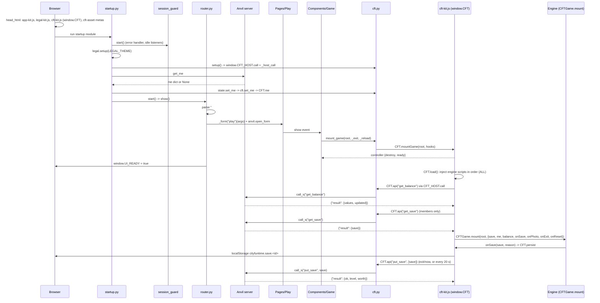

# The Anvil client (client_code/)

Everything a player sees outside the 3D canvas is a native Anvil Form written in Python (`client_code/`). The 3D game
itself is plain JavaScript in `theme/assets/cft-*.js`, glued together by `theme/assets/cft-kit.js` (`window.CFT`). This page
explains the Python side and the exact bridge between the two. Server functions are in [server.md](server.md); tests in
[testing.md](testing.md); shipping in [deploy.md](deploy.md).

Package name (used in templates): `City_Fun_Time` (`package_name` in `anvil.yaml`). Client runtime: `client_version: '3'`.

## 1. Files at a glance

| File | Role |
|---|---|
| `client_code/startup.py` | The startup module (`anvil.yaml` → `startup: module: startup`). Runs once per page load. |
| `client_code/router.py` | Hash routing: `#name/arg1/arg2` → a page Form, with sign-in rules (`PAGES`, `NAV`, `HOME`). |
| `client_code/state.py` | App-wide client state (`me`) and helpers every Form uses (`call`, `toast`, a11y helpers). |
| `client_code/auth.py` | Sign in / sign up / reset / Continue with Google / sign out. |
| `client_code/legal.py` | Connects the shared Privacy & Terms kit (`theme/assets/legal-kit.js`, `window.LegalKit`) to the server. Kit file: do not edit here. |
| `client_code/session_guard.py` | Quiet reload when Anvil's server session expired; uncaught-error reporting. |
| `client_code/lifetime.py` | Lifetime access on the page side (`lifetime.gate`, `lifetime.offer`, `lifetime.handle_return` in startup). Shared file from template-forms: do not edit here. Dialogs `LifetimeOffer`, `LifetimeSales`. |
| `client_code/cft.py` | **The only bridge** from Python to the JS engine (`window.CFT`) and from the engine to the server. |
| `client_code/Layouts/Shell/` | The frame around every page except Play: header, account menu, footer, phone tab bar. |
| `client_code/Pages/*` | Landing, Play, Life, Quests, Album, Ranks, Auth, Profile, Admin. |
| `client_code/Items/*` | RepeatingPanel row templates. |
| `client_code/Dialogs/Mission/` | The mission details dialog on the Quests page. |
| `client_code/Components/Game/` | Mounts the 3D game (`cft.mount_game`). |
| `client_code/Components/Bar/` | A progress bar component (`value` 0-100, `tone`). |

Each Form is a folder with `form_template.html` (HTML + `<anvil-component>` tags, `anvil:name`, `anvil:dom-node`,
`anvil:on-dom:click`) and `__init__.py` (the class, event handlers with `@handle(...)`).

## 2. Boot sequence (`startup.py`)

In order, exactly as written:

1. `session_guard.start()`: installs `anvil.set_default_error_handling(_on_error)`, listeners for `visibilitychange`,
   `focus`, `pointerdown`, `keydown`, restores typed text after a guard reload, and exposes `window.__sg` for tests.
2. `legal.setup(LEGAL_THEME)` with `LEGAL_THEME = {"accent": "#6b4eff"}`: configures `window.LegalKit` and its accept handler.
3. `cft.setup()`: creates `window.CFT_HOST = {call: _host_call}` so the JS engine can reach the server.
4. `state.set_me(anvil.server.call("get_me"))`: **the one blocking server call at start** (Anvil's spinner shows). `set_me`
   also calls `cft.set_me(...)`, which writes `window.CFT.me` and clears `CFT.adopt` / `CFT.save`.
5. If signed in: `legal.refresh_soon()` (a `setTimeout` 50 ms → `legal_state` via `call_s`, shows the "review the new terms"
   bar if needed).
6. `router.start()`: adds one `hashchange` listener and calls `router.show()` for the current address.

`window.CFT` exists before `startup.py` runs because `cft-kit.js` is a `<script>` in `anvil.yaml` → `native_deps.head_html`
(with a `?v=` hash). The engine files themselves are **not** loaded at boot: they are listed as
`<meta name="cft-asset" content="...?v=...">` tags and loaded on demand by `cft-kit.js` (see section 6).

## 3. Routing (`router.py`)

```
PAGES[name] = (who may open it, browser-tab title)
  "landing": (None, "Welcome")       "auth": ("guest", "Sign in")     "play": (None, "Play")
  "life": ("user", "My life")        "quests": (None, "Quests")       "album": (None, "Album")
  "ranks": (None, "Leaderboard")     "profile": ("user", "Your profile")   "admin": ("admin", "Admin")
NAV  = [("play","Play","map"), ("life","Life","heart"), ("quests","Quests","star"), ("album","Album","image"), ("ranks","Ranks","users")]
HOME = "life"
```

`router.show()` (called on every `hashchange` and by `router.go` when the hash is unchanged):

1. `parse(window.location.hash)` strips `#`, `!`, `/` and any `?query`, splits on `/`, URL-decodes each part → `(name, args)`.
2. Unknown name → `home_page()`: `HOME` ("life") when signed in, else "landing". The hash itself is not rewritten.
3. Sign-in rules from `PAGES[name][0]`:
   - `"guest"` and signed in → `HOME`.
   - `"user"`/`"admin"` and signed out → remembers the hash in `_r["after"]` and opens `auth`.
   - `"admin"` and not `state.is_admin()` → toast "That page is for admins only." and `HOME`.
   - `None` → anyone.
4. Sets `document.title` to `"<title> · City Fun Time"`, sets `window.UI_READY = False`, builds the Form via `_form(name)(args=args)`
   (lazy imports, so start-up stays quick), `anvil.open_form(page)`.
5. If the page has a layout with `refresh`, calls `shell.refresh(name)` (Anvil reuses ONE Shell across pages).
6. `window.scrollTo(0, 0)`, then `window.UI_READY = True`. **Every UI test and screenshot waits for `UI_READY`.**

Other helpers: `href(name, *args)` builds an encoded `#name/a/b`; `go(name, *args)` navigates (same hash = reload the page);
`replace(name, *args)` changes the address via `history.replaceState` without reopening (used by Auth, Quests, Ranks when they
switch their own view); `after_sign_in()` goes to the remembered target or `HOME`; `remember_after(target)`.

**Adding a page:** add it to `PAGES`, add a branch to `_form()` (note the final fallback returns `Admin`, so a missing branch
silently opens Admin), and to `NAV` if it belongs in the menu (the phone tab bar shows only the first four plus "You").

## 4. Client state and helpers (`state.py`)

| Helper | What it does |
|---|---|
| `me()` / `set_me(value)` | The signed-in person `{id, email, name, is_admin, joined}` (from server `get_me` / `me_dict`) or None. `set_me` also calls `cft.set_me`. |
| `is_admin()` | `me().get("is_admin")`. Client-side only for UI; the server re-checks every admin call. |
| `call(fn, *args)` | `anvil.server.call`; a `{"ok": False, "error": ...}` reply becomes an error toast and `None`. Other replies pass through; exceptions still raise. |
| `call_quiet(fn, *args)` | `anvil.server.call_s` (no spinner); returns None on `AppOfflineError`. |
| `toast(msg, kind)` | `Notification` (6.5 s for errors, 3.2 s otherwise); falls back to the older `style=` on App Server 1.18. |
| `store_get` / `store_set`, `theme` / `set_theme` | Wrap `window.UI.store` and `UI.theme` / `UI.setTheme` from `theme/assets/app-kit.js`. |
| `set_attr`, `set_control_attr`, `control`, `focus` | HTML attributes / focus on a component's root or its real `<input>/<button>`. |
| `heading(label, level)`, `live(label)` | ARIA heading / live-region roles on a Label. |
| `focus_key()` / `refocus(component, key)` | Keep keyboard focus on the same `data-key` element across a RepeatingPanel redraw. |
| `feedback()` | Opens the Prepsto panel (`window.Prepsto.open`), else the Prepsto link in a new tab. Prepsto is the app's only feedback channel. |
| `plural`, `initials`, `short_date`, `month_year`, `ago` | Formatting. |

## 5. Accounts, legal, session guard

**`auth.py`** functions return `{"ok": True, ...}` or `{"ok": False, "error": ...}` for expected problems (mapped in
`AUTH_ERRORS`; `EXPECTED` is the tuple of exception classes caught). Every sign-in uses `remember=True` (needed so a
session-guard reload keeps the person signed in).

- `sign_in(email, password)` → `anvil.users.login_with_email` → `_signed_in()`.
- `sign_up(name, email, password)` → `signup_with_email`; if `get_user()` is None afterwards the reply carries `confirm: True`
  (email confirmation; currently off in `anvil.yaml`: `confirm_email: false`). Otherwise `_signed_in(name)` which calls
  server `update_profile(name)`.
- `reset(email)` → `send_password_reset_email`; always the same answer (no account enumeration).
- `google(name="")` → `login_with_google`; None means no account yet → `_google_step_done()` → `signup_with_google`.
- `_signed_in()` → `state.set_me(anvil.server.call("get_me"))` + `legal.refresh_soon()`.
- `sign_out()` → `anvil.users.logout()`, `legal.signed_out()`, `state.set_me(None)`.

**`legal.py`** (installed from the legal kit; edit the kit, not this copy): `setup`, `refresh` (server `legal_state` via
`call_s`), `refresh_soon`, `signed_out`, `open(tab)`, `consent_field()` (HTML for the sign-up tick box) and `consent_ok(node)`.
The kit's "I agree" button calls `_accept(version, source)` → server `legal_accept` and gets JSON text back.

**`session_guard.py`**: constants `IDLE_MS` (10 min), `LOOP_MS` (30 s), `DRAFT_MS` (3 min), `REPORT_MAX` (10).
- An uncaught `SessionExpiredError` (matched by name in `is_expired`) → `reload_page()`: saves non-password field values to
  `sessionStorage` (`KEY = "anvil.session_guard"`), marks `reloaded`, reloads at the same hash. After the reload
  `_restore_fields` waits for `window.UI_READY` and the same number of fields, then puts the values back.
- Back after `IDLE_MS` (tab visible again, focus, first click/key) → `check_now()` calls server `session_ping` (KeepAlive.py)
  and reloads if expired.
- A second expiry within `LOOP_MS` of a guard reload is left to Anvil's own box (no reload loops).
- Any other uncaught error → `_report(err)` → server `log_client_error` (AppStatus.py → table `error_log`), at most
  `REPORT_MAX` per page load, then re-raised for Anvil's normal handling.
- Test hook: `window.__sg = {check, idle_ms, age(ms)}` (used by `tools/session_test.py`). The module docstring mentions a
  tools/ui/session.js file; that file does not exist, the test is `tools/session_test.py`.

## 6. The bridge to the JS engine (`cft.py` + `cft-kit.js`)

Pages never touch the engine directly; they use `cft.py`:

| Python (`cft.py`) | JavaScript (`window.CFT` in `cft-kit.js`) | Used by |
|---|---|---|
| `setup()` | creates `window.CFT_HOST.call = _host_call` | `startup.py` |
| `set_me(me)` | sets `CFT.me` (JSON copy), clears `CFT.adopt`, `CFT.save` | `state.set_me` |
| `prepare()` | `CFT.prepare()` → loads `DATA` (`cft-content.js`, `cft-game.js`), then `CFT.loadSave()`, then `CFT.save = CFTGame.migrate(save)` | Life, Quests, Album |
| `view(name, arg)` | `CFT.viewJSON(name, arg)` → `JSON.stringify(VIEWS[name](CFT.save, arg))`; Python `json.loads` it | Life (`life`), Quests (`quests`, `mission`), Album (`album`) |
| `track(mission_id)` | `CFT.track(id)`: sets `save.track`, `CFT.persist(save, 'now')` | Quests |
| `mount_game(node, exit_fn, reload_fn)` | `CFT.mountGame(root, {exit, reload})` → controller with `destroy()` and `ready` | `client_code/Components/Game` |
| `mount_wiki(node)` | `CFT.mountWiki(root)` → loads `cft-content.js`, `cft-game.js`, `cft-wiki.js`, then `CFTWiki.mount(root, {api: CFT.api})` | Admin, tab "balance" |
| `NULL` | a typed JS `null` placeholder for "no controller yet" | Game, Admin |

**Promises:** a JS Promise returned to Anvil Python is awaited automatically, so `cft.prepare()` blocks the Form until the
content scripts and the save are loaded. `mount_game` / `mount_wiki` return a controller object (not a promise), so the page
appears at once and the engine fills the node when ready.

### 6a. Engine → server: `CFT.api` and `_host_call`

```
JS:   CFT.api(fn, args, quiet)
        → window.CFT_HOST.call(fn, JSON.stringify(args), !!quiet)        // a Python function
Py:   cft._host_call(fn, args_json, quiet)
        args = json.loads(args_json)
        r = (anvil.server.call_s if quiet else anvil.server.call)(fn, *args)
        {"ok": False, ...} reply      → '{"error": "<message>"}'
        any other reply               → '{"result": <reply>}'
        SessionExpiredError           → '{"error": "Your session expired. Reload the page and sign in again."}'
        other exception               → '{"error": str(e)}'
JS:   JSON.parse(text); r.error → Promise rejects with Error(r.error); else resolves with r.result
```

Rules that follow from this: arguments and replies must be JSON-serialisable (no datetimes or rows; the server tests enforce
JSON replies); an expected failure must be returned as `{"ok": False, "error": "..."}`, which JS sees as a rejected promise.
All engine calls pass `quiet = true` (no Anvil spinner).

Server functions the engine calls through this bridge:

| JS call site | Server function |
|---|---|
| `CFT.loadSave` | `get_save` |
| `CFT.push` (from `CFT.persist`, `CFT.loadSave`, `mountGame` adopt) | `put_save` |
| `CFT.reset` (the game's "start over") | `reset_save` |
| `CFT.balance` (before every game mount) | `get_balance` |
| `CFT.tiles.archive` / `CFT.tiles.backup` (used by `cft-world.js`) | `tile_archive` / `tile_backup` |
| `cft-wiki.js` via the `api` option | `admin_balance_get`, `admin_balance_save`, `admin_balance_restore` |

### 6b. The save (where it lives)

- Browser: `localStorage["cityfuntime.save.<user id>"]` or `cityfuntime.save.guest` (`CFT.key()`), written on every
  `CFT.persist`. Photos: `cityfuntime.photos.<id|guest>` (max 24, browser only).
- Server (signed in only): table `saves` via `put_save`. `CFT.persist(save, reason)` pushes at once when `reason` is
  `'exit'` or `'now'`, otherwise at most every 20 s (debounced timer).
- `CFT.loadSave()` for a member: server copy, unless this browser's copy is more than 1 s newer (`updated`), which is then
  pushed. No server copy but a local one → pushed. Neither, but a guest save exists → `CFT.adopt = guest save` (the Life page
  offers to keep it; `mountGame` adopts it automatically if there is still no save). Server unreachable → local copy.
- The game calls `opts.onSave(save, reason)` (`doSave` / `G.saveNow` in `cft-game.js`); `mountGame` passes that to
  `CFT.persist`. `mountGame` also saves on `visibilitychange` to hidden, and the engine's `destroy()` saves with `'exit'`.

### 6c. Views (`VIEWS` in `cft-kit.js`) consumed by Forms

| View | Shape used by Python | Consumer |
|---|---|---|
| `life` | `{welcome, adopt?, initials, name, sub, xp, money, worth, now{on,title,text}, home{e,title,label,note}, love{title,sub,kids,pets}, stats, friends, biz, turfs, turfsNote, stickers, stickersPct, missions, diary, saved}` | `client_code/Pages/Life` |
| `quests` (arg = filter) | `{lead, started, counts{all,active,open,done,locked}, chapters[{e,title,blurb,count,pct,missions[...]}]}` | `client_code/Pages/Quests`, `client_code/Items/Chapter`, `client_code/Items/MissionCard` |
| `mission` (arg = id) | `{e, title, who, status, reqs, quote, steps, rewards, canTrack}` | `client_code/Dialogs/Mission` |
| `album` | `{lead, pct, sets[{title,bonus,done,stickers}], photos[{url,caption,meta}]}` | `client_code/Pages/Album`, `client_code/Items/StickerSet`, `client_code/Items/Sticker`, `client_code/Items/Photo` |

To show a new field on Life / Quests / Album: add it to that function in `VIEWS`, then read it in the Form. Python never walks
engine objects.

## 7. Layout and pages

**`client_code/Layouts/Shell`** (`ShellTemplate`): header with `nav_panel` (RepeatingPanel of `client_code/Items/NavLink`), guest buttons
(`#auth`, `#auth/signup`), the account menu (`avatar_button`, `menu`, profile/admin links, theme buttons
`theme_auto`/`theme_light`/`theme_dark`, Submit feedback, Sign out), the footer (`copyright_label`, Submit feedback,
Privacy & Terms, Contact developer: arkvital.com, Parent company: addanapp.com) and the phone `tabbar` (`tab_panel` + `tab_profile`).
Everything that depends on the signed-in person or the open page is drawn in `refresh(page)`, which `router.show()` calls after
every page change. Never put that logic only in `__init__` (the Shell instance is reused). Click-outside and Escape close
the menu (listeners added on `show`, removed on `hide`).

| Page | Address / who | What it does | Server / engine calls |
|---|---|---|---|
| `Landing` | `#landing`, anyone | Static marketing copy in the template; toggles `guest_cta`/`member_cta`; the YouTube cover swaps to a `youtube-nocookie` iframe on click (`YT_VIDEO`). | none |
| `Play` | `#play`, anyone | Full screen, **no Shell layout**; contains one `client_code/Components/Game`. | via Game |
| `Life` | `#life`, user (the members' `HOME`) | `cft.prepare()` + `cft.view("life")`; welcome card (`welcome_box`, `adopt_note`) or the scrapbook (`_draw`). | `get_save`/`put_save` via the bridge |
| `Quests` | `#quests/<all\|active\|open\|done\|locked>`, anyone | `cft.prepare()`, `cft.view("quests", filter)`; filter buttons use `router.replace`; `open_mission(id)` opens `client_code/Dialogs/Mission` with `alert(...)`; "track" → `cft.track`, "play" → `router.go("play")`. | bridge |
| `Album` | `#album`, anyone | `cft.prepare()` + `cft.view("album")`. | bridge |
| `Ranks` | `#ranks/<worth\|level\|turfs\|missions>`, anyone | `state.call("leaderboard")` once, then switches boards locally (`BOARDS`). | `leaderboard` |
| `Auth` | `#auth`, `#auth/signup`, `#auth/reset`, guests only | Validates input (`EMAIL` regex, 8-char password, 2-char name), consent tick box from `legal.consent_field()`, then `auth.*` and `router.after_sign_in()`. | Users service, `get_me`, `update_profile` |
| `Profile` | `#profile`, user | Name (`update_profile`), theme, password reset email, feedback, sign out. | `update_profile` |
| `Admin` | `#admin/<tab>`, admin | `TABS = overview, players, maps, feedback, users, demo, balance`; each tab is its own address; `__init__` calls `self._<tab>()`. Balance mounts the wiki into `dom_nodes["wiki_root"]` and destroys it on `hide`. | `admin_overview`, `admin_players`, `admin_tiles_status`, `admin_tiles_cap`, `admin_tiles_seed` (looped per city), `list_feedback`, `list_users`, `demo_load`, `demo_remove`; wiki → `admin_balance_*` |

**Items** (RepeatingPanel rows; `self.item` is a dict): `Chapter`, `MissionCard` (calls `item["host"].open_mission(id)`),
`StepRow`, `DiaryRow`, `ListRow`, `StatRow` (contains a Bar), `Pill`, `Sticker`, `StickerSet`, `Photo`, `RankRow`, `NavLink`,
`PlayerRow` (server `admin_set_player`), `UserRow` (server `set_admin` / `set_enabled`; reverts the checkbox if refused),
`FeedbackRow` (server `set_feedback_status` / `delete_feedback`; raises `x-changed` on its panel so Admin reloads).

**Dialogs/Mission** takes `view=cft.view("mission", id)` and closes with `raise_event("x-close-alert", value=...)`:
`"track"`, `"play"` or None.

**Components/Game**: on `show` it destroys any old controller and calls
`cft.mount_game(self.dom_nodes["root"], self._exit, self._reload)`; on `hide` it calls `destroy()` (the engine saves with
`'exit'`). `_exit` → `router.go(HOME or "landing")`; `_reload` → `router.show()` (used after "start over").

**Components/Bar**: properties `value` (clamped 0-100, sets the width of `dom_nodes["fill"]`) and `tone`
(`""`, `gold`, `pink`, `mint` → CSS class on `dom_nodes["bar"]`).

## 8. Sequence: page load to a saved game



## 9. Common changes

- **New field on a page that reads the save:** `VIEWS` in `cft-kit.js` → the Form. Then `python tools/assets.py` (cft-kit.js
  changed), `python tools/check.py`, `python -I tools/ui_test.py`.
- **New server call from a Form:** `state.call("name", ...)` (shows `{"ok": False}` errors as toasts). From the engine:
  `CFT.api('name', [args], true)`.
- **New page:** see section 3. Template starts with `<anvil-form layout="City_Fun_Time.Layouts.Shell">` unless it is
  full screen like Play.
- **New list:** a RepeatingPanel with `prop:item_template="City_Fun_Time.Items.<Name>"` + a folder in `client_code/Items/`.

## 10. Review checklist for AI-made diffs (client_code)

- [ ] Every page name used in `router.go`, `href`, templates (`href="#..."`) exists in `PAGES`; a new page has a `_form()` branch
      (the fallback silently returns `Admin`).
- [ ] Sign-in rules: member or admin data never opened on a page whose `PAGES` entry is `None`; admin UI also guarded server-side.
- [ ] Shell state is set in `Shell.refresh`, not only in `__init__`.
- [ ] `window.UI_READY` handling in `router.show()` unchanged (tests depend on it).
- [ ] Forms talk to the engine only through `cft.py`; no new `window.CFT...` calls scattered in Pages.
- [ ] Anything passed through `_host_call` / `CFT.api` is JSON-serialisable; expected failures come back as
      `{"ok": False, "error": ...}`.
- [ ] Python reads only keys that the matching `VIEWS` function in `cft-kit.js` actually returns (and with the same names).
- [ ] Server calls use `state.call` for user actions (errors shown) and `call_s`/`call_quiet` only for background work.
- [ ] Every new sign-in path uses `remember=True` and ends in `auth._signed_in` (so `state.me`, `CFT.me` and legal stay in sync).
- [ ] Components that mount JS (`Game`, Admin wiki) destroy their controller on `hide`.
- [ ] Accessibility helpers kept: `state.heading` on page titles, `aria-pressed` on toggle buttons, focus restored after redraws.
- [ ] No edits to kit files (`client_code/legal.py`, `theme/assets/legal-kit.js`, `theme/assets/ark-music.js`).
- [ ] `theme/assets` changed → `python tools/assets.py` was run and `anvil.yaml` hashes are in the diff.
- [ ] `python tools/check.py` → ALL CHECKS PASSED; `python -I tools/ui_test.py` → ALL UI TESTS PASSED for page changes.
