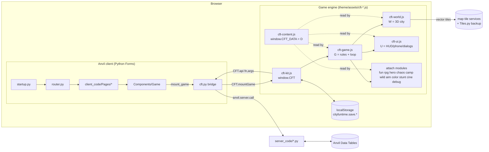
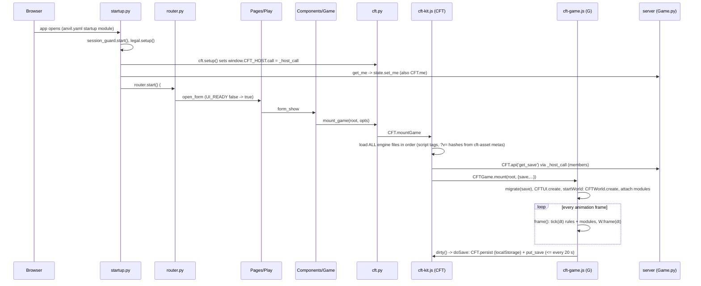

# Architecture — how City Fun Time fits together

City Fun Time is two programs in one Anvil app:

1. **The Anvil app** (Python): pages, accounts, admin, the server and the database. Native Anvil Forms in
   `client_code/`, server modules in `server_code/`, tables in `anvil.yaml`.
2. **The game engine** (plain JavaScript + three.js r149): about 20 files in `theme/assets/` named `cft-*.js`. It draws
   the 3D city from real OpenStreetMap tiles, runs the rules and draws its own HUD, phone and dialogs.

They meet in exactly one place: `client_code/cft.py` (Python) ↔ `theme/assets/cft-kit.js` (`window.CFT`). Everything
else is either pure Anvil or pure engine.

## 1. Boot sequence

Details: [anvil-client.md](anvil-client.md) (pages, router, bridge), [modules/cft-kit.md](modules/cft-kit.md) (loader,
saves), [modules/cft-game.md](modules/cft-game.md) (mount, loop).

## 2. Engine load order

`cft-kit.js` `ALL` loads the files one after the other (each defines one global):

| # | File | Global | Role | Doc |
|---|---|---|---|---|
| 1 | three.min.js | `THREE` | three.js r149 (vendor, never edit) | – |
| 2 | cft-post.js | `CFTPost` | post-processing (exposure, bloom, AO) | [cft-post](modules/cft-post.md) |
| 3 | cft-gfx.js | `CFTGfx` | wall / roof / PBR materials | [cft-gfx](modules/cft-gfx.md) |
| 4 | three-gltf.js | `THREE.GLTFLoader` | glTF loader for figment models (vendor) | – |
| 5 | cft-content.js | `CFT_DATA` (`D`) | every data table + `D.TUNE` balance knobs | [cft-content](modules/cft-content.md), [balance](balance.md) |
| 6 | cft-tiles.js | `TileMaker` | MVT/protobuf decoder → sub-tiles | [cft-tiles](modules/cft-tiles.md) |
| 7 | cft-world.js | `CFTWorld` | the 3D city, player movement, camera, rides | [cft-world](modules/cft-world.md) |
| 8 | cft-ui.js | `CFTUI` | HUD, feed, dialogs, phone, panels, minigames | [cft-ui](modules/cft-ui.md) |
| 9 | cft-fun.js | `CFTFun` | street life + combat | [cft-fun](modules/cft-fun.md) |
| 10 | cft-rpg.js | `CFTRpg` | loot, talents, reputation | [cft-rpg](modules/cft-rpg.md) |
| 11 | cft-hero.js | `CFTHero` | hype, swagger, outposts, borrowed cars | [cft-hero](modules/cft-hero.md) |
| 12 | cft-chaos.js | `CFTChaos` | decor toys, mayhem, ranged, flying, Dex | [cft-chaos](modules/cft-chaos.md) |
| 13 | cft-camp.js | `CFTCamp` | campaign: intro, crazy list, cap, ammo, powers, MEGA | [cft-camp](modules/cft-camp.md) |
| 14 | cft-wild.js | `CFTWild` | stamina, climbing, updrafts, dodge | [cft-wild](modules/cft-wild.md) |
| 15 | cft-aim.js | `CFTAim` | shooter slot, aim camera, web tether | [cft-aim](modules/cft-aim.md) |
| 16 | cft-color.js | `CFTColor` | colour blocks (grey until freed) | [cft-color](modules/cft-color.md) |
| 17 | cft-stunt.js | `CFTStunt` | car stunt courses | [cft-stunt](modules/cft-stunt.md) |
| 18 | cft-vo.js | `CFT_VO` | generated voice clip table (never hand-edit) | [cft-cine](modules/cft-cine.md) |
| 19 | cft-cine.js | `CFTCine` | voiced cinematic scenes | [cft-cine](modules/cft-cine.md) |
| 20 | cft-debug.js | `CFTDebug` | play-test panel (`?debug=1`) | [cft-debug](modules/cft-debug.md) |
| 21 | cft-game.js | `CFTGame` | the rules object `G`, loop, saves, missions (last: uses all above) | [cft-game](modules/cft-game.md) |

`cft-wiki.js` (`CFTWiki`, Admin > Balance) is loaded separately by `CFT.mountWiki`. Pages that only need data (Life,
Quests, Album) load `DATA` = cft-content + cft-game.

**The list lives in three places** and all three must change together when a file is added: `ALL` in cft-kit.js, `ENGINE`
in `tools/live/harness.py`, and one `<meta name="cft-asset">` per file in `anvil.yaml` head_html. `tools/assets.py`
refreshes hashes of existing entries only; it never adds one.

## 3. The objects at run time

| Object | Made by | Holds | Console handle |
|---|---|---|---|
| `D` | cft-content.js | all data (items, missions, monsters, TUNE...) | `CFT_DATA` |
| `G` | `CFTGame.mount` | the rules, `G.state` (save), `G.rt` (run-time state), every `G.<module>` | `window.__cft` |
| `W` | `CFTWorld.create` in `startWorld` | the 3D scene, tiles, player, camera, life, effects | `__cft.W` |
| `U` | `CFTUI.create(G, root)` | HUD, overlays, phone | `__cft.ui` |
| `G.fun` … `G.stunt` | `CFTx.attach(G, api)` | each feature module's methods and run-time state | `__cft.fun` etc. |

### Attach and tick order

`startWorld` (cft-game.js) attaches modules **in this order**: fun → rpg → hero → chaos → camp → wild → aim → color →
stunt → cine → debug. Chaos onward (except cine and debug) attach only `if (G.fun)`. Order matters: cft-wild wraps
`W.flyHook`, `G.chaos.fire` and `G.camp.power` when it attaches, and `G.hero.event` is wrapped by chaos and then camp.

`tick(dt)` calls `G.<module>.tick(dt, paused || rt.busy)` in the same order (fun, rpg, hero, chaos, camp, wild, aim,
color, stunt). cine and debug are not ticked. `destroy` tears down in the same order and then cine and debug.

### There is no event bus

Modules talk in three ways, all plain function calls:

1. **`api` closures** passed to `attach`: `bump`, `bumpTo`, `spawnPickup`, `chatPed`, `setBusy` (and `travel`,
   `setState` inside G). Each module gets only the ones it needs.
2. **Direct calls through `G`**: e.g. cft-fun `hitMonster` calls `G.rpg.onKill`, `G.color.onKill`, `G.hero.event('kill')`;
   cft-game calls `G.rpg.bonus(key)`, `G.camp.allow(...)`, `G.cine.play(...)`. Always guarded (`G.rpg && ...`).
3. **World hooks**: a module assigns a callback or flag on `W` and the world checks `if (W.onX)`. Each hook has
   **one slot**; a second module that wants it must wrap the previous value. Full list:
   [modules/cft-world.md](modules/cft-world.md) "Public API" and "hooks". Examples: cft-stunt sets
   `W.onCarAir`/`W.onCarLand`, cft-wild sets `W.onClimb`/`W.onDodge`, cft-chaos sets `W.onSmash`/`W.flyHook`, cft-aim sets
   `W.onWheel`/`W.onTetherEnd`.

Other modules also write parts of the HUD directly (cft-camp counts, cft-aim gun icon, cft-color chip, cft-chaos mayhem
meter) and feed minimap markers through a `markers(list)` method. See [modules/cft-ui.md](modules/cft-ui.md).

## 4. Units and conventions

- **Time:** 1 real second = 1 game minute; a game day = 24 real minutes. `save.clock` is minutes of the day.
- **Space:** every saved position is lat/lon. World coordinates are metres from `save.home`: **x east, z south**. Models
  face −z; the facing vector of `yaw` is (−sin yaw, −cos yaw).
- **Ground:** `W.heightAt` is *building* height. Anything placed on the ground uses `W.groundAt` / `W.standAt` /
  `W.surfaceAt`.
- **Low quality** is detected everywhere as `!W.renderer.shadowMap.enabled`.
- **Display units:** figment health and your hits are shown ×10; your own health is shown raw.
- **Each module owns `save.<module>`** (fun, rpg, hero, chaos, camp, wild, aim, color, stunt, cine) and creates it lazily
  in its own `st()`. `migrate` in cft-game fills only missing top-level keys.
- **Every engine file is an IIFE** that sets one `window.X` global; no modules, no bundler, no build step.
- **Test flags:** `window.CFT_TEST` (set by the live tests): `calm`, `noLuck`, `campaign`, `cine`, `ammo`, `guns`,
  `outposts`, `mute`, `autoplay`... Each module doc lists the ones it reads. `G.stepSim(n)` steps the simulation
  without rendering timing (hit-stop and slow motion are ignored there).

## 5. Data and balance

All numbers live in `D` (cft-content.js). `D.TUNE` at the end of the file is the tree of balance knobs. Admins change them
live in Admin > Balance (cft-wiki.js), which publishes a flat override map (`{"TUNE.combat.parry": 0.25}`) through
`server_code/Balance.py` into `app_settings`. The game fetches it with `get_balance` and `D.applyBalance` changes `D` in
place. Some values are read only once (world people/traffic counts, graphics, a few camp/wild timers) and need a reload.
Full story: [balance.md](balance.md).

## 6. Saves

One JSON object per player (`newSave` in cft-game.js; field list in [modules/cft-game.md](modules/cft-game.md)). It is
always written to localStorage (`cityfuntime.save.<user id|guest>`); signed-in members also save to the `saves` table via
`put_save` (at most every 20 s, at once on tab hide / exit; max 400,000 characters). The server stores it whole and only
summarises it for the leaderboard (`server_code/Game.py`). **Any new save field needs a default in `newSave` and must be
tolerated when missing** (old saves), either in `migrate` or in the module's lazy `st()`.

## 7. Where each kind of work lives

| You want to… | Start at |
|---|---|
| change a number (too hard / too often / too fast) | [balance.md](balance.md), `python -I tools/where.py --tune <word>` |
| add an item, mission, monster, sticker, business | [modules/cft-content.md](modules/cft-content.md) |
| change how the city looks or moves | [modules/cft-world.md](modules/cft-world.md), [modules/cft-gfx.md](modules/cft-gfx.md), [modules/cft-post.md](modules/cft-post.md) |
| change fighting | [systems-combat.md](systems-combat.md) |
| change progression / unlocks | [systems-progression.md](systems-progression.md) |
| change the HUD, phone or a dialog | [modules/cft-ui.md](modules/cft-ui.md), [styles.md](styles.md) |
| change a web page (Life, Quests, Admin…) | [anvil-client.md](anvil-client.md) |
| change the server or a table | [server.md](server.md) |
| test anything | [testing.md](testing.md) |
| ship it | [deploy.md](deploy.md) |
| make or review an AI change | [changing-code.md](changing-code.md) |
