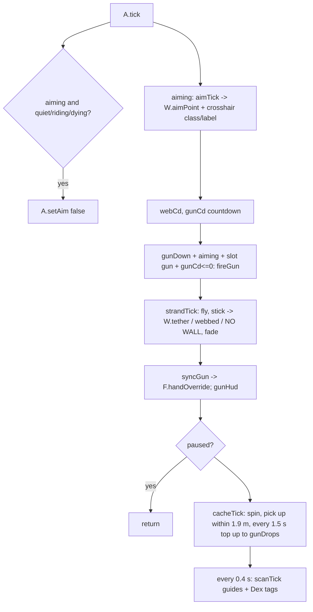

# cft-aim.js — the right-mouse sight, hotbar slots 1-5 (powers, web, shooter belt), the web tether, shooters lying around town, rainbow guides

## At a glance

| | |
|---|---|
| File | `theme/assets/cft-aim.js` (465 lines) |
| Global exported | `window.CFTAim = { attach }` (L464) |
| Attached as | `G.aim = CFTAim.attach(G, { bump })` in cft-game.js `startWorld` (~L2271), only `if (G.fun)`; after G.wild, before G.color and G.stunt |
| Ticked by | cft-game frame: `G.aim.tick(dt, paused \|\| rt.busy)` (~L2180) |
| Destroyed by | cft-game `destroy()` -> `G.aim.destroy()` (drops strand + caches, clears `F.handOverride`, `W.onWheel`, `W.aiming`, `W.aimPoint`, `W.tether`, `W.onTetherEnd`) |
| Also listed in | cft-kit.js `ALL`, tools/live/harness.py `ENGINE`, a `cft-asset` meta in anvil.yaml (tools/assets.py keeps the hash) |
| DOM it uses | `[data-sight]` + `[data-sightlbl]` (the centre crosshair, built by cft-ui), hotbar `[data-pw]` buttons (`.sel`), `[data-pw="gun"]` with `[data-gunicon]` / `[data-pwn="gun"]`, `[data-pwn="web"]`; toggles `.cft-aiming` on the shell |
| Reads data | `D.TUNE.aim`, `D.ITEMS` (shooters = `type: 'gear'` with `weapon.ranged` `'proj'` or `'shot'`) |
| Tests | `python -I tools/live/game_test.py --aim` (aimtest.js: sight, slots, web, reach arcs, guides) and `--balance` (balancetest.js: slot 5 belt, wheel, shooters in town); pictures `--aimshots DIR` |
| Test flags read | `CFT_TEST.calm` blocks town shooter drops unless `CFT_TEST.guns` is also set (L282) |

## Responsibilities

- **The sight:** hold the right mouse button -> `A.setAim(true)` -> `W.aiming` (cft-world moves the camera over the shoulder and writes `W.aimRay` each frame). `aimTick` turns the ray into `W.aimPoint` `{x, y, z, kind: 'foe' | 'wall' | 'ground' | 'sky', m?}` and styles the crosshair.
- **Slots** (`SLOTS = ['water', 'volt', 'foam', 'web', 'gun']`, keys 1-5): choosing (`A.select`), using with left click while aiming (`A.fire`), touch choose-and-use (`A.tap`). Slots 1-3 call cft-camp `G.camp.power(k, down)` (foam is held); slot 4 is the web (here); slot 5 fires the chosen belt shooter through cft-fun `F.shoot`.
- **The shooter belt (slot 5):** every owned shooter, cheapest first (`belt()`); `save.aim.gun` = the chosen one; scroll wheel cycles (`W.onWheel`); hold left button to auto-fire; the shooter mesh shows in the hand while aiming slot 5 (`F.handOverride`); one-time migration of old saves (shooter in hand -> belt).
- **The web:** strand flight, sticking to walls (`W.tether` for cft-world to pull you), webbing figments (stun), "NO WALL!" on anything else, cutting on release.
- **Shooters lying around town** ("caches"): spawn, spin, pick up (new shooter or ammo), minimap markers.
- **Rainbow guides** (`W.guide`) toward MEGAs, figments, weird creatures and new animals; "📸 NEW" Dex tags.

**It does NOT:** move the camera or the player, apply the tether pull or gravity (cft-world `updateCamera`, `updatePlayer`), run water/lightning/foam (cft-camp `K.power`), simulate projectiles (cft-chaos `C.fire`) or count ammo (cft-camp `K.useAmmo` / `K.addAmmo` / `K.charges`), bonk (left click without the sight goes to `G.attack()` -> cft-fun), or block (G / 🛡️ -> cft-fun `F.setBlock`; the right mouse no longer blocks since 2026-11-19).

## Public API

| Name | Signature | What it does | Called by |
|---|---|---|---|
| `A.on` (~L79) | `() -> bool` | Is the sight up? | cft-ui left-mouse handler (~L841) |
| `A.setAim` (~L125) | `(on)` | Sight on/off. Refused when quiet, not on foot (`mode !== 'foot'`), or dying. Off = stop firing, clear `W.aimPoint`, `cutWeb()`. | cft-ui right mouse down (~L826) / up + window blur (`unaim` ~L820); `A.tick` drops it when quiet / riding / dying |
| `A.select` (~L115) | `(slot)` | Choose a slot (keys 1-5, mouse on hotbar); feed line + one-time tip. | cft-ui keys (~L810), hotbar (~L854), cft-ui Chaos app chips (~L1240), cft-debug |
| `A.fire` (~L134) | `(down) -> bool` | Down: only while aiming -> `aimTick()` then `use(slot)`. Up: stop auto-fire and the extinguisher. | cft-ui left mouse down (~L841) / up (~L827) |
| `A.tap` (~L140) | `(slot, down)` | Touch: choose and use; release stops foam / gun. | cft-ui hotbar pointer events (~L854-857) |
| `A.slot` (~L80) | `() -> slot` | Current slot. | cft-ui (~L1240) |
| `A.isShooter` (~L81) | `(weapon) -> bool` | `ranged === 'proj' \|\| 'shot'`. | cft-game buy (~L1324), `wearShop` (~L1385), `slotOptions` (~L1401), cft-ui |
| `A.guns` / `A.gun` / `A.gunWeapon` (~L82-85) | `()` | Belt ids / chosen id / chosen weapon object `{e, n, id, ...weapon}`. | cft-ui (~L1077) |
| `A.pickGun` (~L87) | `(id, quiet?) -> bool` | Choose an owned shooter for slot 5. | cft-game `wearShop` (~L1385), cft-ui Chaos app, cft-debug |
| `A.cycle` (~L93) | `(dir)` | Next/previous belt shooter; switches to slot 5. | `W.onWheel` |
| `A.addGun` (~L103) | `(id, how)` | Mark owned, choose it, tip, feed line. | cft-game `G.buy` (~L1324), cft-camp `shooterHint` (~L336), `takeCache` |
| `A.fireGun` (~L197) | `() -> bool` | One shot of the chosen shooter (cooldown `gunCd` = 0.32 for `shot`, else `w.rate`). | `use('gun')`, auto-fire in `A.tick`, tests |
| `A.cutWeb` (~L307) | `()` | Cut the strand; stop the pull (speed kept). | `A.setAim(false)` |
| `A.caches` / `A.spawnCache` / `A.markers` (~L289-291) | array / `(id, x, z)` / `(out)` | Town shooters; spawn one (tests); minimap markers. | cft-ui minimap (~L754), tests |
| `A.tick` (~L433) | `(dt, paused)` | See Per-frame flow. | cft-game |
| `A.test` (~L450) | object | `{st, aimTick, shootWeb, wallAhead, guideTo, belt, fireGun, cacheTick, takeCache, strand, guideCd, gunCd, gunDown, announced}` | aimtest.js, balancetest.js |
| `A.destroy` (~L451) | `()` | Teardown. | cft-game |

### World / module hooks

| Hook | Direction | Notes |
|---|---|---|
| `W.aiming` | **set** (`A.setAim`) | cft-world: shoulder camera (`cam.aimK`), face camera yaw, 75% walk, no sprint, aim pose; hides the reach arc |
| `W.aimRay` | read | written by cft-world `updateCamera` every frame: `{ox, oy, oz, dx, dy, dz, from}` |
| `W.aimPoint` | **set** (`aimTick`) | read by cft-camp `aimDir` (water/lightning) and cft-chaos `aimShot` (projectiles) |
| `W.rayCast(ox, oy, oz, dx, dy, dz, maxD, from)` | called | wall / ground hit (cft-world) |
| `W.tether` | **set** (`strandTick`) | `{x, y, z, v0, acc, max, life, t}`; cft-world `updatePlayer` pulls (foot only), clears it on arrival / Space / timeout |
| `W.onTetherEnd(how)` | **set** (~L385) | called by cft-world with `'roof'`, `'wall'`, `'jump'`: pops + `G.chaos.add('bounce')`, counter `webroofs` |
| `W.onWheel(dy, e)` | **set** (~L218) | cft-world canvas wheel listener asks it first; return true = consumed (else camera zoom) |
| `W.guide(x, z, {hue, max})` | called | rainbow chevrons (cft-world) |
| `F.handOverride` | **set** (`syncGun` ~L201) | cft-fun `syncWeapon` shows that mesh in hand, without a REACH pop |
| `F.shoot(w)` | called | cft-fun: damage growth, ammo, projectile/bubble |
| `F.monsters`, `F.dying` | read | targets, guards |
| `G.camp.power/megas/charges/inIntro/addAmmo` | called | slots 1-3, MEGA targets, ammo display, cache ammo |
| `G.chaos.rot/critters/add` | read/called | guides, Dex tags, mayhem |
| `G.hero.word` | called | via `word()` (defined but the module mostly uses pops/feed) |

## Internal structure

| Lines | Section | Contents |
|---|---|---|
| 1-28 | Header | Design notes, API, world hooks, counters |
| 32-76 | Setup | constants (`SLOTS`, `NAMES`), module vars (L40-42), `isShooter`, `st()` + belt migration (L48-67), `belt()` (L69), `tip()`, DOM lookups |
| 78-182 | Slots + the sight | `A.on/slot/guns/gun/gunWeapon`, `A.pickGun`, `A.cycle`, `A.addGun`, `markSlot`, `A.select`, `A.setAim`, `A.fire`, `A.tap`, `use` (L145), `aimTick` (L153) |
| 183-292 | Slot 5 shooter | `fireGun` (L187), `syncGun` (L199), `gunHud` (L203), `W.onWheel` (L218), `pickGunKind` (L230), cache meshes, `spawnCache` (L241), `dropCache`, `takeCache` (L254), `cacheTick` (L271), `A.markers` |
| 293-391 | The web | `handPos`, `cutWeb`, `dropStrand`, `wallAhead` (L314), `shootWeb` (L323), `strandTick` (L351), `W.onTetherEnd` (L385) |
| 392-431 | Guides + Dex tags | `guideTo` (L393), `scanTick` (L399) |
| 432-462 | Tick | `A.tick`, `A.test`, `A.destroy`, initial `markSlot()` |

## Key state

**Saved (`save.aim`, repaired by `st()` ~L48):**

| Field | Meaning |
|---|---|
| `slot` | `'water' \| 'volt' \| 'foam' \| 'web' \| 'gun'` (default `'water'`) |
| `tips` | {tipKey: 1} one-time tips shown (`belt`, `slots`, `aim`, `web`, `nowall`) |
| `belt` | 1 once the old-save migration ran (shooter in `equip.weapon` moved to the belt, dearest owned bonk weapon put back in hand unless a loot weapon is worn) |
| `gun` | chosen shooter item id (must be owned and a shooter, else reset to the dearest owned one) |

Also writes `save.owned[id] = true` (`A.addGun`) and `save.equip.weapon` (migration only). Counters: `webs`, `webpulls`, `webbed`, `webroofs`, `guides`, `gunfinds`.

**Runtime:** `aiming`, `foamDown`, `gunDown` (auto-fire held), `webCd`, `gunCd`, `strand` (`{line, end, x, y, z, kind: 'wall'|'foe'|'miss', m, len, t, stuck, fade, tether}`), `scanT`, `guideCd`, `aimHit`, `wheelAcc`/`wheelT`, `cacheT`, `caches[]`, `handOn`, `announced` (WeakSet of things already guided), `tagged` (Set with Dex tags).

## Per-frame flow



`aimTick` details: scans `F.monsters` (point at 55% of model height, hit radius `m.r + 0.5`) and `G.camp.megas` (radius `m.r + 1.5`) along the ray between `from` and `T.range + from`; then `W.rayCast` up to the nearest foe; else `kind: 'sky'` at 45 m. Crosshair classes: `foe` (red), `wall` (green, only with the web slot and within `T.webRange`), `miss` (web slot, no wall), plus `s-<slot>`.

The web: `shootWeb` picks the target (aim point if within `webRange`, else a point `webRange` along the ray; without the sight `wallAhead()` tries four up-angles), resets any tether, creates the strand, `webCd = T.webCd`. `strandTick` grows it at `T.webSpeed`; on arrival: wall -> `W.tether = {..., v0: webV0, acc: webAcc, max: webMax, life: webLife}`; foe -> `m.stun = max(stun, webStun)`, `m.webbed`; else "NO WALL!". cft-world ends the pull (arrival within 1.6 m, a wall hit within 5.5 m, or `life` s; mantles onto the roof if < 2.4 m above, else clings via cft-wild climbing) and calls `W.onTetherEnd`.

## Tunables (`D.TUNE.aim`, cft-content ~L1870)

| Knob | Default | Effect |
|---|---|---|
| `range` | 70 | metres the sight searches |
| `webRange`, `webCd`, `webSpeed` | 42, 0.45, 170 | web reach, cooldown, strand speed (m/s) |
| `webV0`, `webAcc`, `webMax`, `webLife` | 9, 70, 30, 3.2 | pull start speed, acceleration, top speed, give-up time |
| `webStun` | 2.2 | seconds a webbed figment is stuck |
| `guideR`, `megaR`, `rotR`, `critterR` | 48, 260, 110, 26 | guide distances (figment, MEGA, weird creature, new animal) |
| `guideCd`, `guideMax` | 7, 80 | seconds between ordinary guides, longest trail (m) |
| `gunDrops`, `gunDropMin`, `gunDropMax` | 4, 60, 300 | town shooters kept, spawn distance band |
| `gunAmmo` | 8 | ammo from a shooter you already own (and added on every pickup) |

Hard-coded: wheel step 60 units with a 250 ms reset, caches 70 m apart and dropped beyond 650 m, pickup radius 1.9 m, Dex tags within 40 m, `pickGunKind` weight `(owned ? 1 : 3) / sqrt(max(10, price))` gated by `req.lvl <= level + 2`.

## How to test

```
python -I tools/live/game_test.py --aim               # aimtest.js
python -I tools/live/game_test.py --balance           # balancetest.js (slot 5, wheel, town shooters)
python -I tools/live/game_test.py --aimshots OUTDIR   # sight on a wall, web pull, swing, rainbow guide, Dex gallery
```

Page script pattern (from aimtest.js): set `W.controls.enabled = true` after closing overlays, dispatch `MouseEvent('mousedown', {button: 2})` on `G.ui.canvas` to aim, then `A.fire(true)`; `A.test.shootWeb()`, `A.test.strand`, `A.test.guideCd = 0`. Town shooters in a calm test need `CFT_TEST.guns = true`.

**`?debug=1` panel:** Chaos -> "🎯 Ranged weapons" (owns every proj weapon, picks `w_balloon` on the belt, selects slot 5); Campaign -> "🎒 Refill" (ammo and powers).

## How to modify safely

- **New shooter:** an item with `type: 'gear', slot: 'weapon', weapon: {ranged: 'proj', proj, rate, speed, ammo, dmg, reach, mesh, word}` (+ `W.propMesh` shape, content_check `MESHES`, a projectile look in cft-chaos). It joins the belt, shops, town drops and the wiki automatically; nothing to change here.
- **New slot / power:** add the id to `SLOTS` and `NAMES`, a branch in `use()`, a `[data-pw="<id>"]` button in cft-ui markup, the key in cft-ui `SLOT_KEYS` (and the `Digit[1-5]` regex), and the power itself (cft-camp `K.power`).
- **Change web feel:** `D.TUNE.aim.web*` first; arrival / mantle logic is in cft-world `updatePlayer` (the `W.tether` block), not here.
- **Change the wheel step:** `W.onWheel` (60 units). Ctrl + wheel must keep zooming.
- **More/fewer guides:** `guideR`, `guideCd`; special figments (boss, champion, guardian, rare, outpost) always get one.

Pitfalls:
- `onFoot()` here is `mode === 'foot'` (no sight, web or slot-5 on a skateboard/bike), while cft-fun allows bonking in `'ride'` mode.
- `W.onWheel` and `W.onTetherEnd` are single slots: another module assigning them would silently replace these.
- `F.handOverride` must go back to null when not aiming slot 5 (`syncGun` each tick, `A.destroy`), or the hand keeps showing the shooter.
- Letting go of the right button cuts the web (`A.setAim(false)` -> `cutWeb`): keep that (the user's rule), and keep "NO WALL!" for anything that isn't a wall.
- `aimTick` runs every frame while aiming; keep it allocation-light.
- The crosshair is the only HUD element allowed in the screen centre (four-corner HUD rule).

## Review checklist for AI-made diffs

- [ ] New numbers in `D.TUNE.aim`; new shooters only as data.
- [ ] Every `W.*` hook set here is reset in `A.destroy`.
- [ ] `save.aim` fields repaired in `st()`; the migration (`belt`) still runs once only.
- [ ] Shots still go through `F.shoot` (ammo, damage growth, hero multiplier) rather than calling `G.chaos.fire` directly.
- [ ] Input changes mirrored in cft-ui (`SLOT_KEYS`, mouse handlers, hotbar) and the help text.
- [ ] `CFT_TEST.calm`/`guns` respected for self-spawning things.
- [ ] Ran `--aim` and `--balance`, `check.py`, `python tools/assets.py`.
