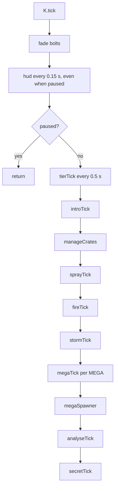

# cft-camp.js — the campaign: opening, crazy list, mission cap, ammo, powers, fire, storms, MEGA figments, secrets

## At a glance

| | |
|---|---|
| File | `theme/assets/cft-camp.js` (1091 lines, ~72 KB) |
| Global exported | `window.CFTCamp = { attach }` (~L1090) |
| Attached as | `G.camp = window.CFTCamp.attach(G, api)` in cft-game.js `startWorld` (~L2269), after `G.chaos`, only when `G.fun` exists |
| api passed in | `{ bump, bumpTo, spawnPickup, setBusy, travel, setState }` (`setState` is passed but not used here) |
| Ticked by | cft-game.js `tick` (~L2178): `G.camp.tick(dt, paused \|\| rt.busy)`, after chaos, before wild |
| Main callers | cft-game.js (`G.allow` ~L526, `G.openMissions` ~L522, `G.storyOn` ~L524, `startWorld` → `introPending`/`startIntro`, pickup `collect`, `findInteraction`), cft-fun.js (`F.attack` → `useAmmo` / `meleeHit`, `F.hurt` → `immortal` / `shrug`), cft-chaos.js (`updateShots` → `shotHit`), cft-wild.js (`fires`, `stash`, `spots`, `storm`, `bolt`, wraps `power`), cft-aim.js (`power`, `charges`, `addAmmo`, `megas`, `inIntro`), cft-ui.js (keys 1/2/3, minimap `markers`, `VIEWS.camp` → `summary`), cft-debug.js (Campaign row), cft-color.js (`inIntro`) |
| Data | `D.CAMPAIGN` (cft-content.js ~L1707: `INTRO_SECS`, `CAP`, `WILD`, `MEGA`, `SECRET_LOOT`, `NOTES`, `PANIC`), `D.TUNE.camp` (~L1903), pickups `D.PICKUPS.ammo/water/volt/foam` (`camp: true`, ~L1749) |
| Save | `save.camp = { intro, left, ammo, water, volt, foam, secrets: {id: day}, shown: [], seen, megaT, snap?, veteran? }` |
| Tests | `python -I tools/live/game_test.py --camp` (tools/live/camptest.js, ~60 checks); pictures `--campshots DIR` |
| Test flags read | `CFT_TEST.calm`, `CFT_TEST.campaign` (without it `bypass()` = true), `CFT_TEST.ammo` (turns ammo on in bypass mode); URL `nointro=1` (cft-game.js ~L2294) skips the opening |

## Responsibilities

- **The opening** ("fever dream"): 5 immortal minutes of everything chasing you, then waking at home with level 1 and $0.
- **The crazy list:** `K.allow(id)` = which of `D.CAMPAIGN.WILD` is switched on, one more per finished mission (`tier`).
- **The mission cap:** `K.capOpen(ids)` limits story/side missions on the map to `D.CAMPAIGN.CAP[min(tier, 2)]` (1, 3, 5).
- **Ammo** for shooters (crates, drops, secrets), **powers** water (1), lightning (2), extinguisher (hold 3).
- **Fire** (spreads, burns props, hurts), **lightning storms**, **MEGA figments** with an exposed weak spot.
- **Bouncy world hooks:** stomping figment heads, prop bounces, wall jumps, mantles (physics itself is in cft-world.js).
- **Secrets:** finds tight gaps between building footprints and puts stashes there.
- HUD counts: ammo / power numbers on the hotbar, `[data-mcount]` mission and crazy-list counter, MEGA name plates.

**It does NOT:** implement climbing / wall-jump physics (cft-world.js `updatePlayer`), decide when missions become
available (cft-game.js `refreshAvailability` / `reqMet`), spawn ordinary figments outside the opening (cft-fun.js), draw the
hotbar markup (cft-ui.js), or handle shooter selection (cft-aim.js slot 5).

## Public API

| Name | Signature | What it does | Called by | Line |
|---|---|---|---|---|
| `K.tick` | `(dt, paused)` | per-frame update | cft-game.js `tick` | L1057 |
| `K.inIntro` | `() → bool` | intro is `'run'` or `'ending'` | cft-game `G.storyOn`, cft-aim, cft-color, cft-wild `free` | L72 |
| `K.introPending` | `() → bool` | intro not `'done'` | cft-game `startWorld` | L73 |
| `K.immortal` | `() → bool` | same as inIntro | cft-fun.js `F.hurt` | L74 |
| `K.shrug` | `(n)` | "IMMORTAL!" pop instead of damage | cft-fun.js `F.hurt` | L273 |
| `K.startIntro` | `async ()` | start/resume the opening | cft-game `startWorld` | L150 |
| `K.skipIntro` | `()` | jump the countdown to 0.01 or mark done | cft-debug.js | L272 |
| `K.allow` | `(id) → bool` | crazy-list gate (behind `G.allow`) | cft-game.js `G.allow` | L75 |
| `K.tier` | `() → number` | finished D.MISSIONS count | tests | L82 |
| `K.capOpen` | `(ids) → ids` | filter open missions to the cap | cft-game.js `G.openMissions` | L84 |
| `K.useAmmo` | `(w) → bool` | pay `w.ammo \|\| 1`; out = mutates `w` into a weak melee bonk and returns false | cft-fun.js `F.attack` | L283 |
| `K.collect` | `(k)` | pickups `ammo`/`water`/`volt`/`foam` | cft-game.js `collect` (~L1103) | L318 |
| `K.addAmmo` | `(n) → ammo` | add ammo (capped) | cft-aim.js (shooter found) | L342 |
| `K.charges` | `() → {ammo, water, volt, foam}` | | cft-aim.js hotbar | L343 |
| `K.power` | `(kind, down) → bool` | `'water'`, `'volt'` (on press), `'foam'` (held: true starts / false stops spraying) | cft-aim.js `tap`, cft-ui.js keys/buttons; wrapped by cft-wild.js `airAim` | L361 |
| `K.spawnFire` | `(x, z, size) → fire \| null` | merges within 1.8 m, capped by `fireMax` | internal, cft-debug, tests | L486 |
| `K.spawnMega` | `(x, z, def?, intro?) → mega` | spawn a MEGA (random from `D.CAMPAIGN.MEGA`) | internal, cft-debug, tests | L626 |
| `K.meleeHit` | `(p, f, w, lined) → bool` | melee on a MEGA heart/body | cft-fun.js `F.attack` (melee only) | L830 |
| `K.shotHit` | `(s, o) → bool` | projectile vs MEGA | cft-chaos.js `updateShots` | L838 |
| `K.analyse` | `(sub) → {cands, spots}` | find secret spots in one sub-tile | `analyseTick`, camptest.js | L929 |
| `K.interaction` | `(p)` | E: open a stash, fill water at a hydrant | cft-game.js `findInteraction` | L1024 |
| `K.markers` | `(list)` | minimap: fires, MEGAs, near stashes | cft-ui.js minimap | L1045 |
| `K.summary` | `()` | phone app data | cft-ui.js `VIEWS.camp` | L1051 |
| `K.bolt` | `(x0, y0, z0, x1, y1, z1, thick)` | draw a lightning bolt | cft-wild.js `X.conduct` | L1076 |
| `K.test` | `{pwCd, spraying, st, endIntro, introTick, startStorm, stopStorm, crates, orbs, foams, analysed, removeMega, douse}` | test handles | camptest.js, cft-debug.js | L1077 |
| `K.megas` `K.fires` `K.spots` `K.stash` `K.storm` | arrays / Map / object | live state | cft-wild, cft-aim, tests | L34 |
| `K.destroy` | `()` | clears meshes, DOM and world hooks | cft-game.js `destroy` | L1078 |

### Hooks it sets

| Hook | Effect | Called from | Line |
|---|---|---|---|
| `W.onWreckFire(x, z)` | a car wreck becomes a real fire (when fire is allowed) | cft-world.js `hitProp` (~L1892) | L566 |
| `W.stompHook(x, y, z) → vy` | landing on a figment head = STOMP (returns 13), on a MEGA head = dizzy (16), else 0 | cft-world.js `updatePlayer` (call at line ~4212) | L862 |
| `W.onPropBounce(e, chain)` | counters `bounces`, `bestchain`, "BOING xN" | cft-world.js `updatePlayer` | L879 |
| `W.onWallJump()` | counter `walljumps`, first-time toast | cft-world.js `updatePlayer` | L887 |
| `W.onMantle()` | counter `mantles` | cft-world.js `updatePlayer` | L893 |
| `G.hero.event` (wrapped after chaos) | figment kills drop ammo 16% / power orb 8% (not MEGAs or intro foes) | cft-hero.js | L1036-L1044 |

## Internal structure

| Section | Lines | Key functions |
|---|---|---|
| setup, `st()`, `storyDone`, `wants` | L25-L70 | `bypass`, `st`, `storyDone`, `wants` |
| crazy list + mission cap | L71-L109 | `K.allow`, `K.capOpen`, `tierTick` |
| HUD bits | L110-L148 | `hud`, `setT` |
| the opening | L149-L281 | `K.startIntro`, `introTick`, `dreamSnap`, `wakeUp`, `endIntro`, `DREAM_KEYS` |
| ammo | L282-L344 | `K.useAmmo`, `manageCrates`, `K.collect`, `shooterHint` |
| powers | L345-L473 | `aimDir`, `inCone`, `K.power`, `waterBlast`, `bolt`, `zap`, `strikeGround`, `sprayTick` |
| fire | L474-L567 | `fireMesh`, `K.spawnFire`, `douse`, `fireTick` |
| storms | L568-L622 | `startStorm`, `stopStorm`, `stormTick` |
| MEGA figments | L623-L860 | `K.spawnMega`, `dizzy`, `hitMega`, `killMega`, `megaTick`, `startAttack`, `megaSpawner` |
| bouncy world | L861-L894 | the four `W.*` hooks |
| secrets | L895-L1034 | `nearestOnRing`, `enclosure`, `reachable`, `K.analyse`, `analyseTick`, `secretTick`, `openSecret` |
| hooks for the game | L1035-L1088 | `K.markers`, `K.summary`, `K.tick`, `K.destroy` |

## Key state

**`save.camp`** (defaults in `st()` ~L51):
- `intro`: `'todo'` (set only for new games in cft-game.js `U.onReady` ~L2307) → `'run'` → `'ending'` → `'done'`. A save
  with no `camp` at all becomes `{intro: 'done', veteran: true}`: `K.allow` is always true for veterans (the cap still applies).
- `left` (seconds of the opening), `snap` (deep copy of `DREAM_KEYS` taken at the first `startIntro`, deleted on wake).
- `ammo`, `water`, `volt`, `foam` (0..`foamMax`).
- `secrets` {spotId: day found}, `shown` [mission ids currently shown, sticky], `seen` (tier already announced), `megaT`
  (seconds to the next MEGA).

**Runtime:** `tier` (= `storyDone()`, recomputed in `tierTick` every 0.5 s), timers (`fireT`, `stormT`, `cratesT`,
`introEv`, `introFire`, `introPanic`, `introMega`, `introChamp`, `analyseT`, `secretT`), `crates`/`orbs`/`foams` pickup
lists, `analysed` (WeakSet of sub-tiles), `bolts`, `spraying`, `pwCd`.

**Counters bumped:** `intro`, `splashes`, `zaps`, `fires_out`, `megas`, `stomps`, `bounces`, `bestchain` (absolute),
`walljumps`, `mantles`, `secrets`, `chests`.

## Per-frame flow

### The crazy list and cap

- `storyDone()` (~L66) counts `save.m[id].s === 'done'` for ids in `G.MISSION` (every entry of `D.MISSIONS`: story chapters
  and side missions defined with `S(...)`; odd jobs in `save.dyn` do not count).
- `K.allow(id)` (~L75): true if `bypass()`, in the opening, veteran save, id not in `WILD`, or `WILD` index < `tier`;
  otherwise true only for `fire` when an active mission counts `fires_out`, or `mega` when one counts `megas` (`wants`).
- `tierTick` (~L97) shows a banner per newly enabled WILD item (staggered 2.6 s); first run on an older save records `seen`
  silently.
- `K.capOpen(all)` (~L84): story missions sorted by `D.MISSIONS` order; keeps already shown ones (`c.shown`), adds until
  `cap − active story missions`; non-story ids (odd jobs) pass through. Empty during the opening.

### The opening

`K.startIntro` (~L150): takes the dream snapshot, travels 220-360 m from home, clock 21.8, `cft-panic` class, countdown,
a storm for the whole opening. `introTick` (~L175): keeps `introFoes` figments with `{aggro: 999, introFoe: true}`, a
champion pack every 45 s, King Blob after 50 s, a MEGA at ~75 s with 0.35 health and no rewards, a random street event every
22 s, fires every 2.5-4.5 s, panic ticker lines. All powers/ammo are free (∞). `endIntro` (~L233): removes everything,
travels to `save.home`, clock 8, `wakeUp` restores `DREAM_KEYS` (`bag, owned, equip, rpg, stickers, counters, hero, chaos,
fun, m, track, jobs, dyn`), sets xp, money, savings, rested to 0, full energy/health, starting ammo/powers, refreshes look and
ride, kills dream pickups; Max's dialog; `U.help(true)`.

### MEGA figments

- Health (~L644): `T.megaHits × (D.SLAP.dmg × 1.6 × D.calc.dmgMul(level)) × T.megaWeak` (× 0.35 in the opening): always the
  same number of basic hits on the heart, at any level. Better gear just gets there faster.
- Attack: `T.megaAtk × baseHp(L)` where `baseHp` (~L625) = `60 + 8L + 3` (hard-coded, not `D.calc.maxHp`). Shown level = L + 3.
- States in `megaTick` (~L706): `walk` (flattens props each step, attacks when < 42 m), `stomp` (1.4 s red ring 9.5 m; in the
  air = JUMPED IT; then `dizzy`), `throw` (boulder + orange ring 4.6 m), `breath` (fire line, or a shockwave ring to jump),
  `dizzy` (5.5 s heart exposed between it and you), `dying`.
- Damage: `hitMega` (~L668) × `megaWeak` on the exposed heart, × `megaArmor` otherwise. A wet MEGA zapped = short circuit
  (dizzy, 12 s cooldown). Landing on its head = dizzy.
- Rewards (`killMega` ~L681, not for intro MEGAs): counter `megas`, XP `300 + 45L` (`'monster'`), money `150 + 30L`, two
  `G.rpg.drop('boss')`, 14 coin/cash pickups, `G.hero.event('kill', …boss)`.
- `megaSpawner` (~L846): one at a time, only if `K.allow('mega')` or a mission wants one (timer ×5), never within 150 m of
  home, 90-140 m away, every `megaEvery` s. Leaves past 480 m (or 150 m after 420 s).

### Secrets

`analyseTick` analyses one unvisited sub-tile within 260 m every 0.3 s with `K.analyse`: building pairs within
`secretGap[1]`, sampled every 1.5 m along walls; gap width in `secretGap`; middle must be open; `reachable` (walk-in from open
ground ≤ 30 m), `enclosure` (≥ 4 of 8 rays hit a wall in 10 m), > 4 m from a street; best `secretsPerTile`, 30 m apart.
Spot id = `'q' + round(lat × 20000) + ':' + round(lon × 20000)` (stable across visits). `secretTick` keeps stash meshes at the
14 nearest unfound spots within 200 m (visible within `secretSee`). `openSecret` (~L1000): records the day, calls
`G.color.secret(spot)`, rolls `D.CAMPAIGN.SECRET_LOOT` (money / chest → `G.rpg.drop('chest')` / ammo +20 / powers / sticker →
`G.addSticker()` / XP `40 + 10L`), banner with a `NOTES` line.

## Tunables (`D.TUNE.camp` unless noted)

| Knob | Meaning |
|---|---|
| `introFoes` / `introFoesLow` | figments chasing you in the opening |
| `ammoStart`, `ammoMax`, `ammoCrate` | ammo; a crate gives `ammoCrate + floor(level / 2)` |
| `ammoCrates`, `crateMin`, `crateMax` | crates kept around you and their distance band |
| `waterMax`, `voltMax`, `foamMax`, `waterStart`, `voltStart`, `waterOrb`, `voltOrb`, `hydrant` | power charges and refills (`foamPick` exists but is unused: a foam pickup sets `foamMax`) |
| `orbs` | water/lightning orbs kept around you |
| `waterRange`, `waterKnock`, `voltRange`, `voltDmg`, `voltChain`, `wetMul` | powers (damage × `D.calc.dmgMul(level)`) |
| `fireMax`, `fireMaxLow`, `fireSpread`, `fireHurt`, `fireEvery` | fire |
| `stormEvery`, `stormSecs`, `strikeEvery` | storms |
| `megaEvery`, `megaHits`, `megaWeak`, `megaArmor`, `megaAtk`, `megaSpeed` | MEGA figments |
| `secretsPerTile`, `secretSee`, `secretGap` | secrets |
| `D.CAMPAIGN.INTRO_SECS`, `CAP`, `WILD` (order matters), `MEGA`, `SECRET_LOOT` | campaign data |
| `ammo` on a weapon in `D.ITEMS` | ammo cost per shot (default 1) |

Captured at attach time (a live Balance change won't affect them until reload): the first `fireT` and `stormT` timers, and
`WILD_IDX` (the WILD order).

## How to test

- `python -I tools/live/game_test.py --camp` (sets `CFT_TEST = {calm, noLuck, outposts: false, campaign: true, ammo: true}`);
  covers HUD, crazy list + cap, opening + fever dream reset, ammo, powers, fire, storms, MEGA (stomp, weak spot), secrets,
  bouncy world, veteran saves.
- `python -I tools/live/game_test.py --campshots OUTDIR` for pictures.
- Other suites (chaostest.js, funtest.js...) run without `campaign`, so `bypass()` opens every gate and makes shooting free.
- Browser: `?debug=1` → 🐞 → **Campaign** row: Skip the opening, MEGA, Fire, Storm, Refill, Next crazy thing (marks the next
  `D.MISSIONS` entry done), Nearest secret.

## How to modify safely

- **Reorder or add a crazy thing:** edit `D.CAMPAIGN.WILD` (index = missions needed). For a new id, gate the feature with
  `G.allow('<id>')` where it spawns. Old saves: `tierTick` announces only newly reached indices (`seen`), veterans are unaffected.
- **Change the mission cap:** `D.CAMPAIGN.CAP` (the last value applies from that tier on).
- **Make a mission force a feature on:** a `count` step with `key: 'fires_out'` or `'megas'` already does (see `wants`);
  for a new feature add a similar clause in `K.allow`.
- **New power:** add a charge to `st()` defaults, a branch in `K.power`, HUD numbers in `hud()` (`[data-pwn="<kind>"]`),
  a key/button in cft-ui.js (`SLOT_KEYS`) and cft-aim.js `tap`.
- **New secret loot:** add `[kind, weight]` to `D.CAMPAIGN.SECRET_LOOT` and a branch in `openSecret`.
- **New MEGA:** add to `D.CAMPAIGN.MEGA` `{id, kind (a D.MONSTERS model), size, n, e, breath: 'fire'|'honk'|'slime', line}`.
- **Anything kept/removed by the fever dream:** `DREAM_KEYS` (~L216) and `wakeUp`.

**Pitfalls**
- `K.useAmmo` **mutates the weapon object** when out of ammo (`ranged = null`, reach, dmg × 0.6). Callers must pass a copy
  (cft-fun.js does: `modWeapon(Object.assign({}, …))`).
- `hud()` runs while paused; keep it cheap and DOM-diffed (`setT`).
- `G.storyOn()` is true during the opening; anything that should only run after it must also check `!K.inIntro()`.
- The opening's foes carry `introFoe` / `event` lifetimes; kill drops skip them (no ammo farming in the dream).
- `W.stompHook` etc. are set to null in `K.destroy`; don't capture them elsewhere.
- Tests without `CFT_TEST.campaign` bypass the cap and gates: a feature that "works in tests" may still be gated in play.
- The legacy boss bar `[data-boss]` is forced hidden (~L136); MEGA info is on `W.foePlate` name plates.

## Review checklist for AI-made diffs

- [ ] New world features are gated with `G.allow('<WILD id>')` and also suppressed during the opening if they shouldn't run there.
- [ ] Changes to `capOpen` keep `c.shown` sticky and pass odd jobs through.
- [ ] Anything granted during the opening is in a `DREAM_KEYS` slot (or explicitly reset in `wakeUp`).
- [ ] Power/ammo costs respect `K.inIntro()` (free) and storms (lightning free).
- [ ] Monster damage goes through `F.hitMonster`; MEGA damage through `hitMega`.
- [ ] Every scene object created (fires, rings, hearts, labels, stashes) is removed in its remover **and** `K.destroy`.
- [ ] Knobs added to `D.TUNE.camp`, documented in FIX_INDEX.md.
- [ ] camptest.js has a check; `python -I tools/live/game_test.py --camp` passes; `python tools/assets.py` + `python tools/check.py` pass.
