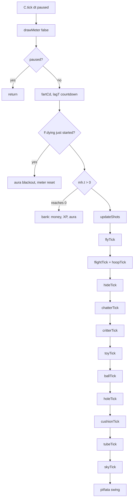

# cft-chaos.js — juice, toys, ranged combat, flying and the Dex (the "chaos update")

## At a glance

| | |
|---|---|
| File | `theme/assets/cft-chaos.js` (1200 lines, ~99 KB) |
| Global exported | `window.CFTChaos = { attach }` (~L1199) |
| Attached as | `G.chaos = window.CFTChaos.attach(G, api)` in cft-game.js `startWorld` (~L2268), only when `G.fun` exists. Order: `G.fun` → `G.rpg` → `G.hero` → **`G.chaos`** → `G.camp` → `G.wild` → `G.aim` → `G.color` → `G.stunt` |
| api passed in | `{ bump, bumpTo, spawnPickup, setBusy }` (`bumpTo(k, n)` sets `save.counters[k] = n`) |
| Ticked by | cft-game.js `tick` (~L2177): `G.chaos.tick(dt, paused \|\| rt.busy)`, after `G.hero`, before `G.camp` |
| Main callers | cft-fun.js (`F.attack` → `fire` / `meleeHit`, `updateMonsters` → `rangedAI`, `startEvent`/`updateEvent`/`endEvent`), cft-ui.js (B key → `fart`, minimap → `markers`, phone apps `VIEWS.chaos` / `VIEWS.dex` → `summary` / `dexPics`), cft-game.js (`findInteraction` → `interaction`, speed → `speedMul`), cft-camp/cft-wild/cft-aim/cft-stunt (→ `add`, `sfx`, `holes`, `rot`, `critters`, `flying`) |
| Data | `D.CHAOS` (cft-content.js ~L1578: RANKS, POINTS, AURA, CHATTER, KIDS, FART, FART_WORDS, BLIMPS, POTTY, BRAINROT, CRITTERS, PINATA_COLS, TUBE_COLS), `D.TUNE.chaos` (~L1848), chaos events in `D.EVENTS` (`chaos: true`) |
| Save | `save.chaos = { aura, dex: {id: n}, best, bestRank }`; Dex photos in `localStorage` key `cityfuntime.dexpics.<playerId>` (not in the save) |
| Tests | `python -I tools/live/game_test.py --chaos` (tools/live/chaostest.js, ~44 checks); pictures `--chaosshots DIR`; also part of the full run |
| Test flags read | `CFT_TEST.calm` (stops critters, brainrot, toys, sky, chatter, hoops), `CFT_TEST.noLuck` (no piñata mimic) |

## Responsibilities

- **Juice:** hit-stop (`G.rt.hitstop`), screen shake, pop-up words, its own Web Audio synth (`SFX`, `fartSound`).
- **Mayhem meter:** a combo score with letter ranks D → SSS that cashes in (money, XP, aura) when you stop.
- **Aura:** a meme number in `save.chaos.aura`, up for cool things, down for silly misfortunes.
- **Decor smash hooks:** wraps `W.onSmash` to count `smash_<kind>` for decor pieces (the decor layer itself lives in cft-world.js).
- **Projectiles** (yours and figments'): spawning, flight, collision, splash, reflection by perfect parry.
- **Ranged / flying figment AI:** movement + aiming + firing for monsters with `def.ranged`, hover height for `def.fly`.
- **Your flight:** jetpack and glide-brella via `W.flyHook`, sky hoops.
- **Fart button (B), porta-potty hiding, stink bombs, meme chatter from passers-by.**
- **Critters + brainrot creatures and the Dex** (photographing them).
- **Toys:** piñatas, beach balls, sewer manholes (launchers), whoopee cushions, wacky tube men.
- **Sky:** blimps with banners, hot-air balloons, a rare sky whale.
- **Six chaos street events** (`ohio`, `glitch`, `catsdogs`, `cheese`, `sixseven`, `balloons`).

**It does NOT:** decide whether a weapon is ranged or consume ammo (cft-fun.js `F.attack` + cft-camp.js `K.useAmmo`);
damage monsters itself (always through `F.hitMonster`); spawn ranged figments (cft-fun.js spawn pool, gated by
`G.allow('shooters')`); run the street-event timer (cft-fun.js `updateEvent`); draw decor (cft-world.js `layDecor`);
own the umbrella that everyone has (cft-wild.js wraps `W.flyHook`); persist the meter (runtime only).

## Public API

All members live on the object `C` returned by `attach`.

| Name | Signature | What it does | Called by | Line |
|---|---|---|---|---|
| `C.tick` | `(dt, paused)` | per-frame update, see below | cft-game.js `tick` | L1165 |
| `C.fire` | `(w) → bool` | fire a projectile weapon (`w.ranged === 'proj'`); false when driving | cft-fun.js `F.attack` (two branches); wrapped by cft-wild.js `airAim` | L276 |
| `C.meleeHit` | `(p, f, w) → bool` | a melee swing that hit no figment: piñata, ball (kick), event balloon, tube man | cft-fun.js `F.attack` | L956 |
| `C.rangedAI` | `(m, d, dt) → number \| false` | movement + aim for a figment with `def.ranged`; returns a speed when it handled the figment, `false` = let melee chase run, `0` while aiming | cft-fun.js `updateMonsters` | L451 |
| `C.add` | `(kind, mult?)` | add mayhem points `D.CHAOS.POINTS[kind]` (default 10) × chain bonus; no-op unless story is on and state is `play` | internally; cft-camp, cft-wild, cft-aim, cft-stunt | L139 |
| `C.aura` | `(n, quietly?)` | change aura; positive also bumps counter `aura` | internally | L127 |
| `C.bank` | `()` | cash in the meter now | chaostest.js | L172 |
| `C.mayhem` | `() → {pts, rank, chain, t}` | meter snapshot | cft-debug.js `info`, tests | L173 |
| `C.fart` | `() → bool` | the B button (2.2 s cooldown) | cft-ui.js (KeyB, 💨 button) | L573 |
| `C.interaction` | `(p) → {t, fn} \| null` | E prompt: join six-seven, snap a brainrot (< 11 m) or critter (< 4.5 m), hide in a porta-potty | cft-game.js `findInteraction` (after wild + camp) | L1137 |
| `C.markers` | `(out)` | minimap: brainrot (❓ until known), piñatas, hoops | cft-ui.js minimap | L1148 |
| `C.speedMul` | `() → number` | 0.55 during a lag spike × `glideSpeed` while gliding with the brella | cft-game.js speed multiplier | L1153 |
| `C.flying` | `() → 'jet' \| 'glide' \| null` | current gear flight | cft-wild.js `W.flyHook`, debug | L1154 |
| `C.fuel` / `C.hiding` | `() → number / bool` | jet fuel 0..1 / in a porta-potty | debug, tests | L1155 |
| `C.summary` | `() → {aura, best, bestRank, dex[], dexGot, dexAll, ranged[], fly, weapon, stats[]}` | phone apps | cft-ui.js `VIEWS.chaos`, `VIEWS.dex` | L1157 |
| `C.startEvent` | `(id, ev) → bool` | set up a chaos event; false = can't run here | cft-fun.js `startEvent` | L1030 |
| `C.updateEvent` | `(ev, dt) → bool` | true = event finished early | cft-fun.js `updateEvent` | L1057 |
| `C.endEvent` | `(ev)` | restore gravity, peds, CSS class | cft-fun.js `endEvent` | L1113 |
| `C.snap` | `(c)` | photograph a critter/brainrot | `C.interaction` | L796 |
| `C.dexPics` | `() → {id: dataUrl}` | Dex photos from localStorage | cft-ui.js `VIEWS.dex` | L800 |
| `C.spawnCritter` / `C.spawnRot` | `(id, x, z)` | spawn one creature | debug panel, tests | L697 / L705 |
| `C.spawnPinata` `C.spawnBall` `C.spawnHole` `C.spawnCushion` `C.spawnTube` `C.spawnSky` | `(x, z[, yaw])`, `spawnSky(kind, x, y, z)` | place one toy / sky object | debug panel, tests, screenshots | L841-L1019 |
| `C.pinataHit` | `(q, n)` | damage a piñata | internal | L832 |
| `C.model` | `(id)` | build a critter/brainrot model | screenshots | L687 |
| `C.sfx` | `{pew, thump, splash, pop, squeak, boom, whoosh, honk}` | synth sounds | cft-camp.js `sfx`, cft-wild.js `giggleTick` | L103 |
| `C.DEX` | array | BRAINROT + CRITTERS, each with `kind` | tests | L642 |
| `C.shots` `C.critters` `C.rot` `C.pinatas` `C.balls` `C.holes` `C.cushions` `C.tubes` `C.sky` `C.hoops` | arrays | live objects | cft-wild.js `updraftAt` (`holes`), cft-aim.js guides (`rot`, `critters`), tests | L39 |
| `C.ev` | object \| null | the running chaos event | internal, tests | L1021 |
| `C.destroy` | `()` | remove meshes/DOM, `W.flyHook = null`, `W.gravMul = 1` | cft-game.js `destroy` | L1188 |

### World / game hooks it sets or wraps

| Hook | How | Effect | Line |
|---|---|---|---|
| `G.hero.event` | wraps the original (calls it first) | kill / parry / dodge / block / combo / smash → mayhem; kill, parry, mission, level → aura; kill / parry → hit-stop | L187-L205 |
| `W.onSmash` | wraps previous | decor kinds in `CH_DECOR` bump `smash_<k>`; `potty` → stink bomb; `balloons` → 2 coins; `gnome` 20% → −5 aura line | L207-L217 |
| `W.flyHook` | **sets** (cft-wild.js later wraps it) | jetpack thrust / glide gravity; cft-world.js `updatePlayer` calls it for gravity (~L4201) | L511 |
| `W.gravMul` | sets 0.28 during `ohio`, 1 at end | low gravity | L1033, L1114 |
| `G.rt.hitstop` | `hitstop(s)` = max | cft-game.js `frame` slows dt to 6% (~L2202). `G.stepSim` ignores it | L206 |

### Things it reads from other modules

`F.monsters`, `F.hitMonster`, `F.smashProp`, `F.hurt`, `F.blocking` / `F.blockStart` / `F.parryWindow()` / `F.blockPower()`,
`F.dying`, `F.spawnMonster`, `F.streetSpot`, `F.event`; `G.camp.shotHit` (MEGA figments, checked before figments in
`updateShots`); `G.rpg.drop('crate')` (15% from a piñata); `G.hero.word` / `swag`; `G.storyOn()`; `G.allow(id)`;
`G.takePhoto`; `W.aiming` / `W.aimPoint` (cft-aim.js sight); `D.calc.dmgMul`.

## Internal structure (section order)

| Section | Lines | Key functions |
|---|---|---|
| setup, helpers, `st()` save defaults | L29-L62 | `calm`, `quiet`, `onStory`, `onFoot`, `st` |
| sounds | L64-L104 | `ctx`, `noise`, `chirp`, `fartSound`, `SFX` |
| HUD (meter, fuel bar, 💨 button, splat/lag overlay) | L105-L125 | `splat` |
| aura | L126-L136 | `C.aura` |
| mayhem meter | L137-L185 | `C.add`, `rankUp`, `bank`, `drawMeter` |
| hype events + decor smash | L186-L219 | `G.hero.event` wrapper, `hitstop`, `W.onSmash` wrapper, `CH_DECOR` |
| projectiles | L220-L431 | `projMesh`, `spawnShot`, `aimShot`, `C.fire`, `hitProps`, `pedHit`, `impact`, `shotHitsPlayer`, `updateShots` |
| ranged + flying figments | L432-L499 | `los`, `walkTo`, `aimTele`, `C.rangedAI`, `enemyShot`, `flyTick` |
| your flight | L500-L571 | `flyGear`, `W.flyHook`, `flightTick`, `hoopTick` |
| fart + porta-potty | L572-L626 | `C.fart`, `stinkBomb`, `hide`, `hideTick` |
| meme chatter | L627-L639 | `chatterTick` |
| critters, brainrot, Dex | L640-L802 | `critterModel`, `spawnCritter`, `spawnRot`, `critterTick`, `snap`, `savePic` |
| toys | L803-L964 | `pinataHit`, `ballTick`, `kickBall`, `holeTick`, `cushionTick`, `tubeTick`, `toyTick`, `C.meleeHit` |
| sky | L965-L1019 | `blimpModel`, `balloonModel`, `whaleModel`, `skyTick` |
| chaos street events | L1020-L1135 | `C.startEvent`, `C.updateEvent`, `C.endEvent`, `join67`, `popBalloon` |
| hooks for the game | L1136-L1197 | `C.interaction`, `C.markers`, `C.summary`, `C.tick`, `C.destroy` |

## Key state

**Saved (`save.chaos`, created by `st()` ~L48):** `aura` (number), `dex` ({creatureId: times snapped}), `best` (best
banked points), `bestRank` (letter). Old saves get defaults lazily.

**Counters bumped** (`save.counters`, feed achievements and reputation in cft-rpg.js): `aura`, `rankA`, `rankS`, `rankSS`,
`rankSSS`, `smash_<decor kind>`, `shots`, `pedbonks`, `reflects`, `parries`, `airtime` (seconds), `hoops`, `farts`, `hides`,
`dex` (absolute, via `bumpTo`), `pinatas`, `kicks`, `launches`, `cushions`, `popped`, `pets`, `sixseven`.

**Runtime only:** `mh` {pts, chain, t, rank} (the meter), `fuel` (0..1), `flying`, `hideT`/`hideAt`, `lagT`, timers
(`fartCd`, `chatT`, `rotT`, `toyT`, `skyT`, `critT`), `wasDying`; projectile objects
`{kind, owner: 'you'|'foe', obj, t, life, g, vx, vy, vz, bounce, pierce, back, hit: Set, w | dmg, src}`.
Per-monster fields it adds: `m.rcd`, `m.aim`, `m.aimTag`, `m.swoop`, `m.swoopCd`, `m.alt`, `m.ballT`, `m.foamT`.

## Per-frame flow

Spawners are throttled by their own timers: critters every 2.5 s, brainrot every `brainrot` s, toys every 2 s, sky every
3 s, chatter every `chatter` s. Each spawner checks `calm()`, `onStory()` and its `G.allow(...)` gate (critters, brainrot,
toys, sky, chatter). Cleanup by distance happens in the same ticks (toys 170-220 m, critters 150 m, brainrot 200 m or 95 s,
sky 520 m, hoops 260 m).

### The mayhem meter in detail

`C.add(kind)` (~L139): `pts += round(POINTS[kind] × mult × (1 + min(4, chain × 0.1)))`, `chain++`, timer reset to
`T.comboT`; a rank up calls `rankUp` (word, sound, confetti, counters, aura for S / SSS). When the timer runs out `bank`
(~L159): nothing under 60 points; otherwise money `min(500, pts / 25) × (1 + level × 0.05)`, XP `pts / 14` (source
`'explore'`), aura `pts / 25` (quiet under 900), records `best`/`bestRank`. Blacking out (`F.dying`) wipes the meter and
costs `AURA.blackout`.

### A projectile's life

`C.fire(w)` → `aimShot` (mouse-captured camera direction, else facing; nudged to the best target within cos 0.8 ≈ 37°;
right-mouse sight `W.aimPoint` wins; lob solves the arc) → `spawnShot` per pellet (`w.pellets`, `w.spread`) → every frame
`updateShots`: boomerang return (`back`), gravity `g`, spin, life timeout → `impact`; wall / ground: `bounce` or impact.
Foe shots only test the player (`shotHitsPlayer`: perfect parry within `F.parryWindow() + 0.15` reflects it as yours,
block reduces by `F.blockPower()`, else damage + splat/lag). Your shots test, in order: `G.camp.shotHit` (MEGA), figments
(3D box), piñatas, event balloons, balls, people (only below 2.4 m; lobbed shots only when falling), props (`hitProps`).
`impact` applies splash (`w.splash`) to figments/people/piñatas/balls/props and per-kind effects.

## Tunables

| Knob | Meaning |
|---|---|
| `D.TUNE.chaos.comboT` | seconds without chaos before the meter banks (4.5) |
| `D.TUNE.chaos.critters` / `crittersLow` | animal neighbours around you |
| `D.TUNE.chaos.brainrot` | [min, max] seconds between brainrot spawns (max 2 alive) |
| `D.TUNE.chaos.pinatas`, `balls`, `manholes`, `cushions`, `tubes` | toy counts kept around you |
| `D.TUNE.chaos.chatter` | [min, max] seconds between chatter lines |
| `D.TUNE.chaos.jetFuel`, `jetThrust`, `jetUp`, `jetRefill` | jetpack |
| `D.TUNE.chaos.glideFall`, `glideSpeed` | glide-brella (gear) |
| `D.TUNE.chaos.hitstop` | `{kill, big, parry}` seconds |
| `D.TUNE.chaos.enemyShots` | enemy projectile damage multiplier |
| `D.CHAOS.RANKS` / `POINTS` / `AURA` | meter thresholds, points per kind, aura per event |
| `D.CHAOS.BRAINROT` / `CRITTERS` | creatures: `id, n, e, rar, fly, night, say, line, speed, follow, flee, hop, sideways` |
| weapon fields in `D.ITEMS[id].weapon` | `ranged: 'proj'`, `proj`, `speed`, `lob`, `pellets`, `spread`, `bounce`, `pierce`, `back`, `splash`, `stun`, `reach`, `dmg`, `puff`, `rate` |
| monster fields in `D.MONSTERS[k]` | `ranged {r, cd, proj, dmg, speed, lob, drop, slow}`, `fly` (hover metres), `steal` |

Hard-coded numbers you may meet: fart cooldown 2.2 s, porta-potty 4 s, hoop reward `6 × (1 + level × 0.08)`, Dex first-photo
pay `{critter 10, common 25, rare 80, legendary 400} × (1 + level × 0.06)`, piñata 3 hp + 12% mimic, manhole launch vy 25,
bank cash cap 500. Move them to `D.TUNE.chaos` if a play-test note touches them.

Note: Admin > Balance (`D.applyBalance`, cft-content.js ~L1995) changes numbers in place, so `T.*` reads see new values
immediately; nothing in this module caches a knob at attach time except `LOW` (shadow quality).

## How to test

- Full module: `python -I tools/live/game_test.py --chaos` (needs internet; serves `theme/assets` via tools/live/harness.py,
  headless Chrome, `CFT_TEST.norender` + `G.stepSim`). chaostest.js does **not** set `CFT_TEST.campaign`, so cft-camp.js
  `bypass()` is true: every `G.allow` gate is open, no mission cap, ranged shots are free.
- Pictures: `python -I tools/live/game_test.py --chaosshots OUTDIR` then Read the PNGs.
- Ad hoc: `python -I tools/live/game_test.py --eval my.js OUTDIR` (e.g. `G.chaos.add('kill'); return G.chaos.mayhem();`).
- In a browser: open the game with `?debug=1`, 🐞 panel → **Chaos** row (all ranged weapons, jetpack, glide-brella, shooter
  figments, a brainrot, toys, a chaos event). "Copy note info" includes mayhem rank/points, aura, flying, fuel.
- Syntax and asset hashes: `python tools/assets.py` then `python tools/check.py`.

## How to modify safely

- **New mayhem source:** call `G.chaos.add(...)` with a new kind name from anywhere (guard `if (G.chaos)`), and add that kind to
  `D.CHAOS.POINTS` (otherwise it is worth 10).
- **New projectile kind (yours):** give the weapon `ranged: 'proj'` and a new `proj` kind in `D.ITEMS`; add a `case` in `projMesh`
  (~L222); optional per-kind effects in `impact` (~L313) and a sound in `C.fire`. Use `pellets`, never `n` (n is the item's
  name in `weapon()`).
- **New ranged figment:** in `D.MONSTERS` give it `ranged: {r, cd: [min, max], proj, dmg, speed, lob?, drop?, slow?}` and
  optionally `fly`. Foe projectile visuals: `projMesh` (`tomato`, `poop`, `lag`, `spit` exist); effects on you:
  `shotHitsPlayer` (~L336). Remember `G.allow('shooters')` keeps them out of the spawn pool until the campaign tier.
- **New critter / brainrot:** add an entry to `D.CHAOS.CRITTERS` / `BRAINROT` and a `case` in `critterModel` (~L643)
  (unknown ids fall back to a pink sphere). `rar` controls spawn weight (legendary 0.06, rare 0.35, else 1) and photo pay.
  Run `node tools/live/content_check.mjs`.
- **New toy:** follow the piñata pattern: model function, a spawn function, a list on `C`, a tick function added to `C.tick`, a count
  knob in `D.TUNE.chaos`, cleanup in `toyTick` and `C.destroy`, a check in chaostest.js.
- **New chaos street event:** add to `D.EVENTS` with `chaos: true`; handle the id in `C.startEvent` (return false when it
  can't run), `C.updateEvent` (return true to end early) and undo everything in `C.endEvent`.

**Pitfalls**
- `W.flyHook` is set here and **wrapped by cft-wild.js** (`prevFly`). Don't reassign `W.flyHook` elsewhere without
  chaining, or the umbrella or jetpack disappears.
- `G.hero.event` is wrapped twice (here, then by cft-camp.js). Always call the original first.
- `C.add` silently does nothing before the first mission (`onStory()` false) or outside `state === 'play'`; tests must mark
  `c1-couch` done.
- Gates: anything new that should appear "later in the campaign" must check `G.allow('<WILD id>')`.
- Damage to figments must go through `F.hitMonster` (weaknesses, plates, colour blocks, loot, hype all hang off it).
- The meter is not saved; aura and Dex are. Dex photos are in localStorage only and may be missing in a private window.
- `calm()` is the test switch; production code paths must still behave when `window.CFT_TEST` is undefined.
- Hit-stop only works in the real `frame`; tests using `G.stepSim` will not see it slow anything.

## Review checklist for AI-made diffs

- [ ] Every new damage path calls `F.hitMonster` / `F.hurt`, not raw `m.hp -=`.
- [ ] New spawners check `calm()`, `onStory()`, `quiet()` where relevant and the right `G.allow` id.
- [ ] New meshes are removed on despawn **and** in `C.destroy` (use `drop(o)`; sprites dispose their textures).
- [ ] `W.flyHook` / `W.onSmash` / `G.hero.event` are wrapped, not overwritten.
- [ ] New balance numbers live in `D.TUNE.chaos` or `D.CHAOS`, not inline.
- [ ] New counters are bumped through `api.bump` (so achievements / reputation can read them) and named in cft-rpg data if they should count.
- [ ] Humour stays kind (no real people/brands; see SKILL.md "Tone").
- [ ] chaostest.js got a check; `python -I tools/live/game_test.py --chaos` passes; `python tools/assets.py` + `python tools/check.py` pass.
- [ ] Per-frame code does not allocate heavily (no new geometries per frame; reuse `SPH`, `ballGeo`, `hoopGeo`).
