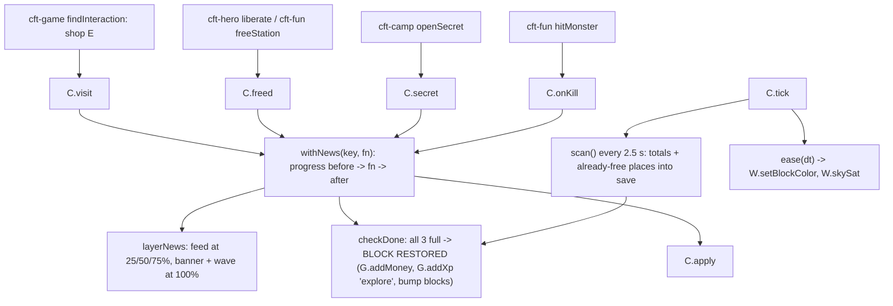

# cft-color.js — `G.color`: colour blocks (2 km squares that start grey and regain colour layer by layer)

Design rationale and the player-facing rules: [docs/colour-blocks.md](../../colour-blocks.md). This page is the code reference.

## At a glance

| | |
|---|---|
| File | `theme/assets/cft-color.js` (~247 lines) |
| Global it exports | `window.CFTColor = { attach }` (~L246) |
| How it is attached | `if (window.CFTColor && G.fun) G.color = window.CFTColor.attach(G, { bump })` in cft-game.js `startWorld` (~L2272): 8th of 11 modules, after `G.aim`, before `G.stunt`; needs `G.fun` |
| Who calls it | cft-game.js (`tick`, `visit` from `findInteraction`'s shop branch, `destroy`), cft-fun.js (`onKill` in `hitMonster`, `freed` when a metro station is freed), cft-hero.js (`freed` on outpost liberation), cft-camp.js (`secret` when a stash opens), cft-ui.js (`summary` for the phone app `VIEWS.colour`, `apply('snap')` when the setting changes; the `[data-colour]` HUD chip opens the phone app) |
| World API it drives | `W.setBlockOrigin`, `W.blockOf`, `W.blockCentre`, `W.setBlockColor`, `W.colorWave`, `W.colorOff`, `W.skySat`, `W.pop`, `W.groundAt` (cft-world.js "colour blocks" section, ~L647–720) |
| State | `save.color` |
| Test flags | `python -I tools/live/game_test.py --color OUTDIR` (`tools/live/colortest.js`; also last in the full run) |

## Responsibilities

- Track per-block progress for three layers: 🏠 buildings (`lib`: freed places, weighted), 🛣️ streets (secret stashes found, read from `save.camp.secrets`), 🌳 nature (figments bonked in the block).
- Turn progress into target saturation per layer and ease the shown values toward it; push them to the world's block-colour texture and the sky.
- Rewards: feed lines at each quarter, a banner when a layer fills, BLOCK RESTORED (cash + XP + banner + colour wave) when all three are full.
- The HUD chip text/bars and the phone app's data.

Not here: the shader that greys materials (cft-world `greyify` / `cgPatch`), the 48 × 48 block texture, colour waves rendering, liberating outposts (cft-hero), freeing metro stations and killing figments (cft-fun), stashes (cft-camp), the phone app markup (cft-ui `VIEWS.colour`), the setting toggle (cft-ui settings `data-set="colour"`).

## Public API (`C = CFTColor.attach(G, api)`)

| Name | Signature | What it does | Called by |
|---|---|---|---|
| `attach` | `(G, {bump}) -> C` (~L28) | Pins the grid origin, pushes every known block's level to the world, sets `W.skySat` and `W.colorOff` | cft-game `startWorld` |
| `C.tick` | `(dt, paused)` (~L212) | HUD every 0.5 s; tracks the current block; `ease`; when not paused: `scan` every 2.5 s; the one-time intro banner once the story is on (and the campaign intro is over) | cft-game `tick` |
| `C.visit` | `(place)` (~L139) | E on a shop: first visit marks `visited[id]` and adds its weight (skips outposts and metro: they come through `freed`); small colour wave + "🎨 +colour" pop | cft-game `findInteraction` |
| `C.freed` | `(place, how)` (~L148) | An outpost liberated / metro station freed: adds weight (`T.wOutpost` / `T.wMetro` fallback), wave, counter `colourwaves` | cft-hero, cft-fun |
| `C.secret` | `(spot)` (~L155) | A stash opened: re-evaluates the block (the count comes from `save.camp.secrets`), wave | cft-camp |
| `C.onKill` | `(monster)` (~L161) | Adds kills to the monster's block: 1, champion 2, boss/rare 3, metro guardian 5; ignores the opening's `introFoe`s | cft-fun `hitMonster` |
| `C.block` | `(x?, z?) -> progress` | Progress of the block at a point (default: the player) | tests, ui |
| `C.progress` | `(key) -> progress` | See Key data | `C.summary`, tests |
| `C.apply` | `(now?)` (~L168) | Re-applies `W.colorOff(!on())`; `'snap'` jumps every shown block straight to its target | cft-ui (setting changed), `withNews` |
| `C.hud` | `()` (~L189) | Updates the `[data-colour]` chip (hidden when off or before the story starts) | `C.tick` |
| `C.summary` | `() -> {on, here, list, restored, T, LAYERS}` (~L202) | Every block visited (current first, then by colour) with distance in km | cft-ui `VIEWS.colour` |
| `C.markers` | `()` | Empty placeholder | — |
| `C.test` | `{scan, progress, target, worth, isFree, secretBlock, shown, checkDone}` | Internals for tests | `tools/live/colortest.js` |
| `C.destroy` | `()` | `alive = false`, `W.colorOff(false)` | cft-game `destroy` |

## Internal structure

| Lines | Section | What |
|---|---|---|
| 1–24 | header | Story, API, world hooks, state, knobs, tests |
| 28–47 | setup | `save`, `P`, `shown` (Map key → [r, g, b, sky]), `LAYERS`, `st` (lazy `save.color`), `keyOf`, `parse`, `blk`, `on` |
| 49–77 | place worth | `OUTPOST`, `worth`, `isFree`, `secretBlock` (stash id `q<lat×20000>:<lon×20000>` → block), `secretsFound` |
| 78–137 | progress | `progress`, `C.block`, `floorSat`, `target`, `scan`, `checkDone`, `layerNews`, `withNews` |
| 138–166 | events | `C.visit`, `C.freed`, `C.secret`, `C.onKill` |
| 167–187 | world | `C.apply`, `ease` |
| 188–210 | HUD + phone | `C.hud`, `C.summary`, `C.markers` |
| 211–247 | tick + start | `C.tick`, `C.test`, `C.destroy`, origin pinning, initial levels |

## Key data

**`save.color`** (created by `st()`): `{origin: {lat, lon}, b: {'bx_bz': {lib: {placeId: weight}, kills, done (day or 0), tot}}, visited: {placeId: day}, intro (day)}`.

- `origin` is set once from `save.home` on first attach and never changes (moving house keeps the grid); converted with `G.xz` → `W.setBlockOrigin`.
- Block key bx_bz from `W.blockOf(x, z)`: 2,000 m squares centred on the origin.
- `tot` = the highest total place weight ever seen loaded in the block (so a block with few places needs fewer points).

**Progress object** (`progress(key)`): `{key, lv: [lib, sec, kill] (0..1), avg, lib, libT, found, kills, done, need: [points, secrets, figments]}` where `libT = max(1, min(T.libTarget, tot || T.libTarget))`.

**Place weight** (`worth`): outposts (`hearton`, `grocery`) `T.wOutpost`; real metro `T.wMetro` (virtual 0); a kind with something to sell: real `T.wShop`, made-up/virtual `T.wMadeUp`; otherwise 0. **Free** (`isFree`): outposts by `save.hero.out[id]`, metro by `G.fun.metroOpen(pl)`, shops by `visited[id]`.

**Shown levels**: `shown.get(key)` = 4 numbers (buildings, streets, nature, sky = average) eased at `min(1, dt×1.6)` per frame toward `floorSat(level) = T.minSat + (1 − T.minSat) × level`; `W.skySat` eases at `dt×1.2`.

## Flow



## Tunables (`D.TUNE.color`, Admin > Balance > Colour blocks)

| Knob | Default | Meaning |
|---|---|---|
| `libTarget` | 40 | Building points for full colour (fewer if the block has fewer places) |
| `wOutpost`, `wMetro` | 4, 4 | Points per liberated outpost / freed metro entrance |
| `wShop`, `wMadeUp` | 1, 0.5 | Points for walking into a real / made-up shop |
| `secretTarget` | 8 | Stashes for full street colour |
| `killTarget` | 25 | Figment points for full nature colour |
| `minSat` | 0 | Colour a block keeps at the start (0 = pure grey) |
| `rewardCash`, `rewardXp` | 300, 400 | BLOCK RESTORED reward, × (1 + 0.15 × (level − 1)) and × (1 + 0.1 × (level − 1)) |

`T = D.TUNE.color` is captured at attach, but `D.applyBalance` mutates that object in place, so live balance drafts apply. Setting: `save.settings.colour === false` = full colour everywhere (progress still counts). Counters: `blocks`, `colourwaves`.

## How to test

```
python -I tools/live/game_test.py --color OUTDIR
```

`colortest.js` measures real rendered saturation (`satNow`), frees places, opens stashes, kills figments, checks BLOCK RESTORED, the setting, the HUD chip and the phone app. Quick manual check: harness with `?debug=1`, then in the console `window.__cft.color.block()`.

## How to modify safely

- **New way to earn colour**: call one of `C.visit` / `C.freed` / `C.secret` / `C.onKill` from the module where it happens (guarded `if (G.color)`), or add a new event that wraps its save change in `withNews(key, fn)` so news, rewards and `C.apply` happen.
- **New layer**: needs a new channel in cft-world's block texture and `greyify` layer mapping, plus `LAYERS`, `progress`, `target`, `C.hud` bars and cft-ui's phone app.
- **New save field**: add it in `st()` with a type check (that is this module's migration).
- Pitfalls: block keys depend on `save.color.origin`; never reset it (all progress would map to other squares). `scan` only sees loaded places, so `tot` grows as the player explores. `C.visit` ignores outposts and metro on purpose (they need liberation). After editing: `python tools/assets.py`; update docs/colour-blocks.md if rules change.

## Review checklist for AI-made diffs

- [ ] Every progress change goes through `withNews` (or `scan`) so `checkDone` runs and the reward is paid once (`b.done`).
- [ ] New numbers live in `D.TUNE.color`, read through `T` at use time.
- [ ] `save.color` additions are created in `st()` with type checks.
- [ ] Callers in other modules guard `G.color`.
- [ ] `--color` passes; docs/colour-blocks.md still matches.
- [ ] `python tools/assets.py` run.
