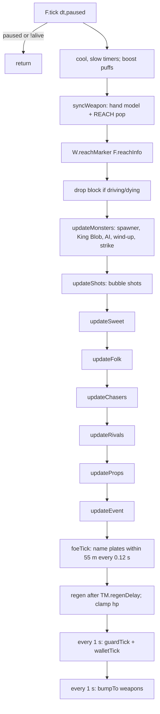

# cft-fun.js — street life and the whole melee combat loop (figments, weapons, health, guardians, folk, sweethearts, chasers, events)

## At a glance

| | |
|---|---|
| File | `theme/assets/cft-fun.js` (1,444 lines) |
| Global exported | `window.CFTFun = { attach }` (L1443) |
| Attached as | `G.fun = CFTFun.attach(G, api)` in cft-game.js `startWorld` (~L2265), right after the world has loaded and **before** `G.rpg`, `G.hero`, `G.chaos`, `G.camp`, `G.wild`, `G.aim`, `G.color`, `G.stunt` (all of which are attached only `if (G.fun)`). |
| `api` passed in | `{ bump(k, n), bumpTo(k, n), spawnPickup(type, x, z), chatPed(ped), setBusy(v) }` (cft-game ~L2265) |
| Ticked by | cft-game `frame` loop: `G.fun.tick(dt, paused \|\| rt.busy)` (~L2174), first of the add-on modules |
| Destroyed by | cft-game `destroy()` -> `G.fun.destroy()` (~L2325) (only sets `alive = false`) |
| Reads data | `D.TUNE.combat` (alias `D.COMBAT`), `D.TUNE.monsters`, `D.TUNE.player` (via `D.calc`), `D.TUNE.bosses`, `D.TUNE.smash`, `D.MONSTERS`, `D.ITEMS[*].weapon`, `D.SLAP`, `D.GUARDIANS`, `D.CITIES`, `D.CITY_MONSTERS`, `D.MONSTER_LOCAL`, `D.HYPE`, plus the street-life lists (`D.JOKES`, `D.FLIRT`, `D.STREETFOLK`, `D.PRANKS`, `D.EVENTS`, `D.FORTUNES`, ...) |
| Tests | `python -I tools/live/game_test.py --fun` (tools/live/funtest.js), `--combat` (combattest.js), `--hero` (herotest.js: block/parry/smash), `--balance` (balancetest.js: weaknesses, reach arc), `--color` (colortest.js: name plates, weapon numbers). Pictures: `--monsters DIR`, `--heroshots DIR`. |
| Test flags read | `window.CFT_TEST.calm` (L57: nothing starts by itself: no spawns, events, folk walking over, rival chases, guardians), `window.CFT_TEST.noLuck` (L538, L550: no guard-break or lucky-dodge dice). Tests also set `CFT_TEST.norender` (engine-wide). |

## Responsibilities

- **Figments (monsters):** spawning (night/day spawner, champion packs, King Blob, metro guardians), level + stat scaling, AI (wander, chase, wind-up/telegraph/strike, recover, leash), name plates, removal at sunrise/distance.
- **Your melee + simple ranged attacks:** `F.attack` (weapon choice, aim assist, combos, counters, openings, arcs, reach), `F.shoot` (slot-5 shooters fired by cft-aim), bubble `shot` projectiles (`updateShots`).
- **Defence:** block (`F.setBlock`), perfect parry window, guard break, lucky dodge, out-of-reach dodge.
- **Player health:** `save.fun.hp`, max HP, armour, regeneration, healing (`F.heal`, `F.quaff`), blacking out (`die`) and the dropped wallet.
- **Metro guardians:** one per real station, freeing stations (`save.fun.cleared`).
- **Street life:** strangers (joke/flirt), sweethearts (`save.fun.crushes`, dates, drama), street folk (hearts, the crown), angry shopkeepers / rivals (chasers, pranks, bans), banana peels, trampolines + air coins, random street events (money rain, flash mob, UFO, goose, slimes, Pigeonzilla, crate, dogs; chaos events delegated to cft-chaos), fortunes.
- **Smashing props** with a swing or a car (`smashProp`, also used by cft-game `W.onDriveHit`).

**It does NOT:** draw models or effects (cft-world: `W.monster`, `W.animateMonster`, `W.foePlate`, `W.swing`, `W.hitProp`, `W.burst/pop/shake`), handle input (cft-ui), decide loot (cft-rpg `onKill`/`drop`/`modWeapon`), run real projectiles, ranged/flying figment AI or toys (cft-chaos `C.fire`, `C.rangedAI`, `C.meleeHit`), ammo / MEGA figments / powers (cft-camp `useAmmo`, `meleeHit`, `power`), perfect-dodge slow motion (cft-wild), hype words and swagger (cft-hero, via `G.hero.event`), the colour blocks (cft-color). It owns no DOM except what `U.*` builds.

## Public API

All on the object `F` returned by `attach` (`G.fun`). Line numbers are approximate.

### Combat and health

| Name | Signature | What it does | Called by |
|---|---|---|---|
| `F.attack` (~L161) | `() -> bool` | One swing / shot with the weapon in hand (see systems-combat.md). Returns true if something happened. | cft-game `G.attack` (~L2076) <- cft-ui F key, `[data-bonk]`, left click when pointer locked and not aiming; cft-camp, cft-wild, cft-chaos (wrappers/tests) |
| `F.shoot` (~L141) | `(w) -> bool` | Fire a shooter that is not in the hand (slot 5): modWeapon, `D.calc.dmgMul`, hero dmgMul, `G.camp.useAmmo`, then `G.chaos.fire(w)` (proj) or a bubble shot (shot). On foot / ride mode only. | cft-aim `fireGun` (~L193) |
| `F.setBlock` (~L117) | `(on)` | Start/stop guarding. Records `F.blockStart = G.rt.t` on a fresh press; sets `F.blocking` and `W.blocking` (slows you to 45% in cft-world). Refused when driving, dying, or dead. | cft-ui (G key down/up, `[data-block]` pointer events, window blur) |
| `F.blocking` / `F.blockStart` | bool / seconds | Guard state. | cft-chaos `shotHitsPlayer` (~L339), cft-ui `unblock` |
| `F.blockPower` (~L159) | `() -> 0.4..0.92` | `clamp(CB.block + R.bonus('block') + weapon().block, 0.4, 0.92)` | `strike`, cft-chaos |
| `F.parryWindow` (~L160) | `() -> seconds` | `CB.parry + (R.bonus('block') + weapon().block) * 0.6` | `strike`, `teleTick`, cft-chaos (+0.15 for shots) |
| `F.combo`, `F.counter` | number / time | Current combo count; time until which the next hit counters (set to `G.rt.t + 3.5` by a parry). | internal, tests |
| `F.REACH_BODY` / `F.trueReach` / `F.reachInfo` (~L126-139) | `0.6` / `(w?) -> m` / `() -> {r, arc, hot, ranged}` | The reach you actually hit with (= weapon reach + an ordinary figment radius); `reachInfo` feeds the ground arc. | `F.tick` -> `W.reachMarker`; `syncWeapon`; balancetest/colortest |
| `F.hitMonster` (~L259) | `(m, w, f?)` | Public wrapper for `hitMonster` (damage, death, rewards). `w` = hit object `{dmg, type, knock, stun, word, puff}`. | cft-camp (powers, MEGA), cft-chaos (projectiles, splash, ball kicks), cft-wild (arcs), cft-hero tests |
| `F.weakMul` (~L260) | `(m, type) -> mul` | `m.def.weak[type]` or `D.MONSTERS[kind].weak[type]`, default 1. | `hitMonster`, tests |
| `F.spawnMonster` (~L310) | `(kind, x, z, o?) -> m \| null` | Spawn a figment. `o`: `{def, lvl, champ, hp, atkMul, size, event, aggro, home, leash, guard, station, nightBorn, outpost}` (any extra keys are copied onto `m`). | cft-hero `spawnPack`, cft-rpg `spawnRare`, cft-chaos, cft-camp, cft-debug |
| `F.removeMonster` (~L258) | `(m, poof?)` | Remove a figment (plate, telegraph, scene object). | cft-hero, cft-camp, cft-debug, tests |
| `F.monsters` | array | Every live figment object `m` (see Key state). | cft-chaos, cft-camp, cft-wild, cft-aim, cft-hero, cft-rpg, cft-debug |
| `F.monsterLevel` (~L299-300) | `(x, z) -> level` | `max(1, min(L+4, L-1+floor(distFromHome / TM.levelEvery)))` | `spawnMonster`, cft-hero `spawnPack` |
| `F.scaleFor` (~L305) | `(lvl) -> {hp, atk}` | `D.calc.scale(L, lvl, gear, F.maxHp(), F.armor())` with `gear` from the weapon in hand. | `spawnMonster`, cft-chaos (~L479) |
| `F.windUp` / `F.strike` (~L512, L558) | `(m)` | Exposed for tests and the debug panel ("❗ One winding up"). | cft-debug, tests |
| `F.plateTick` (~L346) | `(m, dt)` | Redraw a figment's name plate. | cft-camp/cft-chaos when they change hp |
| `F.lastFoe` | m \| null | The last figment you hit. | internal |
| `F.maxHp` (~L574) | `() -> int` | `D.calc.maxHp(L, fit, R.bonus('life') + H.hpBonus())` | cft-ui HUD, cft-game (clamp on load ~L122), cft-camp, cft-debug |
| `F.hp` (~L575) | `() -> number` | Current HP (initialises `save.fun.hp` to max if missing/NaN). | cft-ui, cft-debug |
| `F.armor` (~L577) | `() -> int` | `R.bonus('armor') + weapon().def` (weapon only on foot/ride). | `F.hurt`, `F.scaleFor` |
| `F.hurt` (~L578) | `(n, src?) -> dmg` | Damage you: ignored while dying / `G.debugGod` / cft-camp `immortal()` (calls `K.shrug`). `dmg = max(1, n*100/(100+armor))`. Calls `die()` at 0. | `strike`, `touch`, cft-chaos (enemy shots), cft-camp (fire, zaps, MEGA attacks) |
| `F.heal` (~L590) | `(n)` | Heal up to max. | cft-game `addEnergy` (0.7 x energy, ~L274), sleep (~L1947, `heal(1e9)`), cft-hero (outposts), cft-debug |
| `F.quaff` (~L592) | `() -> bool` | Q / 🍵: eat/drink the bag item whose heal + 0.7 x energy is closest to the missing HP. | cft-ui (Q key, `[data-quaff]`) |
| `F.dying` | bool | True during the black-out fade. Many modules check it. | cft-chaos, cft-camp, cft-aim |
| `F.gotWallet` (~L635) | `()` | Give back `save.fun.wallet.amount`. | cft-game pickup handler (~L1095) |
| `F.metroOpen` (~L645) | `(place) -> bool` | Virtual, cleared, or within 90 m of a station in `save.metro`. | cft-game `metroOpen` (~L1882), cft-color |
| `F.stationName` (~L646) | `(place) -> string` | Name, nearest named metro within 160 m, or "<street> station". | cft-game (~L1876, ~L2035) |
| `F.guards` | Map placeId -> m | Live guardians. | internal |
| `F.localName` / `F.cityName` (~L290-297) | `(kind)` / `()` | Local monster names from `D.CITY_MONSTERS` / `D.MONSTER_LOCAL`. | `spawnMonster`, cft-hero `spawnPack` |

### Street life and game hooks

| Name | Signature | What it does | Called by |
|---|---|---|---|
| `F.tick` (~L1415) | `(dt, paused)` | The per-frame update (see Per-frame flow). | cft-game frame |
| `F.interaction` (~L1367) | `(p) -> {t, fn} \| null` | E prompt for a flash mob, a street-folk persona, a sweetheart. | cft-game `findInteraction` (~L2003) |
| `F.pedMenu` (~L713) | `async (ped)` | E on a stranger: hi / flirt / joke. | cft-game (~L2056) |
| `F.noFlirt` (~L712) | `(ped) -> bool` | Kid check (theirs or yours). | cft-hero `compliment` |
| `F.shopGate` (~L1072) | `(place) -> {t, fn} \| null` | A banned made-up shop. | cft-game (~L2030) |
| `F.canPrank` / `F.prank` (~L1089-1090) | `(place)` | Pranks on `place.virtual` shops only; starts a keeper chase. | cft-ui shop panel |
| `F.startEvent` / `F.endEvent` (~L1258-1259) | `(id) -> bool` / `()` | Start/end a street event. | cft-camp, cft-debug, tests |
| `F.event` | object \| null | The running event. | cft-chaos, cft-camp, cft-debug |
| `F.fortune` (~L1351) | `()` | Fortune teller outcome. | cft-game item use (~L1338) |
| `F.markers` (~L1374) | `(out)` | Minimap markers: folk, crushes, figments (not guards), metro entrances, wallet, chasers, pads, grudges, event, gems (if king). | cft-ui minimap |
| `F.newDay` (~L1388) | `(parts)` | Grudges expire, sweethearts fade / give gifts, royal tribute. | cft-game new day (~L1935) |
| `F.summary` (~L1402) | `() -> object` | Phone "Street life" app data. | cft-ui |
| `F.speedMul` / `F.happyBonus` (~L1365-1366) | `()` | Banana/fortune boost; +2 happy per crush (max 8), +4 if crowned. | cft-game `speedMul` (~L223), `happyTarget` (~L235) |
| `F.smashProp` (~L257) | `(e, dmg, f, byCar)` | Hit a street prop via `W.hitProp`; counters, coins, words, hype. | `F.attack`, cft-game `W.onDriveHit` (~L2277), cft-chaos, cft-camp |
| `F.streetSpot` (~L335) | `(x, z, a, b)` | A street point a..b m away. | cft-rpg, cft-chaos |
| `F.rideChanged` (~L1437) | `()` | Forces `syncWeapon` to refresh the hand model. | cft-game `setRide`, cft-hero borrow/park, cft-camp |
| `F.handOverride` | mesh name \| null | **Set by cft-aim** `syncGun` (~L201): the shooter mesh shown in hand while aiming slot 5. | read by `syncWeapon` |
| `F.destroy` (~L1438) | `()` | `alive = false`. | cft-game |

### World hooks set or called

| Hook | Direction | Where |
|---|---|---|
| `W.onBounce` | **set** here (~L1204): bump `bounces`, BOING pop | called by cft-world bouncy surfaces |
| `W.blocking` | **set** by `F.setBlock` | read by cft-world `updatePlayer` (45% speed, block pose, no climb) |
| `W.reachMarker(info)` | called each tick (~L1420) | cft-world `updateReach` draws the ground fan |
| `W.setWeapon`, `W.showReach`, `W.swing(reach, arc)` | called | `syncWeapon`, `F.attack` |
| `W.monster`, `W.animateMonster`, `W.foePlate`, `W.label`, `W.hitProp`, `W.propNear`, `W.carAt`, `W.nearestPed`, `W.holdPed` | called | spawning, animation, smashing, bystanders |
| `G.hero.event(name, o)` | called via `hype()` (~L36) | kill, parry, dodge, block, combo, smash |
| `G.hero.dmgMul()`, `G.hero.hpBonus()`, `G.hero.outpostKill(m)` | called | attack/shoot, maxHp, hitMonster |
| `G.rpg.weapon/weaponId/modWeapon/bonus/onKill/drop` | called (all guarded `G.rpg &&`) | weapon choice, bonuses, loot |
| `G.camp.useAmmo/meleeHit/immortal/shrug` | called | attack/shoot, hurt |
| `G.chaos.fire/meleeHit/rangedAI/startEvent/updateEvent/endEvent` | called | proj weapons, toys, ranged figment AI, chaos events |
| `G.wild.perfectDodge/flurryOn/flurryHit` | called | `strike`, `F.attack` |
| `G.color.onKill/freed` | called | `hitMonster`, `freeStation` |
| `G.allow(key)` | called | campaign gates: `'night'`, `'day'`, `'shooters'`, `'events'`, `'chaosEvents'` |
| `G.storyOn()` | called via `onStory` (~L707) | nothing street-life starts before the story is on |

## Internal structure

| Lines | Section | Contents |
|---|---|---|
| 1-20 | Header comment | API summary, save layout, combat rework notes |
| 24-101 | Setup + helpers | `F` object and runtime vars (L34-40), `fun()` save accessor (L42), `quiet`/`onFoot`/`calm`/`facing` (L55-58), `walk` (L61), `nameTag`, `streetSpot` (L76), `kerbSpot` (L89) |
| 103-282 | Weapons | `weapon()` (L104), `syncWeapon` (L105), `F.setBlock`, reach helpers, `F.shoot`, `F.blockPower`, `F.parryWindow`, `F.attack` (L161-238), `smashProp` (L240), `bonkPed` (L261), `updateShots` (L273) |
| 284-572 | Monsters | names (L286-297), `monsterLevel`, `F.scaleFor`, `spawnMonster` (L310), plates (L336-346), `removeMonster`, `isNight`, `hitMonster` (L356-400), `updateMonsters` (L401-484), `windUp` (L487), `teleTick` (L497), `removeTele` (L507), `strike` (L513-557), `touch` (L559) |
| 573-641 | Health | `F.maxHp`, `hp`, `F.armor`, `F.hurt`, `F.heal`, `F.quaff`, `die` (L606), `walletTick`, `F.gotWallet` |
| 643-705 | Metro guardians | `F.metroOpen`, `F.stationName`, `guardTick` (L653), `spawnGuardian` (L667), `freeStation` (L679), `foeTick` (L693: plates within 55 m) |
| 707 | `onStory` | `G.storyOn()` fallback to `c1-couch` done |
| 709-777 | Strangers | `noFlirt`, `F.pedMenu`, `joke`, `flirt`, `countSweet` |
| 779-874 | Sweethearts | `updateSweet`, `dateSpot`, `finishDate`, `drama`, `sweetMenu` |
| 876-1010 | Street folk | `folkLook`, `spawnFolk`, `folkRec`, `updateFolk`, `folkMenu`, `crown` |
| 1012-1149 | Chasers | `chase`, `keeperObj`, `endChase`, `updateChasers` (speed rule), grudges, `F.shopGate`, `banned`, `F.canPrank`/`F.prank`, `startKeeper`, `updateRivals` |
| 1151-1204 | Props | `updateProps` (peels, trampolines, air coins), `W.onBounce` |
| 1206-1362 | Events | `startEvent`, `endEvent`, `updateEvent`, `joinMob`, `F.fortune` |
| 1364-1441 | Game hooks | `F.speedMul`, `F.happyBonus`, `F.interaction`, `F.markers`, `F.newDay`, `F.summary`, `F.tick`, `F.rideChanged`, `F.destroy` |

## Key state

### Saved (`save.fun`, created/repaired by `fun()` ~L42)

| Field | Type | Meaning |
|---|---|---|
| `hearts` | number | Street hearts from folk (`D.CROWN_AT` crowns you) |
| `king` | 'King' \| 'Queen' \| 'Monarch' \| null | Crowned title (`crown`) |
| `folk` | {personaId: {day, got, story, asked, total, court?}} | Per-persona per-day record (`folkRec`) |
| `folkAt` | {personaId: {lat, lon, yaw, day}} | Today's kerb spot per persona |
| `crushes` | [{id, name, lat, lon, love, met, seen, talk, look}] | Sweethearts (max 12 via flirt) |
| `grudges` | {placeId: bannedUntilDay} | Shop bans |
| `feats` | {stickerId: day} | Shenanigans feats given |
| `cleared` | {placeId: day} | Freed metro stations (by guardian) |
| `hp` | number | Current health (repaired on load in cft-game ~L122 and each tick) |
| `wallet` | {lat, lon, amount} \| null | Money dropped when you blacked out (accumulates) |

Counters bumped (in `save.counters`): `bonks`, `bonk_<kind>`, `champions`, `boss`, `guardians`, `deaths`, `hurt` (by damage taken), `blocks`, `parries`, `dodges`, `runover`, `smash`, `carsmash`, `wrecks`, `alarms`, `pedbonks`, `jokes`, `flirts`, `dates`, `dramas`, `helped`, `dodged` (folk), `pranks`, `escapes`, `caught`, `slides`, `bounces`, `events`, `mobs`, `ufos`, `crates`; set with `bumpTo`: `sweet`, `crowned`, `weapons`.

### Runtime only

- `F.monsters[]`: each `m` = `{kind, obj, x, z, def, lvl, hp, mhp, atk, atkK, xpv, r (body radius), state, t (age), stun, kx/kz (knockback), grab, carry (stolen money), wanderA, born, say, plate}` plus options (`champ`, `event` (lifetime s), `aggro`, `home`, `leash`, `guard` (placeId), `station`, `nightBorn`, `outpost`, `captain`) and combat timers `wind`, `windT`, `tele`, `ring`, `recover`, `runT`, `dead`, `webbed`, `touched`.
- Module vars (L37-40): `cool` (attack cooldown), `slow` (1 s housekeeping timer), `propT`, `eventT`, `shopT`, `rivalCool`, `weaponOn`/`weaponHeld` (hand model keys), `lastHurt`, `lastHitT`, `foeT`, `guardT`, `alive`.
- `F.folk[]`, `F.sweet` (Map crushId -> actor), `F.chasers[]`, `F.peels[]`, `F.pads[]`, `F.shots[]`, `F.event`, `F.guards`, `F.boost`/`F.boostMul`, `F.nightNote`, `F.bossT`, `F.dramaT`.

## Per-frame flow



Note: `F.tick` returns at once when `paused` (cft-game passes `paused || rt.busy`, so any open menu freezes street life and regeneration).

## Tunables

| Knob | Used in |
|---|---|
| `D.TUNE.combat.wind [0.55, 1.05]`, `reach 1.9`, `recover 0.75`, `parry 0.3`, `block 0.6`, `counter 2.5`, `opening 1.35`, `comboT 1.25`, `comboStep 0.06`, `guardBreak [0.22, 0.06]`, `luckyDodge 0.05`, `runOver 7` | `windUp`, `teleTick`, `strike`, `F.attack`, `updateMonsters` (cft-content ~L1791) |
| `D.TUNE.monsters.night/nightLow/day/dayLow`, `champChance`, `aggro`, `levelEvery`, `regenDelay`, `regen`, `champHp/champAtk/champSize/champXp`, `hpGrow/hpPerLevel/atkPerLevel/gearShare/lifeShare/armorShare/challenge/challengeMax` | spawner, `monsterLevel`, `spawnMonster`, `D.calc.scale`, regen (~L1805) |
| `D.TUNE.player.hpBase/hpPerLevel/hpPerFit/dmgPerLevel/xpPerMonsterLevel` | `D.calc.maxHp`, `dmgMul`, `xpFor` (~L1819) |
| `D.TUNE.bosses.guardHp/guardHpAdd/guardAtk/guardXp/guardSize` | `spawnGuardian` (~L1825) |
| `D.TUNE.smash.weaponMul` (2.2) | `F.attack` -> `smashProp` |
| `D.MONSTERS[kind]` `{hp, speed, atk, steal, coins, xp, w, night, boss, size, cash, gem, ranged, fly, weak}` | everywhere (cft-content ~L993, chaos kinds ~L1550, weaknesses ~L1924) |
| `D.ITEMS[id].weapon` + `D.WEAPON_DEFAULTS` + `D.SLAP` | `weapon()`, `F.attack`, `F.armor`, `F.blockPower` |
| `D.EVENTS`, `D.PRANKS`, `D.STREETFOLK`, `D.CROWN_AT`, `D.FLIRT`, `D.JOKES`, `D.RIVALS`, `D.KEEPER_LINES`, titles lists | street life |

Hard-coded numbers worth knowing (not in D.TUNE): chaser speed `max(3.2, min(walk x 0.86, 11.5))` (~L1051), escape after `secs` (22 s pranks / 14 s rivals) or 60 m, guardian spawn radius 70 m / despawn 140 m / one per 90 m, death money loss 10%, wallet visible within 350 m, flirt chance formula (~L749), peel boost 1.7x for 2.4 s, trampoline vy 17.5, event timer 55-100 s, guardian stun factor 0.25, parry stun 2.2 s and counter window 3.5 s (~L529-530), runover damage `|speed| x 0.28 x dmgMul` (~L448).

All numeric `D.*` leaves can be overridden live from Admin > Balance (`D.applyBalance`), e.g. `"TUNE.combat.parry"`, `"MONSTERS.slime.weak.volt"`, `"ITEMS.w_pan.weapon.dmg"`.

## How to test

```
cd C:\Users\arkvi\Documents\CLAUDE\cityfuntime-forms
node tools/live/content_check.mjs                     # data references (monsters, items, events, meshes)
python tools/check.py                                 # syntax, asset hashes, server tests
python -I tools/live/game_test.py --fun               # street life + weapons + events
python -I tools/live/game_test.py --combat            # figments, health, guardians, loot gear
python -I tools/live/game_test.py --hero              # wind-up / block / parry / dodge, smashing
python -I tools/live/game_test.py --balance           # weaknesses, reach arc, overrides
python -I tools/live/game_test.py --monsters OUTDIR   # pictures only
python -I tools/live/game_test.py --eval my.js        # run your own snippet against window.__cft
```

In a test or `--eval` script: `const G = window.__cft, F = G.fun;` set `window.CFT_TEST = {norender: true, calm: true, noLuck: true}`, step with `G.stepSim(n)`, and never `await` something that opens a dialog (start it, then drain the overlays, see funtest.js `drain`).

**`?debug=1` panel** (cft-debug.js): Fights -> "👾 A figment", "🔵 Champion pack", "❗ One winding up" (calls `F.windUp` 2.2 m in front), "🧹 Clear figments"; "🛡️ God mode" sets `G.debugGod` (checked first in `F.hurt`); "🌀 Chaos event"; "Go to" -> Metro (guardians). "Copy note info" lists figments within 40 m (`kind*` = champion, `@outpost`, `@guard`) and your HP.

## How to modify safely

- **Add a figment kind:** add `D.MONSTERS.<kind>` (`n, e, hp, speed, atk, steal, coins, xp, w`, optional `night`, `size`, `ranged`, `fly`, `weak`), a model branch in cft-world `W.monster` / `W.animateMonster`, names in `D.MONSTER_LOCAL[kind]` and every `D.CITY_MONSTERS[city]`, an entry in the `WEAK` table (cft-content ~L1926) if it has weaknesses. Keep `speed` below `D.WALK.run` (content_check enforces). The body radius `r` is hard-coded in `spawnMonster` (~L323: blob 1.6, brute/worm 0.85, else 0.6): add a case if the model is big. Run `content_check.mjs`, `--combat`, `--monsters DIR`.
- **Add a weapon:** an item in `D.ITEMS` with `type: 'gear', slot: 'weapon', weapon: {dmg, reach, arc, cd, hits, knock, stun, mesh, word, puff?, ranged?}` (missing fields come from `D.WEAPON_DEFAULTS`), sell it from a `D.KINDS[...].sells`, a shape in cft-world `W.propMesh`, its mesh name in content_check `MESHES`. `ranged: 'proj' | 'shot'` makes it a shooter (goes to the cft-aim belt, needs ammo); `'cone'` is a blast handled in `F.attack`.
- **Change the parry window / block strength:** `D.TUNE.combat.parry` and `.block` (not in code). Shields add through `R.bonus('block')` (x0.6 for the window); weapons through `weapon.block`. The gold ring timing in `teleTick` reads the same `F.parryWindow()`, so the visual stays in sync. cft-chaos adds +0.15 s for projectiles.
- **Change wind-up / telegraph timing:** `D.TUNE.combat.wind`; multipliers for big ones (x1.2), champions (x0.85) and level gap live in `windUp` (~L490).
- **Change who spawns at night:** `D.TUNE.monsters.night*/day*`, spawn weights `w`, `night: true`; the campaign gate is `G.allow('night'|'day'|'shooters')` (cft-camp).
- **New damage source on figments:** call `F.hitMonster(m, {dmg, type, knock, stun, word}, dir)`; always give `type` (one of `D.DMG_TYPES`) or it counts as `bonk`. Multiply by `D.calc.dmgMul(G.level())` if it should grow with level.
- **New street event:** `D.EVENTS` entry + branches in `startEvent` and `updateEvent` (+ its id in content_check). Chaos-style events (`chaos: true`) go to cft-chaos instead.

Pitfalls:
- `onFoot()` here means **not driving** (`mode !== 'drive'`): on a skateboard/bike (`mode: 'ride'`) you can still bonk, block and get hit. cft-aim uses `mode === 'foot'`.
- `hitMonster` mutates `m` but copies `w` when a weakness applies; `F.attack` copies per target (`hw`). Don't mutate shared weapon objects (`D.ITEMS[...].weapon`): `weapon()` and `R.weapon()` return fresh copies; keep it that way.
- A strike can knock you out and `die()` clears `F.monsters` mid-loop: `updateMonsters` guards with `if (i >= F.monsters.length) continue` and `!F.monsters.includes(m)`; keep those guards in any new loop that can hurt the player.
- Every menu wraps itself in `api.setBusy(true)` ... `finally { api.setBusy(false) }`; while busy, `F.tick` is paused.
- Pranks, bans, angry owners and rivals must stay on `place.virtual` / `pl.made` shops (real businesses).
- Chasers must stay slower than your walk (the user's rule, ~L1051).
- Figment framing ("the Static") is kind: no mockery of mental illness (see SKILL "Combat").
- The HUD foe bar is intentionally hidden (`foeTick` calls `U.foe(null)` once); plates over heads replace it.
- `F.scaleFor` reads the weapon **in hand** at spawn time; switching weapons later does not rescale existing figments, and belt shooters (slot 5) never count.

## Review checklist for AI-made diffs

- [ ] Every new number lives in `D.TUNE` (or `D.MONSTERS` / item data), not inline; formulas belong in `D.calc`.
- [ ] New hit sources pass `type` and go through `hitMonster` (so weakness, plates, XP, loot, colour blocks, hype and outposts all fire).
- [ ] Player damage goes through `F.hurt` (armour, god mode, campaign immortality, death).
- [ ] `G.rpg`, `G.hero`, `G.camp`, `G.chaos`, `G.wild`, `G.color` are always guarded (`G.x && ...`): they attach after G.fun and can be absent.
- [ ] Loops over `F.monsters` that can kill the player or remove monsters iterate backwards or over a `slice()`.
- [ ] `calm()` / `CFT_TEST.noLuck` respected for anything random or self-starting (tests rely on them).
- [ ] New saved fields go in `save.fun` and are repaired in `fun()`; ids stay stable.
- [ ] Menus use `api.setBusy` with `finally`.
- [ ] No pranks/bans on real (non-virtual) places; Tim Hortons never named.
- [ ] Ran `content_check.mjs`, `check.py` and the matching `game_test.py` flag; `python tools/assets.py` after editing theme/assets.
