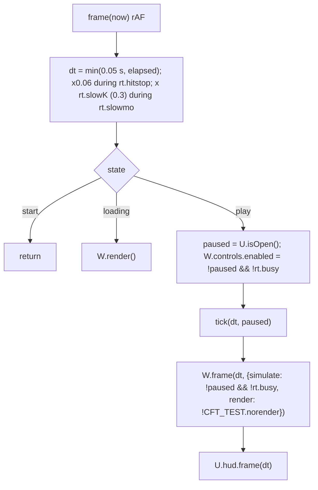

# cft-game.js — the rules object `G`: saves, missions, economy, time, the game loop and module wiring

## At a glance

| | |
|---|---|
| File | `theme/assets/cft-game.js` (~2345 lines, one IIFE) |
| Global it exports | `window.CFTGame = { mount, newSave, migrate, summary, missionBoard, levelOf, xpAt, reqMet, STICKERS, MISSION, BIZ, CREW, fmt$ }` (~L2344) |
| Also sets | `window.__cft = G` while a game is mounted (~L2317; tests read it), removed in `destroy` |
| Created by | `CFT.mountGame` in `theme/assets/cft-kit.js` calls `CFTGame.mount(root, opts)` after every engine file is loaded (cft-kit `ALL` list; `cft-game.js` is loaded **last**) |
| Pure helpers used without 3D | `newSave`, `migrate`, `summary`, `missionBoard`, `reqMet`, `levelOf`, `xpAt` — used by cft-kit `VIEWS` (Life / Quests / Album pages) after `CFT.data()` loaded only `cft-content.js` + `cft-game.js` |
| Depends on | `window.CFT_DATA` (= `D`, cft-content.js; read at file load, so content must load first), `window.CFTUI.create` (cft-ui.js, at mount), `window.CFTWorld.create` (cft-world.js, in `startWorld`), optional attach modules (`CFTFun`, `CFTRpg`, `CFTHero`, `CFTChaos`, `CFTCamp`, `CFTWild`, `CFTAim`, `CFTColor`, `CFTStunt`, `CFTCine`, `CFTDebug`), `window.ArkMusic` (ark-music.js) |
| Test flags | `python -I tools/live/game_test.py` (full run: `gametest.js` covers this file most: missions, shops, delivery, race, chase, escort, business + rush, moving house, midnight, turf) · `--balance` (balance overrides + live draft) · `--camp` (mission cap, opening) · `--eval FILE.js` (your own script against `window.__cft`) |

## Responsibilities

What `cft-game.js` owns:

- **The save**: its schema (`newSave` ~L28), upgrading old saves (`migrate` ~L43, `migrateWear` ~L56), summaries for pages (`summary` ~L68, `missionBoard` ~L96) and persisting it through `opts.onSave` (`doSave` ~L2137).
- **Derived stats and multipliers**: `stat`, `G.maxEnergy`, `G.discount`, `G.incomeMul`, `G.xpMul`, `G.foodMul`, `G.priceOf`, `speedMul`, `G.happyTarget` (~L187–237).
- **Economy and progress primitives** every module uses: `addMoney`, `addXp`, `addStat`, `addHappy`, `addEnergy`, `addRel`, `makeFriend`, `giveItem`, `addSticker`, `giveSticker`, `applyReward` and `bornKid` (section "economy + progress", lines 239–336).
- **Missions**: availability, accept/abandon, the step machine (`beginStep`, `updateMissions`, `triggerStep`, `completeStep`, `failStep`, `completeMission`), step goals and HUD text, dynamic missions (odd jobs, rush hours).
- **Mission-side world actors**: mission givers standing at their spots (`actorSpots`, `updateActors`), followers and escorts, races and chases, pickups (coins and mission items), the goal beam and arrow.
- **Places**: resolving mission targets on the real map (`resolveTarget`, `findPlace`, `spotOf`, `hilltop`, made-up "virtual" places `createVirtual`).
- **Shops, wardrobe, rides, homes, businesses, turf, metro, odd jobs, photos, sleep and the day cycle.**
- **The E-key interaction priority** (`findInteraction` ~L1986).
- **The main loop** (`frame` ~L2197 → `tick` ~L2148) and **wiring the attach modules** into `G` (`startWorld` ~L2265–2275).
- **Applying balance overrides** before anything reads numbers (`G.applyBalance` ~L119).

What it does **not** do (and who does):

| Not here | Owner |
|---|---|
| Content: missions, items, cast, kinds, tunables, formulas `D.calc`, `D.applyBalance` | `theme/assets/cft-content.js` (`window.CFT_DATA`) |
| Drawing the 3D city, the player, movement, physics, camera, tile streaming, `W.*` builders | `theme/assets/cft-world.js` (`W`, created in `startWorld`) |
| HUD, phone apps, dialogs, menus, minigames (`U.dialog`, `U.choose`, `U.dance`, `U.quiz`, panels) | `theme/assets/cft-ui.js` (`U = G.ui`) |
| Monsters, combat, health (`save.fun.hp`), street folk, pranks, events | `theme/assets/cft-fun.js` (`G.fun`) |
| Loot, talents, rested XP, achievements | `theme/assets/cft-rpg.js` (`G.rpg`) |
| Loading files, local/server save storage, page views | `theme/assets/cft-kit.js` (`window.CFT`) |
| Server validation of saves, leaderboard columns | `server_code/Game.py` |

## Public API

`mount(root, opts)` returns `{ G, destroy() }`. `opts`: `{ save, me, balance, onSave(save, reason), onPhoto(url, meta), onExit(), onReset(), quality }` (cft-kit passes all but `quality`).

### Module-level exports (`window.CFTGame`)

| Name | Signature | What it does | Called by |
|---|---|---|---|
| `mount` | `(root, opts) -> {G, destroy}` | Creates `G`, `G.ui`, starts the rAF loop; the world starts after `U.onReady` | cft-kit `CFT.mountGame` |
| `newSave` | `(o?) -> save` (~L28) | A fresh save; `o.home`, `o.name`, `o.look` | `U.onReady` (via `U.startScreen` result), `migrate` |
| `migrate` | `(s) -> s` (~L43) | Fills every missing top-level key from `newSave`, missing stats with 1, merges `settings` and `settings.follow`, runs `migrateWear`. Mutates and returns `s` | `U.onReady`, cft-kit `CFT.prepare` |
| `summary` | `(s) -> {...}` (~L68) | Level, money, net worth (`bizValue` + owned apartment + 60% of vehicles/furniture), story missions done, jobs, turfs, stickers, family | cft-kit `VIEWS.life` |
| `missionBoard` | `(s) -> [{ch, missions}]` (~L96) | Every story mission per chapter with `done` / `active` / `open` / `locked` | cft-kit `VIEWS.quests` |
| `reqMet` | `(s, m) -> bool` (~L85) | Mission requirements: `req.m` (missions done), `lvl`, `partner`, `married`, `kids`, `stat` | `refreshAvailability`, cft-kit `mystery`, `openCount`, `VIEWS.mission` |
| `levelOf` / `xpAt` | `(xp)` / `(level)` (~L17–19) | Delegate to `D.calc.levelOf` / `D.calc.xpAt` (fallback `60 × (l-1)^1.8`); no level cap | everywhere |
| `STICKERS`, `MISSION`, `BIZ`, `CREW` | lookup tables built at file load (~L20–23) | `MISSION[id]` / `BIZ[id]` / `CREW[id]` are the same objects as in `D` (balance overrides reach them) | cft-kit views, tests |
| `fmt$` | `(n) -> '$1,234'` | Money format | views |

### `G` — properties

| Name | What |
|---|---|
| `G.D`, `G.opts`, `G.MISSION`, `G.BIZ`, `G.CREW`, `G.STICKERS`, `G.fmt$`, `G.levelOf`, `G.xpAt`, `G.hash`, `G.TURF` | set at mount (~L110) |
| `G.rt` | runtime state, never saved (see Key data structures) |
| `G.ui` | `CFTUI.create(G, root)` (~L128) |
| `G.W` | the world, set in `startWorld` (~L2217) |
| `G.save` | the save, set in `U.onReady` (~L2302) |
| `G.fun`, `G.rpg`, `G.hero`, `G.chaos`, `G.camp`, `G.wild`, `G.aim`, `G.color`, `G.stunt`, `G.cine`, `G.debug` | attach modules (may be `undefined`/`null`; always guard with `if (G.x)`) |
| `G.sfx` | `{coin, pick, cash, done, fail, tick, snap, level, swing, bonk, boing, slide, alarm}` WebAudio blips (~L171), silent when `save.settings.sound` is false |
| `G.balanceDraft` | number of values in this browser's "try it" balance draft |

### `G` — functions (grouped; "callers" = other engine files and tests, found by grep)

| Name | Signature | What it does | Called by |
|---|---|---|---|
| `G.state` | `() -> 'start'\|'loading'\|'play'` | Game state | ui, fun, hero, chaos, camp, wild, aim, stunt, tests |
| `G.applyBalance` | `() -> n` (~L119) | `D.applyBalance(opts.balance ⊕ localStorage draft)`; clamps `save.fun.hp` to `G.fun.maxHp()` | mount, `storage` event |
| `G.stat` | `(id) -> number` (~L193) | Base stat + worn shop gear + completed sticker sets + `G.rpg.bonus('stat_'+id)` + furniture; `'happy'` returns `save.happy` | fun, ui |
| `G.level` | `()` | `levelOf(save.xp)` | most modules |
| `G.maxEnergy` | `()` (~L204) | `100 + floor(fit)×2 + save.maxE + set bonus + 10 (friend kim) + G.hero.energyBonus()` | camp, debug, hero, ui |
| `G.discount`, `G.relMul`, `G.happyMul`, `G.incomeMul(id)`, `G.xpMul`, `G.foodMul`, `G.priceOf(id)` | (~L205–216) | Multipliers, see Money math | ui, fun, rpg |
| `G.happyTarget` | `()` (~L230) | Where happiness drifts to (0–100) | tick, ui |
| `G.log` | `(text, emoji)` | Diary line, keeps 40 | camp, chaos, color, fun, hero, rpg |
| `G.addMoney` | `(n, why?)` | Adds, floors at 0, counts `counters.earned`, feed line if `why`, `dirty()` | camp, chaos, color, fun, hero, rpg, stunt |
| `G.addXp` | `(n, src?)` | XP with multipliers + rested; level-up banner, `G.rpg.onLevel`, `G.hero.event('level')`, refills energy | camp, chaos, color, debug, fun, hero, rpg, stunt, wild |
| `G.addStat` | `(id, n, quiet?)` | Stat up (2 decimals), feed on whole-number rise | fun |
| `G.addHappy` / `G.addEnergy` | `(n)` | Clamped; energy gain also heals `G.fun.heal(n×0.7)` | chaos, fun, hero, ui |
| `G.addRel` | `(castId, n)` | Relationship 0–100 (positive × `G.relMul()`); a `D.FRIENDS` member crossing 60 becomes a friend | fun, ui |
| `G.makeFriend`, `G.giveItem(id, n)`, `G.addSticker(rare?)`, `G.giveSticker(id)` | | Friends, bag, stickers (set-complete banner) | fun, hero, ui, camp |
| `G.has(id, n?)`, `G.owned(id)`, `G.isFriend(id)`, `G.setDone(setId)` | | Lookups | world, ui, rpg |
| `G.text` | `(s, ctx?)` (~L338) | Replaces `{name} {place} {home} {street} {pt} {he} {He} {him} {his} {kid} {biz} {n}` | cine, fun, ui |
| `G.xz` / `G.ll` | `(ll)` / `(x, z)` | lat/lon ↔ world metres (wraps `W.toXZ` / `W.toLL`) | camp, color, debug, fun, ui |
| `G.allPlaces`, `G.placesOf(kind)`, `G.findPlace(kind, x, z, o)` | | Real map places + this save's virtual places | color, debug, fun, ui |
| `G.hilltop`, `G.resolveTarget(spec, m, step)`, `G.spotOf(who, at)`, `G.homeSpot()` | | Mission target resolution (see Missions) | ui, camp, fun, hero, rpg, tests |
| `G.getM(id)` | | `MISSION[id]` or `save.dyn[id]` | ui |
| `G.activeMissions()` / `G.openMissions()` | | Ids; open list is capped by `G.camp.capOpen` | camp, debug, ui |
| `G.storyOn()` | | First mission `c1-couch` done, or the campaign intro is running | aim, camp, chaos, color, fun, hero |
| `G.allow(feature)` | | `G.camp.allow(f)` (the campaign's unlock list), `true` without camp | camp, chaos, fun, hero, rpg |
| `G.accept(id)`, `G.track(id)`, `G.abandon(id)` | | Start / track / drop a mission | ui, tests |
| `G.curStep(id)`, `G.bump(counter, n?)`, `G.completeStep(id, quiet?)`, `G.failStep(id, why)`, `G.triggerStep(id)`, `G.inWindow([h0,h1])`, `G.ownCount(step)`, `G.stepGoal(id)`, `G.stepIcon(step)`, `G.stepText(id)` | | The step machine (see Missions) | ui, camp, tests |
| `G.castLook(id)`, `G.refreshFollowers()`, `G.actorOf(who, maxD)` | | Cast figures | ui, cine |
| `G.talkTo(actor)`, `G.giveGift(who)`, `G.chatPed(ped)` | | Conversations | ui, tests |
| `G.canBuy(id) -> reason\|null`, `G.buy(id, place) -> bool` | (~L1298–1345) | Shops | ui |
| `G.playerLook()`, `G.wornIn(slot)`, `G.wearShop(id)`, `G.takeOff(slot)`, `G.slotOptions(slot)`, `G.wearFx(o)` | | Look + wardrobe | camp, fun, rpg, ui, debug |
| `G.setRide(id\|null)`, `G.toggleRide()` | | Rides | camp, ui |
| `G.addressOf(x, z)`, `G.moveHome(tier)` | | Homes | ui |
| `G.bizIncome`, `G.bizCap`, `G.upgradeCost`, `G.managerCost`, `G.buyBiz`, `G.upgradeBiz`, `G.hireManager`, `G.collectTill`, `G.startRush` | `(bizId)` | Businesses | ui |
| `G.turfIdOf(x, z)`, `G.turfBounds`, `G.turfRing`, `G.turfCrew`, `G.turfIncome()`, `G.turfNeed(id)`, `G.spotReachable(w)`, `G.rivalTarget()` | | Turf | rpg, ui |
| `G.visitMetro(pl)`, `G.metroTo(station)`, `G.travel(q, msg)` | | Metro + teleport with tile loading | fun, ui |
| `G.sleep()`, `G.jobs()`, `G.takeJob(i)`, `G.takePhoto(caption)` | | Time, odd jobs, photo | ui, chaos |
| `G.peek()`, `G.interact()`, `G.attack()` | | `findInteraction` preview / run / `G.fun.attack()` | ui, tests |
| `G.currentGoal()` | | What the arrow points at | (internal, tests) |
| `G.dirty(now?)`, `G.saveNow(reason)` | | Schedule / force a save | all modules; cft-kit (`saveNow('now')` on tab hide) |
| `G.stepSim(n, render?)` | (~L2212) | Runs `n` fixed 1/30 s ticks + world frames (tests) | every `tools/live/*test.js` |
| `G.musicMood()`, `G.reset()`, `G.exit()` | | Music mood; `opts.onReset`; save + `opts.onExit` | ui |

## Internal structure (guided tour)

| Lines | Section | What is there |
|---|---|---|
| 1–26 | header + helpers | `hash`, `clamp`, `fmt$`, `rnd`, `pick`, `xpAt`, `levelOf`; lookup tables `MISSION`, `BIZ`, `CREW`, `STICKERS`; `RIDE_KIND`, `FOOD_BIZ`; `TURF = 300` |
| 27–106 | saves | `newSave`, `migrate`, `OLD_SLOTS` + `migrateWear`, `bizValue`, `summary`, `reqMet`, `missionBoard` |
| 107–131 | the game | `mount`: `G`, `G.rt`, balance (`BAL_KEY`, `balanceDraft`, `G.applyBalance`, `onBalance` storage listener), `G.ui`, state vars `W`, `raf`, `alive`, `state`, `save` |
| 132–154 | music | `MUSIC` playlists, `music(dt)` every 3 s picks day / night / drive |
| 155–186 | sound | `tone`, `G.sfx` |
| 187–238 | derived stats | `owned`, `has`, `isFriend`, `setDone`, `setBonus`, `stat`, multipliers, `speedMul`, `G.happyTarget` |
| 239–336 | economy + progress | `log`, `addMoney`, `addXp`, `addStat`, `addHappy`, `addEnergy`, `addRel`, `makeFriend`, `giveItem`, `addSticker`, `giveSticker`, `applyReward`, `bornKid` |
| 337–361 | text tokens | `G.text` |
| 362–516 | positions + places | `xz`, `ll`, `dist`, `P`, `vplacePins`, `usedBuildings`, `freeBuilding`, `createVirtual`, `findPlace`, `tallest`, `hilltop`, `resolveTarget`, `spotOf`, `homeSpot` |
| 517–856 | missions | `getM`, `refreshAvailability`, `accept`, `G.abandon`, `curStep`, `bump`, `beginStep`, `endStepRuntime`, `completeStep`, `completeMission`, `failStep`, `triggerStep`, `inWindow`, `updateMissions`, `followersOk`, `ownCount`, `stepGoal`, `stepIcon`, `G.stepText` |
| 857–901 | escorts + followers | `castLook`, `makeCastObj`, `startEscort`, `refreshFollowers` (max 6: escorts, partner, kids, pets, one friend) |
| 902–1000 | race + chase | `startRace`, `stopRace`, `updateRace`, `startChase`, `stopChase`, `updateChase` |
| 1001–1107 | pickups | `tokenMats`, `tokenGeo`, `spawnPickup`, `removePickup`, `spawnMissionPickups`, `clearMissionPickups`, `PICK_W`, `randomType`, `managePickups`, `collect` |
| 1108–1200 | cast actors | `actorSpots` (givers + turf bosses), `updateActors` |
| 1201–1217 | voiced scenes | `sayLines` (→ `G.cine.play` for story missions, else `U.dialog`), `G.actorOf` |
| 1218–1296 | talking | `talkTo`, `rewardLine`, `greet`, `chatLine`, `giveGift` |
| 1297–1347 | shops | `G.canBuy`, `G.buy`, `advanceClock` |
| 1348–1373 | rides + look | `playerLook` |
| 1374–1440 | wardrobe | `wornIn`, `wearShop`, `takeOff`, `slotOptions`, `wearFx`, `setRide`, `G.toggleRide` |
| 1441–1520 | homes | `aptCandidates`, `addressOf`, `nearbyStreetName`, `G.moveHome`, `placeHomeFlag` |
| 1521–1631 | businesses | income/cost formulas, `G.buyBiz`, `G.upgradeBiz`, `G.hireManager`, `G.collectTill`, `accrue`, `G.startRush`, `nearestBiz`, `buildBizSign`, `updateSigns` |
| 1632–1871 | turf | grid helpers, `spotReachable`, `turfWalls`, `spotRow`, `fixTurfSpots`, `ensureTurf`, `updateTurf`, posters, `nearestTagTarget`, `rivalTarget`, `ensureRival`, `tagSpot`, `challengeBoss`, `winTurf` |
| 1872–1908 | metro | `visitMetro`, `metroOpen`, `G.metroTo`, `travel` |
| 1909–1951 | time | `newDay`, `sleep` |
| 1952–1972 | odd jobs | `G.jobs`, `G.takeJob` |
| 1973–1984 | photos | `takePhoto` |
| 1985–2079 | interaction (E) | `findInteraction`, `chatPed`, `G.peek`, `G.attack`, `G.interact` |
| 2080–2133 | beam | `updateBeam`, `makeArrow`, `updateArrow`, `currentGoal` |
| 2134–2146 | saving | `dirty`, `doSave` |
| 2147–2213 | main loop | `tick`, `frame`, `G.stepSim` |
| 2214–2345 | start | `startWorld` (world hooks, loading loop, module attach, offline income, intro), `U.onReady`, `G.reset`, `G.exit`, the returned `destroy`, `window.CFTGame` |

## Lifecycle

```mermaid
sequenceDiagram
  participant Kit as cft-kit CFT.mountGame
  participant Game as CFTGame.mount
  participant UI as CFTUI (U)
  participant World as CFTWorld (W)
  Kit->>Kit: load ALL scripts, CFT.balance(), CFT.loadSave()
  Kit->>Game: mount(root, {save, me, balance, onSave, onPhoto, onExit, onReset})
  Game->>Game: G, G.rt, G.applyBalance(), storage listener
  Game->>UI: CFTUI.create(G, root); U.init(); requestAnimationFrame(frame)
  UI-->>Game: U.onReady()
  alt opts.save given
    Game->>Game: save = migrate(opts.save)
  else new player
    Game->>UI: U.startScreen(me) -> {name, home, look}
    Game->>Game: save = newSave(r); save.camp = {intro:'todo'}
  end
  Game->>World: startWorld(): CFTWorld.create({canvas, quality, tune: D.TUNE})
  Game->>World: W.makeShop / placeFix / signList / signInfo, setOrigin(home), setLook, setRide, teleport
  loop until tiles around start are built (max 50 s)
    Game->>World: W.pumpAt, W.loadStatus
  end
  Game->>Game: attach modules (fun, rpg, hero, chaos, camp, wild, aim, color, stunt, cine, debug)
  Game->>Game: refreshAvailability, refreshFollowers, resume active steps, offline income
  Game->>Game: state = 'play'; intro (G.camp.startIntro) or help or welcome banner
```

`state` values: `'start'` (before the world; `frame` returns early), `'loading'` (world renders, no `tick`; also during `travel`, and `G.camp` can set it via `api.setState`), `'play'`.

`destroy()` (~L2320): saves (`doSave('exit')` if playing), `alive = false`, removes the storage listener, stops ArkMusic, calls `destroy()` on fun, rpg, hero, chaos, camp, wild, aim, color, stunt, cine, debug (in that order), cancels rAF, `W.destroy()`, `U.destroy()`, deletes `window.__cft`.

### Module attach order (startWorld ~L2265–2275)

| # | Line | Code | Condition | `api` handed over |
|---|---|---|---|---|
| 1 | ~2265 | `G.fun = CFTFun.attach(G, api)` | `window.CFTFun` | `bump`, `bumpTo`, `spawnPickup`, `chatPed`, `setBusy` |
| 2 | ~2266 | `G.rpg = CFTRpg.attach(G, api)` | `window.CFTRpg` | `spawnPickup` |
| 3 | ~2267 | `G.hero = CFTHero.attach(G, api)` | `window.CFTHero` | `bump`, `spawnPickup` |
| 4 | ~2268 | `G.chaos = CFTChaos.attach(...)` | `window.CFTChaos && G.fun` | `bump`, `bumpTo`, `spawnPickup`, `setBusy` |
| 5 | ~2269 | `G.camp = CFTCamp.attach(...)` | `window.CFTCamp && G.fun` | `bump`, `bumpTo`, `spawnPickup`, `setBusy`, `travel`, `setState` |
| 6 | ~2270 | `G.wild = CFTWild.attach(...)` | `window.CFTWild && G.fun` | `bump`, `bumpTo`, `spawnPickup`, `setBusy` |
| 7 | ~2271 | `G.aim = CFTAim.attach(...)` | `window.CFTAim && G.fun` | `bump` |
| 8 | ~2272 | `G.color = CFTColor.attach(...)` | `window.CFTColor && G.fun` | `bump` |
| 9 | ~2273 | `G.stunt = CFTStunt.attach(...)` | `window.CFTStunt && G.fun` | `bump`, `bumpTo` |
| 10 | ~2274 | `G.cine = CFTCine.attach(G)` | `window.CFTCine` | none |
| 11 | ~2275 | `G.debug = CFTDebug.attach(G)` | `window.CFTDebug` (returns `null` unless `?debug=1`) | none |

Consequences:

- A module can rely on every module **before** it being attached during its own `attach` (e.g. hero can read `G.rpg`), not on later ones (they exist by the first `tick`). Some module header comments say "after G.hero" for debug; the real position is last.
- Modules are attached **after** the world has loaded and after `placeHomeFlag` / `buildBizSign`, but **before** `refreshAvailability`, `refreshFollowers`, resuming active steps (`beginStep` for steps with no `p` yet; deadlines reset), the offline-income banner and the intro. `G.camp.introPending()` / `startIntro()` run at the very end of `startWorld`.
- `api` closures are the only way a module can write `rt.busy` (`setBusy`), set an absolute counter (`bumpTo(k, n)`), spawn a coin-style pickup (`spawnPickup(type, x, z, mission?, idx?)`) or change `state`. `bump` is also public as `G.bump`.
- Every module keeps its own save sub-object and creates it lazily in its own `st()` function (`save.fun`, `save.rpg`, `save.hero`, `save.chaos`, `save.camp`, `save.wild`, `save.aim`, `save.color`, `save.stunt`, `save.cine`); `migrate` only knows `fun` (from `newSave`). `save.camp = {intro: 'todo'}` is set by `U.onReady` for new games only; cft-camp's `st()` treats a missing `camp` as an old save (`intro: 'done', veteran: true`).

### The "hook system" between G and modules

There is **no event bus**. The coupling is explicit calls, always guarded by `if (G.x)`:

1. **Per-frame ticks** from `tick` (~L2174–2182) in this fixed order, each with `(dt, paused || rt.busy)`: `G.fun`, `G.rpg`, `G.hero`, `G.chaos`, `G.camp`, `G.wild`, `G.aim`, `G.color`, `G.stunt`. `G.cine` and `G.debug` are **not** ticked by `G`.
2. **Point calls from G into a module** (the module must implement them if it exists):

   | Module | Called from cft-game | Where |
   |---|---|---|
   | `G.fun` | `maxHp()` | `G.applyBalance` |
   | | `speedMul()`, `happyBonus()` | `speedMul`, `G.happyTarget` |
   | | `heal(n)` | `addEnergy`, `sleep` |
   | | `gotWallet()` | `collect` (pickup `wallet`) |
   | | `fortune()` | `G.buy` (service with `fortune`) |
   | | `rideChanged()` | `setRide` |
   | | `stationName(pl)`, `metroOpen(pl)` | `visitMetro`, `metroOpen`, `findInteraction` |
   | | `newDay(parts)` | `newDay` (pushes banner text into `parts`) |
   | | `interaction(p)`, `shopGate(pl)`, `pedMenu(ped)` | `findInteraction` |
   | | `attack()`, `smashProp(e, dmg, dir, true)` | `G.attack`, `W.onDriveHit` |
   | `G.rpg` | `bonus(key)` with keys `stat_<id>`, `discount`, `income`, `speed`, `happy`, `turf`, `coin`, `interest`, `drain` | derived stats, `collect`, `newDay`, `tick` |
   | | `xpMul(src)`, `rested(gain)`, `levelText(lv)`, `onLevel(lv)` | `addXp` |
   | | `questDone(m)` | `completeMission` (story missions only) |
   | | `drop('chest')` | `collect` (pickup `loot`) |
   | | `offline(minutes)`, `onSleep()` | `startWorld`, `sleep` |
   | | `lookParts()`, `worn(slot)`, `unequip(slot, quiet?)`, `spare(slot)` | `playerLook`, wardrobe functions |
   | `G.hero` | `event('level', {lv})`, `event('mission', {m})` | `addXp`, `completeMission` |
   | | `energyBonus()`, `speedMul()` | `G.maxEnergy`, `speedMul` |
   | | `borrowed`, `park()`, `borrow(car)` | `setRide`, `G.toggleRide`, `findInteraction` |
   | | `placeGate(pl)`, `signInfo(pl, info)` | `findInteraction`, `W.signInfo` |
   | `G.camp` | `capOpen(ids)`, `inIntro()`, `allow(f)` | `G.openMissions`, `G.storyOn`, `G.allow` |
   | | `collect(k)` | `collect` (pickup `camp`) |
   | | `interaction(p)`, `introPending()`, `startIntro()` | `findInteraction`, `startWorld` |
   | `G.chaos` | `speedMul()`, `interaction(p)` | `speedMul`, `findInteraction` |
   | `G.wild` | `speedMul()`, `interaction(p)` | `speedMul`, `findInteraction` |
   | `G.aim` | `isShooter(weapon)`, `addGun(id, 'bought')`, `pickGun(id)` | `G.buy`, `wearShop`, `slotOptions` |
   | `G.color` | `visit(place)` | `findInteraction` (shop branch) |
   | `G.cine` | `play(o)`, `chapterFor(m)` | `sayLines`, `talkTo` |

3. **Calls from modules into G**: the public `G.*` functions above, plus shared runtime state: `G.save`, `G.rt` (most used: `rt.t` game time, `rt.busy`, `rt.race`, `rt.chase`, `rt.pickups`, `rt.spots`, `rt.goal`, `rt.pinGoal`, `rt.hitstop`, `rt.slowmo`, `rt.slowK`, `rt.followers`), `G.W`, `G.ui`, `G.D`.
4. **World callbacks** that G installs on `W` in `startWorld`: `W.makeShop(seed)` (made-up shop kind + name from `D.SHOP_MIX` / `D.shopName`), `W.placeFix(pl)` (Tim Hortons → "Tom Hearton's", kind `hearton`), `W.signList()`, `W.signInfo(pl)`, `W.onDriveHit(e, speed, dir)`. G also writes `W.speedMul`, `W.noRun`, `W.controls.enabled`, `W.pose`, `W.touchUI.joy` / `knob` every frame or on events.
5. **UI callback**: `U.onReady` (set by G, called by cft-ui when the shell is ready).
6. **Host callbacks** (`opts`): `onSave(save, reason)`, `onPhoto(url, meta)`, `onExit()`, `onReset()`.
7. **Browser event**: `window` `storage` for `cityfuntime.balance.draft` (the wiki in another tab).

## Per-frame flow



`tick(dt, paused)` (~L2148) in order:

1. `rt.t += dt` (always, even when paused — mission deadlines, race and chase timers measure `rt.t`, so they keep running while a phone overlay is open).
2. If not paused: clock (`save.clock += dt/60`), `save.gameMin += dt`, `save.playMs`, `accrue(dt)` (income), `newDay()` past 24:00, energy drain, `W.noRun`, tired toast, happiness drift, `W.speedMul = speedMul()`, `rt.chatCooldown`.
3. `W.setClock(save.clock)`, `music(dt)`, `managePickups`, `updateActors`, `updateMissions`, `updateRace`, `updateChase`, `updateTurf`, `updateSigns`.
4. Module ticks (order above).
5. Every 0.15 s: `rt.interact = findInteraction()` (null while paused/busy) → `U.prompt(text)`.
6. Every 0.25 s or when `rt.goalDirty`: `rt.goal = currentGoal()`; position the beam (hidden during races and cut-scenes `W.cine`), `updateArrow`.
7. Home flag waves; save scheduling (`rt.dirtyT` countdown → `doSave('auto')`; every 25 s `doSave('timer')`); every even second of `rt.t` → `refreshAvailability()`.

`G.stepSim(n, render)` runs `tick` with dt = 1/30 s (never paused) and `W.frame` with a huge budget, `n` times, bypassing `frame` (no hit-stop, no pause check).

## What cft-game.js needs from U and W

A change in cft-ui.js or cft-world.js that renames or changes one of these breaks the rules layer. Grep `theme/assets/cft-game.js` for the name before changing it.

**From `U` (cft-ui.js)**

| Group | Members |
|---|---|
| Lifecycle | `U.init`, `U.onReady` (set by G), `U.startScreen(me)`, `U.destroy`, `U.canvas`, `U.joy`, `U.knob`, `U.applySettings`, `U.help(first)` |
| Overlays (promise-returning, set `rt.busy` around them) | `U.dialog`, `U.choose`, `U.confirm`, `U.ask`, `U.dance(n, speed) -> score 0..1`, `U.quiz(qs, need, who) -> bool`, `U.progress(text, secs)`, `U.fade(fn, text)` |
| Panels | `U.shopPanel`, `U.bizPanel`, `U.homePanel`, `U.metroPanel`, `U.bankPanel` |
| Feedback | `U.feed(emoji, text)`, `U.toast`, `U.banner(title, text, kind)`, `U.prompt(text)`, `U.timer(label, secs)`, `U.countdown(cb)`, `U.confetti`, `U.flash`, `U.loading(text, error?)`, `U.hud.bump(key)`, `U.hud.frame(dt)` |
| State | `U.isOpen()` (any overlay open = paused) |

**From `W` (cft-world.js)**

| Group | Members |
|---|---|
| Lifecycle / frame | `CFTWorld.create`, `W.setOrigin`, `W.frame`, `W.render`, `W.resize`, `W.destroy`, `W.pumpAt`, `W.loadStatus`, `W.registerAround`, `W.subs`, `W.setClock`, `W.cine` (a cut-scene is playing) |
| Coordinates + map queries | `W.toXZ`, `W.toLL`, `W.groundAt`, `W.surfaceAt`, `W.elevAt`, `W.heightAt` (building height, not ground), `W.streetAt`, `W.nearestWalk`, `W.randomWalkSpot`, `W.buildingsNear`, `W.wallSpot`, `W.housenumbersNear`, `W.waterNear`, `W.areaNear`, `W.places`, `W.collide`, `W.borrowable`, `W.nearestPed`, `W.holdPed` |
| Player | `W.player.pos`, `W.player.face`, `W.player.running`, `W.player.footMoved`, `W.teleport`, `W.setLook`, `W.setRide`, `W.ride()`, `W.setFollowers`, `W.controls.enabled`, `W.speedMul`, `W.noRun`, `W.pose`, `W.TOUCH`, `W.touchUI` |
| Builders | `W.THREE`, `W.scene`, `W.person`, `W.animal`, `W.randomLook`, `W.animate`, `W.label`, `W.emojiTex`, `W.emojiSprite`, `W.say`, `W.snapshot` |
| Agents (chase) | `W.agentOn`, `W.agentAdvance`, `W.agentPoint` |
| Hooks G installs | `W.makeShop`, `W.placeFix`, `W.signList`, `W.signInfo`, `W.onDriveHit` |

## Worked example: what happens when a delivery step runs

1. The player accepts a mission whose step is `{do: 'deliver', item: 'package', to: 'bakery', n: 2, time: 180}` (`talkTo` → `accept` → `beginStep`).
2. `beginStep` gives 2 packages (`giveItem`), sets `ms.tg = resolveTarget('bakery', m, step)` (a random one of the nearest bakeries because `do` is `deliver`; a made-up one via `createVirtual` if none is mapped), `ms.tg.r = 8`, `ms.deadline = rt.t + 180`, calls `dirty()` and `updateBeam()`.
3. Every frame `updateMissions` checks the deadline (→ `failStep`: packages removed, step restarted) and the distance to `ms.tg` (× 1.6 when driving). On arrival: `ms.p++`, one package removed, `bump('rush')` if it is a rush mission, then either a new target or `completeStep`.
4. `completeStep` clears runtime bits, removes leftover quest items, increments `ms.st`, applies `step.get`, plays `step.say` (voiced through `G.cine` for story missions), then `beginStep` for the next step or `completeMission` (rewards, counters, outro, banner, `G.hero.event('mission')`, `refreshAvailability`, `dirty(true)`).
5. Meanwhile `currentGoal` → `stepGoal` → `ms.tg` drives the beam and arrow, and `G.stepText` shows "... ({n} left)" on the HUD.

## Key data structures

### The save (`newSave` ~L28; JSON; the server rejects > 400,000 characters, `MAX_SAVE` in `server_code/Game.py`)

Positions are always `{lat, lon}`; world x and z are metres from `save.home` (x east, z south) and only exist at runtime.

| Field | Type / units | Meaning, who writes it |
|---|---|---|
| `v` | 1 | Schema marker; never read or bumped (migrations are key-based, see `migrate`) |
| `created`, `updated` | ms epoch | `updated` set by `doSave`; used by cft-kit to pick local vs server copy and by `startWorld` for offline time |
| `playMs` | ms | Play time (game-scaled dt) |
| `name`, `look`, `pref` | string, object, `'gf'\|'bf'\|null` | Player; `pref` asked by Rosa's first `m.pref` mission in `talkTo`; drives `{pt} {he}...` tokens |
| `home` | `{lat, lon, label, short}` | The **world origin** (`W.setOrigin`); default Plateau Mont-Royal |
| `apt` | `{tier, lat, lon, label, bh?}` | Current home; `tier` indexes `D.APARTMENTS`; set by `G.moveHome` |
| `pos` | `{lat, lon, yaw}` \| null | Last position, written by `doSave` |
| `walked` | metres | Written by `doSave` from `W.player.footMoved` (not in `newSave`; restored in `startWorld`) |
| `money`, `savings` | dollars | `savings` moved by the bank panel (cft-ui); 1%/day interest in `newDay` |
| `xp` | number | Total XP; level is derived (`levelOf`) |
| `energy` | 0..`G.maxEnergy()` | Drains, refilled by food/sleep/level-up |
| `happy` | 0..100 | Drifts to `G.happyTarget()` |
| `maxE` | number | Extra max energy (furniture `energy`, services `maxEnergy`) |
| `stats` | `{fit, charm, smarts, style, cred}` | Base stats, 2 decimals; start 1 |
| `day`, `clock`, `gameMin` | int, hours 0–24, minutes | Calendar; `gameMin` also used for chat cool-downs |
| `bag` | `{itemId: count}` | Consumables, gifts, quest items, spray cans |
| `owned` | `{itemId: true}` | Vehicles, gear, furniture, licences, once-services |
| `equip` | `{head, face, body, back, feet, weapon, hand, wrist, pocket, ride, lastRide}` | Shop gear per wardrobe slot (`D.WEAR_SLOTS`); a slot holds a shop item **or** a loot piece (`save.rpg.eq`), never both |
| `m` | `{missionId: ms}` | Mission states, see below |
| `track` | id \| null | Tracked mission (arrow) |
| `spots` | `{'who@kind' \| 'hill@lat,lon': {lat, lon, name, kind}}` | Where a cast member stands for missions at a kind of place (stable per save); hilltop cache |
| `castAt` | `{castId: spotKey}` | Last spot a `talk` step put someone at (for `to: 'who'`) |
| `vplaces` | `[{id, kind, name, lat, lon}]` | Made-up places created when the map has none of a kind (`createVirtual`) |
| `jobs` | `{day, list: [{i, t, e, steps, pay, taken}]}` | Today's 3 odd jobs (`G.jobs`) |
| `dyn` | `{id: missionDef}` | Dynamic missions: `job-<day>-<i>` and `rush-<biz>-<day>`; deleted with their `m` entry when done or abandoned |
| `stickers` | `{stickerId: count}` | Album |
| `turf` | `{'i_j': {name, crew, own, tags[4], spots[4][lat,lon,nx,nz], rival?, rivalDay?, rivalCrew?, since?}}` | 300 m turf cells |
| `biz` | `{bizId: {lvl, mgr, name, lat, lon, wlat, wlon, nx, nz, till, earned, since, addr, rushDay?}}` | Businesses |
| `rel`, `friends` | `{castId: 0..100}`, `{castId: true}` | Relationships |
| `partner`, `engaged`, `married` | castId \| null, bool, bool | Set by mission rewards |
| `kids`, `pets` | `[{name, born, seed}]`, `[{kind, name, since}]` | Family |
| `counters` | `{key: number}` | Stats + `count` step keys (see below) |
| `metro` | `[{id, name, lat, lon}]` | Unlocked stations, max 40 |
| `log` | `[{d, h, t, e}]` | Diary, newest first, max 40 |
| `hourPaid` | number | In `newSave` but unused by the current code |
| `fun` | `{hearts, king, folk, folkAt, crushes, grudges, feats, ...}` | cft-fun.js (also `hp`, `cleared`, `wallet`, created by its `st()`) |
| `settings` | `{follow: {partner, kids, pets, friend}, quality, sound, ...}` | Also (not in `newSave`, default = on when missing): `music`, `colour`, `cine`, `voice`, `reach`, `hype`, `mapSize` |
| `rpg`, `hero`, `chaos`, `camp`, `wild`, `aim`, `color`, `stunt`, `cine` | objects | Owned by those modules (created lazily) |

**Mission state `ms` = `save.m[id]`** (persisted, so keep it small): `s` (`'open'|'active'|'done'`), `st` (step index), `d` (day accepted), `done` (day), `p` (progress: count, or visited kinds array), `b` (counter baseline), `tg` (target `{lat, lon, name, kind, r}`), `items` (`[[lat, lon, got]]` for scattered collect items), `deadline` (in `rt.t` seconds; reset on load), `armed`, `t0`, and one-shot note flags `whenNote`, `famNote`, `waitNote`.

**Counters written here** (`bump`): `earned`, `earnedAtDay`, `missions`, `jobs`, `rush`, `chats`, `chat_<castId>` (gameMin of last chat), `tags`, `defends`, `turfs`, `races`, `photos`, `pickups`, `pk_<pickupType>`, `coins`, `chests`, `spent`, `buy_<itemId>`. Modules add many more (bonks, weapons, blocks, colourwaves...). `count` steps read any counter by `key`.

### Runtime `G.rt` (~L111; never saved)

`pickups` (live tokens `{type, x, z, gy, mesh, beam, mission, idx, phase, dead}`), `actors` (Map key → giver figure), `followers` (`[{who, obj}]`), `escorts` (`{missionId: {who, obj, name}}`), `race`, `chase`, `signs`, `posters`, `t` (game seconds since mount), `busy` (a dialog/minigame is running: blocks `G.interact`, freezes simulation), timers (`actorTimer`, `missionTimer`, `promptTimer`, `saveTimer`, `dirtyT`, `goalT`, `chatCooldown`), `interact`, `vpins`, `beam`, `arrow`, `flag`, `goal`, `goalDirty`, `pinGoal` (a map pin set by cft-ui), `spots` (last `actorSpots` result), `homeXZ`/`homeKey`, `hitstop`, `slowmo`, `slowK` (set by chaos/wild), `spotsOk`, `turfFail`, `tiredNote`.

### Constants

`TURF = 300` (m, turf cell), `BAL_KEY = 'cityfuntime.balance.draft'`, `MUSIC`, `RIDE_KIND`, `FOOD_BIZ`, `OLD_SLOTS`, `PICK_W` (pickup types with weight `w > 0`, computed once at mount).

## Missions and interactions

**Sources**: `D.MISSIONS` (story + side, static; `MISSION[id]`) and `save.dyn` (odd jobs from `D.JOBS` via `G.takeJob`, rush hours via `G.startRush`). `getM(id)` returns either.

**Availability**: `refreshAvailability` (~L527) marks every story mission whose `reqMet` passes as `{s: 'open'}`; runs every 2 s of `rt.t`, after `completeMission`, and in `startWorld`. Open missions appear as givers with a "!" (`actorSpots` / `updateActors`: spawn within 240 m, removed beyond 300 m, rebuilt every 1 s) at `spotOf(giver, m.at)`. `G.openMissions()` is capped by the campaign (`G.camp.capOpen`).

**Accept**: E on a giver → `talkTo` → menu → `sayLines(intro)` (voiced scene via `G.cine.play` for story missions) → confirm → `accept(id)` → `beginStep`.

**Step lifecycle**: `beginStep` sets up per-type state and the target, `updateMissions` (every frame; "slow" checks every 0.5 s) completes passive steps, `triggerStep` runs interactive steps (E or the giver), `completeStep` advances (gives `step.get`, plays `step.say`), `completeMission` pays (`applyReward`), `failStep` resets timed steps.

| `do` | beginStep | completes when (updateMissions / triggerStep) | key fields |
|---|---|---|---|
| `go` | target from `to`/`at`/`of`/giver | within `tg.r` (8 m; ×1.6 driving); respects `when`, `family` | `to`, `when`, `family` |
| `talk` | target spot `who@at` (stored in `save.spots`, `save.castAt`) or here | `triggerStep`: `U.dialog` (+ optional `ask` choice; wrong = rel −2) | `who`, `at`, `say`, `ask` |
| `collect` | mission-only pickups scattered (`items`) unless `D.PICKUPS[what].w` > 0 (then street pickups count via `ms.p`) | all `items` got / `p >= n` | `what`, `n`, `near`, `far` |
| `deliver` | gives `item ×n`, target `to` (random place of a kind), optional `time` deadline | each arrival delivers one, re-targets | `item`, `n`, `to`, `time` |
| `visit` | `p = []` | standing within 10 m of a place of each kind in `kinds` | `kinds`, `time` |
| `buy` | baseline `buy_<item>` | owned / in bag / bought / pet adopted | `item` |
| `have`, `stat`, `level`, `own` | — | money ≥ / `stat(id)` ≥ / level ≥ / `ownCount(step)` ≥ | `money`, `stat`+`n`, `n`, `what` (+`id`) |
| `walk`, `chat`, `rush`, `tag`, `defend`, `count` | baseline from `W.player.footMoved` / counters (`defend` also `ensureRival`) | difference ≥ `m` / `n` (`count`: `key`, `abs: true` = absolute value) | |
| `pay`, `dance`, `quiz`, `photo` | target | `triggerStep` (E at target, or at the giver if `at: 'giver'`; auto-starts after 600 ms if `at: 'here'`) | `money`, `n`, `speed`, `qs`, `need` |
| `sleep` | target home | `sleep()` completes every active sleep step | |
| `race` | start line = here | E starts `startRace` (checkpoints, `time`, `ride`, `hill`); win → `completeStep`, timeout → `failStep` | `n`, `time`, `ride`, `hill` |
| `chase` | target | E starts `startChase`; catch within 2.4 m | `who`, `time`, `speed` |
| `escort` | target + follower | arrive (14 m) with the escort within 10 m (or driving) | `who`, `to`, `speed`, `when` |

**Interaction priority** (`findInteraction` ~L1986, first match wins; shown in the prompt every 0.15 s, run by `G.interact`):
1. Active-step targets here (race/chase start within 12 m; photo within 16 m / pay / dance / quiz within 10 m; sleep at home).
2. A mission giver or turf boss within 3.6 m → `talkTo`.
3. `G.fun.interaction(p)` (street folk, sweethearts, flash mob).
4. Turf posters within 3.5 m (tag / clean rival tag).
5. Your business within 8 m → `U.bizPanel`.
6. Home within 8 m → `U.homePanel`.
7. A parked car within 1.3 m (on foot, no ride) → `G.hero.borrow`.
8. The nearest place within 9 m: metro (also unlocks it), `G.fun.shopGate`, `G.hero.placeGate`, metro panel, bank panel, shop panel (`G.color.visit` first).
9. A parked car within 2.4 m.
10. A follower within 2.6 m → `talkTo`.
11. `G.wild.interaction`, `G.camp.interaction`, `G.chaos.interaction`.
12. A pedestrian within 2.6 m → `chatPed` (when a `chat` step is active or no `G.fun`) else `G.fun.pedMenu`.

**Goal arrow** (`currentGoal` ~L2116): race checkpoint → chase target → tracked active mission `stepGoal` → `rt.pinGoal` (cleared within 10 m) → nearest giver with an open mission.

## Money, XP, energy and time math

All numbers below are hard-coded in cft-game.js unless a `D.*` path is named (those can be overridden in Admin > Balance, see Tunables).

- **Time**: 1 real second = 1 game minute (`save.clock += dt/60` hours). A day = 24 real minutes while unpaused. Midnight → `newDay` (loops if several days passed): rent (`D.APARTMENTS[tier].rent`, ×0.8 with friend `max`; unpaid → money 0, happy −10), savings interest `1% + G.rpg.bonus('interest')`, rival tags (owned turf with a rival for ≥ 2 days is lost; 25% chance per day of a new rival tag on a non-home turf), `G.fun.newDay(parts)`, the day banner, odd jobs reset. `advanceClock(h)` (services, `travel` +0.25 h, `sleep` to 07:00) also accrues income.
- **Energy**: drains 0.85 per second × (1 − `G.rpg.bonus('drain')`) while running on foot, else 0.035 per second; clamped to `G.maxEnergy()`. At 0: `W.noRun`, on-foot speed ×0.8. Level-up and sleep refill to max. Food: `it.energy × G.foodMul()`.
- **Happiness**: moves toward `G.happyTarget()` by at most 1/40 point per second. Target = `35 + apt.happy + min(25, furniture happy) + 8 partner + 6 married + 6/kid + min(10, 2/friend) + 4/pet (6 with friend ollie) + sticker set bonus + G.fun.happyBonus() + G.rpg.bonus('happy')`, clamped 0–100. `G.happyMul() = 0.8 + happy/250` scales business income.
- **XP**: `addXp(n, src)`: `gain = round(n × G.xpMul() × G.rpg.xpMul(src))`, plus `G.rpg.rested(gain)` unless `src === 'quest'`. `G.xpMul() = 1 + smarts×0.01 + set bonus + 0.1 (friend okafor)`. Level curve `D.calc.xpAt(l) = round(xpBase × (l−1)^xpExp)` (`D.TUNE.player.xpBase` 60, `xpExp` 1.8), no cap. Pickups without `xp` add a raw `+1` to `save.xp` (no multiplier, no level-up check until the next `addXp`).
- **Money in**: coin-type pickups `rnd(pk.money) × (1 + level×0.06) × (1 + G.rpg.bonus('coin'))`; odd jobs pay `rnd(j.pay) × (1 + level×0.15)`, reward XP `25 + pay/3`; rush hour tip `bizIncome×0.6 + 15`, reward `3×tip` money and `40 + tip/4` XP; ped chat 20% chance of a $1–3 tip; Noor (friend) pays $25 per mission photo.
- **Businesses**: hourly income `BIZ.income × (1 + 0.6×(lvl−1)) × G.incomeMul(id)` where `incomeMul = (1 + smarts×0.02) × happyMul × (1 + set bonus + 0.1 priya + 0.15 tomas for FOOD_BIZ + G.rpg.bonus('income'))`. Without a manager it fills the till up to `G.bizCap = 4 × hourly`; with one it goes straight to money. Upgrade (max level 5) `cost × [0.5, 1, 2, 4][lvl−1]`; manager `cost×0.8 + 100`; opening gives `min(2000, 30 + cost/50)` XP. Offline: managed businesses earn for up to 480 minutes away (only if away > 2 min).
- **Turf**: owned cell income per game hour `(15 + 10×ring) × (1 + cred×0.02) × (1 + G.rpg.bonus('turf'))`, `ring` = Chebyshev distance of the cell from home. Boss needs cred `1 + 3×ring`. Winning: cred +2, XP `150 + 80×ring`, happy +3. Turf only runs once mission `c6-luna` is no longer `open`.
- **Prices**: `G.priceOf = round(ITEMS.p × (1 − G.discount()))`, `discount = min(0.4, min(0.25, style×0.006) + G.rpg.bonus('discount'))`; vehicles −10% with friend `dmitri`; food/snacks free at bakeries and cafés with friend `rosa`. Metro fare $3 (free with friend `bouchard`).
- **Speed** (`speedMul` ~L217): `1 + min(0.4, fit×0.01) + set bonus`, + shoe/gear `speed` on foot, +0.05 riding with friend `kai`, ×0.8 tired on foot, then × `G.fun`, `G.rpg` (1 + bonus), `G.hero`, `G.chaos`, `G.wild` multipliers. Written to `W.speedMul` every unpaused tick.
- **Relationships**: positive gains × `1 + charm×0.03`; a `D.FRIENDS` member at ≥ 60 becomes a friend (`D.FRIEND_PERKS` text). Chatting with a cast member: +2 at most once per 60 game minutes.

## Tunables

- **Balance flow**: `D.TUNE` and every other numeric path in `D` (e.g. `ITEMS.w_pan.weapon.dmg`, `BUSINESSES`, `APARTMENTS`, `PICKUPS`, mission rewards inside `MISSIONS`) can be overridden. At `mount`: `G.applyBalance()` → `D.applyBalance(Object.assign({}, opts.balance, draft))` where `opts.balance` = published values from `get_balance` (`server_code/Balance.py`, fetched by cft-kit `CFT.balance()`; failure = `{}`) and `draft` = `localStorage['cityfuntime.balance.draft'].values` (written by cft-wiki.js; ignored when `on === false`). `D.applyBalance` restores the previous overrides first, then mutates `D` **in place** (`D.BAL_DEFAULTS` keeps originals), so objects modules hold (e.g. `D.TUNE.color`) see new values. The `storage` listener re-applies when the wiki in another tab changes the draft and toasts "Balance draft updated".
- **Read here directly**: only `D.calc.xpAt` / `D.calc.levelOf` (→ `D.TUNE.player.xpBase`, `xpExp`); `D.TUNE` is passed to the world as `tune`. Content numbers read here: `D.APARTMENTS` (`cost`, `rent`, `happy`, `pick`), `D.BUSINESSES` (`cost`, `income`, `up`, `deliver`), `D.ITEMS` (`p`, `energy`, `happy`, `stats`, `speed`, `maxEnergy`, `hours`, `rel`), `D.PICKUPS` (`w`, `money`, `energy`, `xp`...), `D.JOBS` (`pay`), `D.STICKER_SETS` bonuses, `D.WALK`, `D.VEHICLES`, mission `reward`s.
- **Not tunable** (hard-coded): energy drain 0.85 / 0.035, happiness drift 1/40, interest 1%, income growth 0.6/level, till cap ×4, upgrade factors, manager cost, turf income/need, odd job ×0.15/level, coin ×0.06/level, offline cap 480 min, fare $3, pickup density 26 (22 touch) and radii, actor ranges 240/300 m. To make one tunable, move it into `D.TUNE` in cft-content.js and read it at use time.
- **Values cached at mount** (a live balance change will not reach them until the next mount): `PICK_W` (which pickups have weight > 0), `STICKERS`, `MISSION`/`BIZ`/`CREW` key sets (values inside still follow).

## How to test

```
node tools/live/content_check.mjs                       # every mission reference + reachability (after content edits)
python -I tools/live/game_test.py OUTDIR                # full run; gametest.js is the cft-game.js test (3-5 min, needs internet)
python -I tools/live/game_test.py --balance OUTDIR      # balance overrides + the live draft
python -I tools/live/game_test.py --camp OUTDIR         # mission cap (G.openMissions), opening, crazy list
python -I tools/live/game_test.py --eval my.js OUTDIR   # run your own script; window.__cft is G
python tools/check.py                                   # node --check, asset hashes, server tests, docs check
```

- Manual: `python -I tools/live/harness.py` → http://localhost:8772/ (query flags: `?fresh=1` new guest save, `?nointro=1` skip the opening, `?music=0`, `?nopost=1`, `?debug=1` the 🐞 play-test panel from cft-debug.js with time/money/level/god-mode buttons and "Copy note info").
- In a test script: set `window.CFT_TEST = {norender: true}` and drive time with `G.stepSim(n)`; never `await` a call that opens a dialog (start it, then click through the overlay, see `drain()` in the test files). `G.peek()` returns the current E action without running it.
- Saving: `ui_test.py` (pages) + `tools/testing/test_server.py` (`put_save` validation).

## How to modify safely

**Add a save field**: add it with its default to `newSave` (~L28). `migrate` copies missing **top-level** keys from `newSave`, so old saves get it automatically; a new key **inside** an existing object (`stats`, `settings`, `fun`...) is not filled except `stats` (numbers) and `settings` / `settings.follow` (merged) — add explicit code to `migrate` for anything else. Module state belongs in that module's own `save.<module>` and its `st()`. Remember the 400k-character server cap and that `server_code/DemoData.py` `demo_save` builds partial saves that rely on `migrate`. Renaming or moving a field always needs a `migrate` step (see `migrateWear` for the pattern).

**Add a step type**: `beginStep` (setup + `ms.tg`), `updateMissions` (passive completion) and/or `triggerStep` + `findInteraction` (interactive), `stepGoal` (arrow), `stepIcon`, `G.stepText` (HUD), cft-kit `stepLabel` (Quests page), and teach `tools/live/content_check.mjs` about it. Add a gametest check.

**Add a mission**: content only (`M(...)` in cft-content.js); keep ids stable (saves key on them); run `content_check.mjs`.

**Add a counter-based goal**: `bump('mykey')` where it happens (or `api.bump` in a module) and use `{do: 'count', key: 'mykey', n}` in content.

**Add an attach module**: write `attach(G, api)` returning an object with `tick(dt, paused)` and `destroy()`; add the attach line in `startWorld` at the right position (dependencies first), the `tick` call in `tick`, the `destroy` call in the returned `destroy`; add the file to cft-kit `ALL` (before `cft-game.js`), to `ENGINE` in `tools/live/harness.py`, and a `<meta name="cft-asset">` line in `anvil.yaml` head_html; then `python tools/assets.py`.

**Add a G → module hook**: call it guarded (`if (G.x && G.x.fn) ...`), document it in the module's header comment and in the hook table above.

**Change an economy number**: prefer `D.TUNE` + reading at use time, so Admin > Balance can tune it.

Pitfalls:

- After **any** edit in `theme/assets`: `python tools/assets.py` (no `-I`; PyYAML), or browsers keep the old file (`tools/check.py` fails on stale hashes).
- Use `addMoney` / `addXp` instead of writing `save.money` / `save.xp` when you want the feed line, `counters.earned`, level-ups and `dirty()` (several existing paths write directly on purpose: purchases, manager income, coin pickups).
- Call `dirty()` after changing the save (or `dirty(true)` for important moments); otherwise the change is only saved by the 25 s timer.
- `rt.busy` must be reset in `finally` around every awaited dialog; a stuck `busy` freezes the player and blocks E.
- `rt.t` keeps running while paused: timed steps lose time under phone overlays.
- Positions in the save must be lat/lon (`G.ll`), never world x/z (the origin moves with `save.home`).
- Tim Hortons must never be shown by its real name (`W.placeFix`); pranks and bans only on made-up places (`place.virtual` / `made`).
- `G.camp.capOpen` hides open missions: a test expecting an open mission may need the cap considered.
- LF line endings (`Path.write_text` on this PC writes CRLF; use `newline=''` or write bytes in scripts).
- After changing code, refresh the code graph (see the project's CLAUDE.md) and run `python -I tools/doc_check.py` if docs name changed functions.

## Review checklist for AI-made diffs

- [ ] New save field has a default in `newSave`, and nested additions have explicit `migrate` code; no x/z stored.
- [ ] No module accessed without a guard (`G.fun`, `G.rpg`, `G.hero`... can be missing; `G.debug` is usually `null`).
- [ ] New attach module wired in all four places (attach line, `tick`, `destroy`, cft-kit `ALL` + harness `ENGINE` + anvil.yaml meta) and attached after what it depends on.
- [ ] `rt.busy` / `api.setBusy` released in `finally`; no awaited dialog without it.
- [ ] Money/XP changes go through `addMoney` / `addXp` (or a stated reason not to), followed by `dirty()`.
- [ ] Step-type changes touch every function in the "Add a step type" list, including cft-kit `stepLabel`.
- [ ] New numbers are in `D.TUNE` (or justified as hard-coded), read at use time (not cached at mount).
- [ ] `findInteraction` order still puts mission targets, givers and shops before decor/critters.
- [ ] Dynamic missions (`dyn`) are cleaned up on finish and abandon.
- [ ] `python tools/assets.py` run; `python tools/check.py` passes; the relevant `game_test.py` flag (and the full run for mission/economy changes) passes; `content_check.mjs` for content.
- [ ] Every function named in the diff's comments exists; line ranges in these docs still roughly right (`python -I tools/doc_check.py --lines`).
