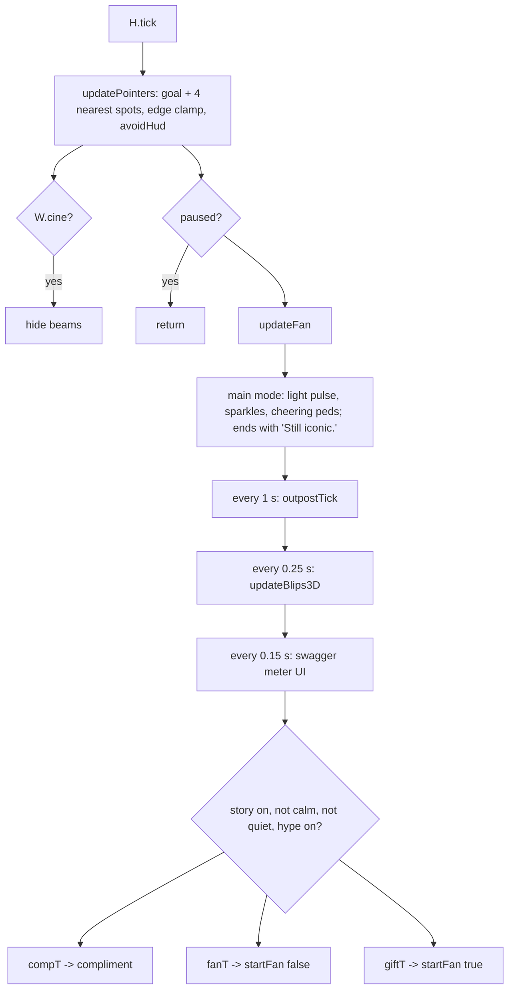

# cft-hero.js — the "main character" layer: hype words, compliments, swagger + main character mode, outposts, mission blips, borrowed cars

## At a glance

| | |
|---|---|
| File | `theme/assets/cft-hero.js` (549 lines) |
| Global exported | `window.CFTHero = { attach }` (L548) |
| Attached as | `G.hero = CFTHero.attach(G, { bump, spawnPickup })` in cft-game.js `startWorld` (~L2267), after `G.fun` and `G.rpg`, before chaos/camp/wild/aim/color/stunt |
| Ticked by | cft-game frame: `G.hero.tick(dt, paused \|\| rt.busy)` (~L2176), after `G.fun` and `G.rpg` |
| Destroyed by | cft-game `destroy()` -> `G.hero.destroy()` (removes its DOM layer, the swagger meter, the vignette and the blip meshes) |
| DOM it creates | `.cft-hero` layer after the canvas with `[data-blips]`, `[data-ticker]`, `[data-hype]`; a `.cft-vignette` (high quality without post-processing); the swagger meter button `.cft-meter.cft-swag` in `[data-meters]` (or `.cft-tl`) |
| Reads data | `D.HYPE` (all lines), `D.TUNE.hype` (incl. `.swag`), `D.TUNE.outposts`, `D.OUTPOSTS`, `D.OUTPOST_CAPTAIN`, `D.MONSTERS`, `D.CAST`, `D.CRUSH_NAMES`, `D.VEHICLES.car`, `D.WALK`, `D.COMBAT.counter` |
| Tests | `python -I tools/live/game_test.py --hero` (tools/live/herotest.js; also in the full run); pictures `--heroshots DIR` |
| Test flags read | `CFT_TEST.calm` (no compliments/fans/gifts/outposts), `CFT_TEST.outposts === false` (older suites switch outposts off; herotest sets it true). herotest also sets `noLuck`. |

## Responsibilities

- **The hype overlay:** big tilted words (`H.word`), the compliment ticker (`H.ticker`), cheering passers-by. Respects `save.settings.hype` = `'max'` (default) | `'some'` | `'off'`.
- **Reacting to game events** (`H.event`): kill streaks, parry, dodge, block, combo, smash streaks, mission complete, level up.
- **Ambient adoration:** compliments/flirts, selfie fans, admirers bringing gear gifts.
- **Swagger** (`save.hero.swag`, 0-100) and **main character mode** (speed and damage multipliers, golden light).
- **Outposts:** every `hearton` / `grocery` place starts occupied; packs of figments (spawned through `G.fun.spawnMonster`), liberation, permanent max energy / max HP bonuses, a free daily treat, sign + minimap state.
- **Mission blips:** 3D beams + giver letters for open mission spots, DOM edge pointers with distances.
- **Borrowed cars:** borrow a parked car (session only), park it again.

**It does NOT:** decide combat outcomes (cft-fun), smash props (cft-world `W.hitProp` / cft-fun `smashProp`; this module only reacts with words), draw the minimap letters (cft-ui reads `H.letterOf` / `H.markers`), own mission data (cft-game `rt.spots`, `rt.goal`), or save borrowed cars (nothing about them is saved). The header comment lists `H.interaction(p)` but **no such function exists** in the code; borrowing is offered by cft-game `findInteraction`.

## Public API

| Name | Signature | What it does | Called by |
|---|---|---|---|
| `H.tick` (~L489) | `(dt, paused)` | Pointers (always), fan, main mode timer, outposts (1 s), 3D blips (0.25 s), swagger meter (0.15 s), ambient compliments/fans/gifts. | cft-game frame |
| `H.event` (~L128) | `(name, o)` | `'kill' {m}`, `'parry' {m}`, `'dodge'`, `'block'`, `'combo' {n}`, `'smash' {kind, wreck, car}`, `'mission' {m}`, `'level' {lv}`. Words + swagger + cheers. | cft-fun `hype()` (kill, parry, dodge, block, combo, smash), cft-game `addXp` level (~L260), mission done (~L647), cft-chaos (~L188-189), cft-camp (~L699, ~L1037-1038) |
| `H.word` (~L74) | `(text, tone, sub?, big?)` | Big word; tones `'gold' \| 'pink' \| 'mint' \| 'red' \| 'violet'`; max 3 on screen; 1.7 s (2.3 s big). No-op when hype is off. | cft-stunt, cft-aim, cft-wild, cft-chaos, cft-camp, cft-color |
| `H.ticker` (~L88) | `(text, who?, emoji?)` | Sliding compliment line, 3 lanes, max 4, 7.6 s; `{name}` / `{NAME}` filled. | internal, cft-camp |
| `H.swag` (~L112) | `(n)` | Add swagger (x0.6 when hype is off); no gain during main mode or before the story; 100 -> `mainMode()`. | internal, cft-wild (perfect dodge), cft-chaos (reflect), cft-camp, cft-debug |
| `H.mainOn` / `H.speedMul` / `H.dmgMul` (~L103-105) | `()` | `mainT > 0`; `TH.mainSpeed` (1.25) / `TH.mainDmg` (1.5) while on, else 1. | cft-game `speedMul` (~L225); cft-fun `F.attack` (~L175), `F.shoot` (~L146) |
| `H.energyBonus` / `H.hpBonus` (~L263-264) | `()` | `min(cap, freedCount(kind) x bonus)` from `D.OUTPOSTS.hearton` / `.grocery`. | cft-game `G.maxEnergy` (~L204); cft-fun `F.maxHp` (~L574) |
| `H.isOutpost` / `H.liberated` (~L259-260) | `(place)` | Is it a `D.OUTPOSTS` kind with a pin / is it in `save.hero.out`. | internal |
| `H.outpostKill` (~L304) | `(m)` | A pack member died: "N LEFT!" at 2 or fewer, last one -> `liberate`. | cft-fun `hitMonster` (~L397) when `m.outpost` |
| `H.placeGate` (~L336) | `(place) -> {t, fn} \| null` | E prompt at an outpost: occupied nudge, or the free treat once a day. | cft-game `findInteraction` (~L2032) |
| `H.signInfo` (~L350) | `(place, info) -> info` | Sign shows ⭐ (freed) or 😈 dark (occupied). | cft-game (~L2238) |
| `H.markers` (~L356) | `(out)` | Outposts within 700 m on the minimap (red occupied, green freed). | cft-ui (~L737) |
| `H.letterOf` (~L402) | `(spot) -> letter` | Giver's initial (titles Officer/Chef/Dr/Grandpa/Mayor dropped), `⚔` for boss spots. | cft-ui minimap/big map (~L736, ~L785) |
| `H.borrow` (~L369) | `(parkedCar) -> bool` | `W.borrowCar(pc)` + `W.setRide(car with tint)`; `H.borrowed = {tint}`; counter `borrowed`. | cft-game `findInteraction` (~L2024, ~L2040) |
| `H.park` (~L385) | `() -> bool` | `W.parkCar` at your spot, back on foot, step 2.2 m to the side. | cft-game `setRide` (~L1423), `toggleRide` (~L1434) |
| `H.borrowed` | `{tint} \| null` | Borrowed-car state. | cft-game, cft-debug |
| `H.summary` (~L527) | `() -> object` | Phone app data: swag, main, fans, gifts, freed counts, bonuses, counters. | cft-ui (~L1040), cft-debug |
| `H.test` (~L535) | object | `{fan(gift), swag, compliment, packs, spawnPack, liberate, updatePointers, blips}` | herotest.js, cft-debug |
| `H.destroy` (~L536) | `()` | Teardown. | cft-game |

Hooks it calls: `G.fun.spawnMonster/removeMonster/localName/monsterLevel/monsters/heal/noFlirt/rideChanged`, `G.rpg.make/add/drop`, `G.color.freed(pl, 'outpost')`, `G.addXp`, `G.addHappy`, `G.addMoney`, `G.giveItem`, `G.maxEnergy`, `G.allow('outposts')`, `G.storyOn`, `W.refreshSign`, `W.borrowCar`, `W.parkCar`, `W.setRide`, `W.teleport`, `W.project`, `W.label`, `W.holdPed`, `W.say`, `W.agentOn`, `U.flash/confetti/banner/feed/toast`. It sets no `W.*` callbacks.

## Internal structure

| Lines | Section | Contents |
|---|---|---|
| 1-23 | Header | Feature list, API, save layout |
| 27-55 | Setup | constants (`HY`, `TH`, `TO`, `SW`), module vars (L39-41), `packs` Map, `st()` save accessor (L43), `level()` hype setting, `fill()` name tokens |
| 57-101 | Overlay | DOM layer, vignette, swagger meter, `H.word`, `H.ticker`, `someone()` |
| 102-126 | Swagger | `H.mainOn/speedMul/dmgMul`, `swag`, `mainMode` (L113) |
| 127-175 | Events | `H.event` switch, `cheer`, `later` |
| 176-255 | Adoration | `nearPed`, `compliment` (L181), `startFan`, `updateFan`, `endFan`, `giveGift` (L243) |
| 256-366 | Outposts | `isOutpost`, `freed`, bonuses, `outpostTick` (L265), `spawnPack` (L281), `H.outpostKill`, `liberate` (L311), `H.placeGate`, `H.signInfo`, `H.markers` |
| 367-396 | Borrowed cars | `H.borrow`, `H.park` |
| 397-487 | Mission blips | beam geometry, `letterOf`, `missionSpots`, `updateBlips3D` (L409), pointers `ptr`, `avoidHud` (L441), `updatePointers` (L456) |
| 488-546 | Main loop | `H.tick`, `H.summary`, `H.test`, `H.destroy`, welcome ticker |

## Key state

**Saved (`save.hero`, repaired by `st()` ~L43):**

| Field | Meaning |
|---|---|
| `swag` | 0-100 swagger |
| `fans` | selfie fans met |
| `out` | {placeId: day liberated} |
| `outKind` | {placeId: 'hearton' \| 'grocery'} (bonuses count by this, not by the live place) |
| `free` | {placeId: day the free treat was used} |
| `gifts` | admirer gifts received |
| `mains` | times main character mode started |

Also reads `save.settings.hype`. Counters bumped: `maincharacter`, `compliments`, `fans`, `gifts`, `liberated`, `lib_<kind>`, `borrowed`.

**Runtime:** `mainT` (main mode seconds left), `compT`/`fanT`/`giftT` timers, `killStreak`/`killT` (4.5 s streak window), `smashStreak`/`smashT` (6 s), `fan` (the running fan/gift scene), `packs` (Map placeId -> `{pl, mons[], started}`), `blips` (Map spotKey -> `{beam, label, letter}`), `ptrs` (DOM pointers), `hudRects`, `mainLight` (PointLight on `W.avatar`), `H.borrowed`.

## Per-frame flow



Outposts in more detail (`outpostTick`): skips unless `onStory()`, not calm, `G.allow('outposts')`, and `CFT_TEST.outposts !== false`. For each loaded outpost place not freed and without a pack: farther than `TO.homeCalm` (90 m) from home, within `TO.range` (62 m), fewer than `TO.maxPacks` (2) packs and none within 50 m -> `spawnPack`. Packs whose place is over 150 m away are removed. `spawnPack` spawns `TO.packMin + min(packMax - packMin, floor(L/3))` figments around the pin (`leash TO.leash`, `aggro 19`, `event 1e9`, `outpost: placeId`) plus a captain (`base.hp x TO.captainHp`, `atkMul TO.captainAtk`, size 1.6, level + 1, xp x4 then `xpv x2`, `champ` + `captain` flags = red plate).

## Tunables

| Knob | Default | Effect |
|---|---|---|
| `D.TUNE.hype.compliment` / `complimentSome` | [6, 11] / [14, 24] s | compliment interval (Max / Some) |
| `D.TUNE.hype.fan` / `fanSome` | [80, 140] / [160, 260] s | selfie fan interval |
| `D.TUNE.hype.gift` / `giftSome` | [170, 260] / [300, 420] s | admirer gift interval |
| `D.TUNE.hype.flirtShare` | 0.34 | share of compliments that are flirty (never when married or for kids) |
| `D.TUNE.hype.swag.*` | kill 5, bigKill 14, parry 12, dodge 3, block 2, combo 2, smash 1.5, wreck 6, mission 25, level 15, compliment 2, fan 6, gift 8, outpost 40 | swagger gains |
| `D.TUNE.hype.mainSecs / mainSpeed / mainDmg` | 25 / 1.25 / 1.5 | main character mode |
| `D.TUNE.outposts.range / maxPacks / homeCalm / packMin / packMax / captainHp / captainAtk / leash` | 62 / 2 / 90 / 3 / 6 / 7 / 1.5 / 26 | outposts |
| `D.OUTPOSTS[kind]` | hearton: energy +5 cap 100, freeItem `doubledouble`; grocery: health +5 cap 150, freeItem `juice` | bonus per freed place, cap, treat, thanks lines |
| `D.HYPE.*` | lists | every line and word (`kills`, `combo`, `smashStreak` are `[n, word]` pairs) |

Hard-coded: kill streak window 4.5 s, smash streak 6 s, fan run speed 7 m/s and 14 s timeout, gift quality odds (4%/18%/38%/rest -> q4/q3/q2/q1, slot weighted to `hand`), blips within 1.1 km, pointers 6-1200 m, liberation XP `60 + 10 x level`. The swagger bar in main mode is drawn as `mainT / 25` (L512), not `/ TH.mainSecs`: if you change `mainSecs`, the bar is wrong (quirk).

## How to test

```
python -I tools/live/game_test.py --hero              # herotest.js
python -I tools/live/game_test.py --heroshots OUTDIR  # pictures: a parry, the hype, an outpost, blips, night
```

In page scripts: `const H = window.__cft.hero; H.test.swag(200); H.test.compliment(); H.test.fan(true); H.test.spawnPack(place); H.test.liberate(place)`. Set `window.CFT_TEST.outposts = true` (and not `calm`) to let outposts spawn by themselves.

**`?debug=1` panel:** Hype -> "✨ Fill swagger" (`H.swag(200)`), "💬 Compliment", "📸 Fan", "🎁 Gift", "🔊 Hype Max/Some/Off"; Go to -> "🍩 Tom Hearton's", "🛒 Grocery" (nearest not freed), "❗ Mission person", "🚗 Parked car". "Copy note info" includes ride (borrowed), hype setting, swagger and outposts freed.

## How to modify safely

- **New hype line or word:** add to the list in `D.HYPE` (`{name}` is filled). Streak words are `[count, word]` pairs in `HY.kills`, `HY.combo`, `HY.smashStreak`.
- **New hype event:** add a `case` in `H.event` and call `G.hero && G.hero.event('<name>', {...})` from the source module; give it a `D.TUNE.hype.swag.<name>` value rather than a literal.
- **New outpost kind:** `D.OUTPOSTS[kind]` (`e, n, what, bonus, cap, free, freeItem, thanks`) + `D.OUTPOST_CAPTAIN[kind]`; places of that `kind` must exist (cft-game `W.placeFix` / `D.SHOP_MIX`). A `what` other than `'energy'`/`'health'` needs new reading code: `H.energyBonus`/`H.hpBonus` and the branches in `liberate` and `H.placeGate` only know those two.
- **Change main character mode:** `D.TUNE.hype.mainSecs/mainSpeed/mainDmg`; also fix the hard-coded `25` in the swagger bar (L512) if you change the duration.
- **Change blips:** `updateBlips3D` (distance limits, scale), `updatePointers` (margins `m = 34`, `top = 96`, `bot = 150`), CSS `.cft-blip` in app.css.

Pitfalls:
- Tone rules: compliments and flirts are PG, never about bodies; no flirts when `save.married` or with kids (`G.fun.noFlirt`). Tim Hortons is always "Tom Hearton's"; outposts are liberations, never mockery of the business.
- Outposts must never spawn within `homeCalm` of home; the older test suites rely on `CFT_TEST.outposts = false`.
- Bonuses count from `save.hero.outKind`, so old saves without it give no bonus for those places (`outKind` was added later; `liberate` writes it).
- `H.word` / `H.ticker` silently do nothing with hype off; don't use them for information the player must see (use `U.banner` / `U.feed`).
- `H.borrow` does not touch `save.equip.ride`; anything that changes rides must call `H.park()` first if `H.borrowed` (cft-game `setRide` does).
- Pointers are DOM; keep them out of the screen centre and HUD corners (`avoidHud`).

## Review checklist for AI-made diffs

- [ ] Every new number in `D.TUNE.hype` / `D.TUNE.outposts` / `D.OUTPOSTS`, not inline.
- [ ] New text lines in `D.HYPE`, kind and PG; `{name}` used instead of hard-coded names.
- [ ] `G.fun`, `G.rpg`, `G.color` guarded; outpost figments spawned only through `G.fun.spawnMonster` with `outpost: placeId` (so `hitMonster` calls `H.outpostKill`).
- [ ] `calm()` and `CFT_TEST.outposts` respected; `onStory()` gate kept.
- [ ] New saved fields in `save.hero` repaired in `st()`.
- [ ] DOM created in `attach` is removed in `H.destroy`; meshes added to the scene are removed.
- [ ] No real "Tim Hortons" text anywhere.
- [ ] Ran `python -I tools/live/game_test.py --hero` (+ `--heroshots` for visual changes), `check.py`, `python tools/assets.py`.
