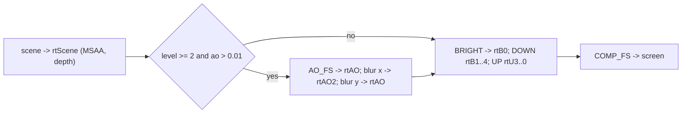

# cft-post.js — `CFTPost`: high-quality post-processing (AO, bloom, filmic grade, FXAA) with an adaptive quality level

## At a glance

| | |
|---|---|
| File | `theme/assets/cft-post.js` (~269 lines; GLSL strings + one factory) |
| Global it exports | `window.CFTPost = { create }` (~L268) |
| How it is created | In `theme/assets/cft-world.js` (~L49): `POST = !LOW && !opts.nopost && !/[?&]nopost=1/.test(location.search) && window.CFTPost && renderer.capabilities.isWebGL2 ? window.CFTPost.create(renderer) : null` |
| Who calls it | cft-world.js only: `POST.setSize` (resize), `POST.render` (every frame in `draw`), `POST.adapt` (live frames), `POST.params` (grade follows the hour in `W.setClock`), `POST.dispose`; exposed as `W.post`; `W.renderInfo()` reads `POST.info`; cft-hero adds a CSS vignette only when `W.post` is missing |
| Load order | Right after `three.min.js` (cft-kit `ALL`) |
| Test flags | `python -I tools/live/game_test.py --gfx OUTDIR` (with and without `CFT_QS="&nopost=1"`); `--balance` checks "the post-processing grade follows the hour" (`tools/live/balancetest.js`) |

## Responsibilities

Render the scene into an off-screen target (half-float on WebGL2 when the float colour extension exists, 4× MSAA, depth texture), then:

1. Ambient occlusion from depth only (SAO-style, half resolution, 12 samples) + a two-pass depth-aware blur.
2. Bloom: bright pass, 4 down-samples, 4 up-samples (5 + 4 targets).
3. One composite: AO, bloom, exposure + ACES filmic curve (in linear space), saturation, contrast, warmth, vignette, dither; FXAA only when there is no MSAA.
4. A frame-time watchdog that drops the level (AO first, then post entirely) when frames are slow.

Not here: what the scene looks like (cft-world, cft-gfx), the day/night grade values (cft-world `W.setClock` multiplies `exposure` and `sat` and sets `warm` from its light table), quality choice (cft-game `startWorld` → `CFTWorld.create({quality})`).

## Public API (`P = CFTPost.create(renderer, opts?)`)

| Name | Signature | What it does | Called by |
|---|---|---|---|
| `create` | `(renderer, opts?) -> P` (~L167) | Allocates targets and materials. `opts` is accepted but not read (the header mentions `{low}`) | cft-world |
| `P.level` | 2 \| 1 \| 0 | 2 = AO + bloom + grade, 1 = no AO, 0 = render straight to the screen | `P.adapt`; tests read it (cft-world's comment also mentions the play-test panel, but cft-debug.js does not reference `W.post` today) |
| `P.params` | `{exposure 0.84, ao 0.9, aoR 1.5, bloom 0.45, thr 0.98, sat 1.1, con 1.04, warm 1, vig 0.26}` | Live grade values (defaults shown) | cft-world `W.setClock` (exposure, sat, warm) |
| `P.info` | `{triangles, calls}` | Stats of the last scene render (not the post passes) | cft-world `W.renderInfo` |
| `P.setSize` | `(w, h)` drawing-buffer pixels | Resizes every target (AO at half, bloom chain at 1/2..1/32) | cft-world resize |
| `P.set` | `(o)` | `Object.assign(P.params, o)` | (no caller found) |
| `P.render` | `(scene, camera)` (~L213) | The whole pipeline, or a plain render at level 0 | cft-world `draw` |
| `P.adapt` | `(dt)` (~L252) | Watchdog: ignores the first 6 s and gaps > 0.5 s; ~4 s of frames slower than 1/34 s → `level--`, calls `P.onLevel(level)` if set; never raises the level again | cft-world `draw` (live frames only) |
| `P.onLevel` | optional callback | Not set by any caller today | — |
| `P.dispose` | `()` | Disposes targets, materials, quad geometry, depth texture | cft-world destroy |

## Internal structure

| Lines | Section | What |
|---|---|---|
| 1–10 | header | Contract |
| 14 | `VS` | Full-screen quad vertex shader |
| 16–66 | `AO_FS` | View-space position from depth, normal from nearest-depth neighbours, radius grows with distance, fades out by `fade` (220 m) |
| 68–87 | `BLUR_FS` | 9-tap blur weighted by linear-depth difference |
| 89–124 | `BRIGHT_FS`, `DOWN_FS`, `UP_FS` | Bloom chain |
| 126–165 | `COMP_FS` | `aces`, `fxaaColor`, the composite |
| 167–200 | `create` setup | Capability checks (`gl2`, `halfOK`), `P`, render targets `rtScene`, `rtAO`, `rtAO2`, `rtB[5]`, `rtU[4]`, quad scene, `mat`, the six materials, `pass` |
| 202–211 | `P.setSize`, `P.set` | |
| 213–248 | `P.render` | Scene → AO (if level ≥ 2 and `ao` > 0.01) → bloom → composite to screen; `renderer.info.autoReset` is turned off during the passes so `P.info` counts the scene only |
| 250–258 | `P.adapt` | Watchdog |
| 260–264 | `P.dispose` | |

## Per-frame flow



## Tunables

Not in `D.TUNE`. `P.params` defaults (above), AO uniforms `radius`/`fade`/sample count, watchdog thresholds (6 s settle, 1/34 s, 4 s). The hour-by-hour grade comes from cft-world's light table (`L.exp`, `L.sat`, `L.warm`) applied in `W.setClock` relative to the first-seen `exposure`/`sat`.

## How to test

```
python -I tools/live/game_test.py --gfx OUTDIR                      # look, by day / dusk / night
CFT_QS="&nopost=1" python -I tools/live/game_test.py --gfx OUTDIR   # compare without post
python -I tools/live/game_test.py --balance OUTDIR                  # includes the grade-follows-the-hour check
```

Manually: the harness page with `?nopost=1` disables it; in the console `W = window.__cft.W; W.post.level = 1` (or 0) to compare; `W.post.params.bloom = 0.8` to try a value live.

## How to modify safely

- **Change the look**: tune `P.params` defaults; remember cft-world overwrites `exposure`, `sat` and `warm` every clock update from its own base values (`postBase` is captured once from the first `P.params`), so change those defaults here, not at runtime.
- **New pass**: allocate its target in `create`, resize it in `P.setSize`, dispose it in `P.dispose`, and keep `pass(material, target)` for drawing.
- Software WebGL in tests is slow: `P.adapt` only runs on live frames (`draw(true)`), and test renders through `W.render()` don't trigger it.
- Not created on WebGL1 or low quality: any feature that depends on post (bloom glow) needs a fallback (see cft-hero's CSS vignette when `W.post` is null).
- After editing: `python tools/assets.py`.

## Review checklist for AI-made diffs

- [ ] Every new render target is resized and disposed.
- [ ] `renderer.info.autoReset` restored at the end of `P.render`.
- [ ] Level 0 path still renders straight to the screen and sets `P.info`.
- [ ] The watchdog only ever lowers the level (no oscillation).
- [ ] Screenshots with and without `nopost` look right; `--balance` passes.
- [ ] `python tools/assets.py` run.
