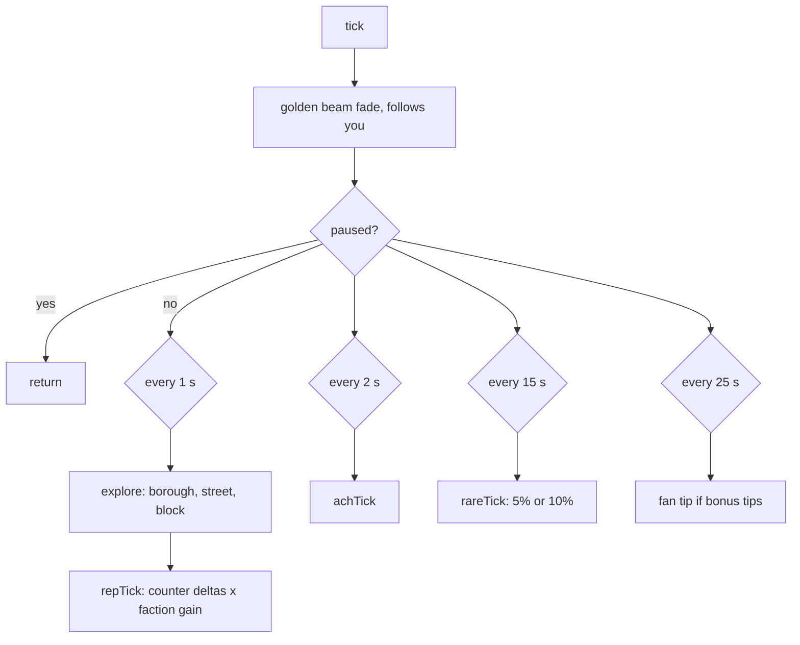

# cft-rpg.js — the long game: loot, gear quality, talents, reputation, achievements, rested XP, discovery, rares

## At a glance

| | |
|---|---|
| File | `theme/assets/cft-rpg.js` (522 lines, ~31 KB) |
| Global exported | `window.CFTRpg = { attach }` (~L521) |
| Attached as | `G.rpg = window.CFTRpg.attach(G, { spawnPickup })` in cft-game.js `startWorld` (~L2266), right after `G.fun`, before `G.hero` (does not require `G.fun`, but rares/discovery use it) |
| api passed in | `{ spawnPickup }` only — it bumps counters directly on `save.counters` with its own `bump` |
| Ticked by | cft-game.js `tick` (~L2175): `G.rpg.tick(dt, paused \|\| rt.busy)`, after fun, before hero |
| Main callers | cft-game.js (`addXp` → `xpMul`/`rested`/`levelText`/`onLevel` ~L250, `completeMission` → `questDone` ~L638, `collect` → `drop('chest')`, `sleep` → `onSleep`, `startWorld` → `offline`, `stat()` / `G.discount` / `G.incomeMul` / speed / happiness / `G.turfIncome` / interest / energy drain → `bonus`, wardrobe `wornIn` etc. → `worn`/`spare`/`unequip`/`lookParts`), cft-fun.js (`weapon()` → `weapon`, `F.attack` → `modWeapon`, `hitMonster` → `onKill`, block/parry/steal/flirt/fade/forgive/maxHp/armor → `bonus`, drops), cft-ui.js (phone apps `VIEWS.hero` / `VIEWS.rep` / `VIEWS.ach` → `view`, actions → `learn`/`respec`/`equip`/`sell`/`sellJunk`/`setTitle`/`claim`, HUD badge → `badge`), cft-hero.js / cft-chaos.js / cft-camp.js (→ `drop`) |
| Data | `D.RPG` (cft-content.js ~L1223: `BAG`, `SLOTS`, `TIER_COST`, `PITY`, `QUALITY`, `SOURCES`, `JUNK`, `CHARMS`, `SUFFIX`, `ADJ`, `LEGEND_ADJ`, `PERKS`, `BRANCHES`, `TALENTS`, `TIERS`, `FACTIONS`, `RARES`, `ACH`, plus `GEAR`, `GEAR_COLS`, `GEAR_AR`, `PREFIX`, `SLOT_NAMES`); `D.TUNE.bosses` (rare stats) |
| Save | `save.rpg = { rested, loot: [], eq: {}, tal: {}, rep: {}, seen, ach: {}, title, titles: [], streets: [], blocks: [], boros: [], pending: [], pity, n, rares: {}, grants: {}, firstAch }` |
| Tests | `python -I tools/live/game_test.py --rpg` (tools/live/rpgtest.js, ~48 checks; also in the full run); pictures `--long DIR` |
| Test flags read | `CFT_TEST.calm` (no rares) |

## Responsibilities

- **One bonus aggregator** `bonus(key)`: talents + equipped charms/gear + faction tier rewards, cached 2 s.
- **Loot:** rolls quality with a pity timer, builds charms (`make`) and visible gear (`makeGear`), the 30-slot bag, auto-equip into
  empty slots, sell, compare (`upgrade`), how gear looks on you (`lookParts`), the loot weapon (`weapon`).
- **Talents:** points from levels, three branches with tiers, respec.
- **Reputation:** five factions fed by counter deltas, tier rewards (bonuses, items, titles).
- **Achievements + titles**, **rested XP**, **level-up beam/text**, **discovery** (boroughs, streets, blocks → XP + chests),
  **named rare monsters**, **mission reward pick** (one of three), **weapon modifiers** (damage bonus, crits).

**It does NOT:** compute XP thresholds or levels (cft-game.js `levelOf`/`xpAt` via `D.calc`), apply XP (cft-game.js `addXp`
calls into it), spawn ordinary monsters, drop shop items (`D.ITEMS`/`save.owned` belong to cft-game.js; loot lives in
`save.rpg.loot`), or render the phone apps (cft-ui.js).

## Public API (the object returned by `attach`, ~L514)

| Name | Signature | What it does | Called by | Line |
|---|---|---|---|---|
| `tick` | `(dt, paused)` | beam fade; discovery + reputation every 1 s, achievements every 2 s, rare roll every 15 s, fan tips every 25 s | cft-game.js `tick` | L499 |
| `bonus` | `(key) → number` | aggregated bonus (see keys below) | ~20 call sites in cft-game.js, cft-fun.js, cft-ui.js | L58 |
| `xpMul` | `(src) → number` | `1 + bonus('xp') + (src === 'monster' ? bonus('monsterXp') : 0)` | cft-game.js `addXp` | L344 |
| `rested` | `(gain) → extra` | spends rested XP: returns `min(rested, gain)` extra XP | cft-game.js `addXp` (not for `'quest'`) | L336 |
| `offline` | `(minutes)` | > 20 min away: +4% of a level per hour (≤ 7 days), cap 1.5 levels | cft-game.js `startWorld` | L327 |
| `onSleep` | `()` | +30% of a level of rested XP | cft-game.js `sleep` | L334 |
| `levelText` | `(level) → string` | the level-up banner subtitle (talent point, new tier, items now for sale) | cft-game.js `addXp` | L356 |
| `onLevel` | `(level)` | golden beam, burst, shake, cache reset | cft-game.js `addXp` | L365 |
| `onKill` | `(m)` | rare → counter `rares` + `drop('rare')`; boss → `drop('boss')`; pigeon → `drop('pigeon')`; else `drop('monster')` | cft-fun.js `hitMonster` (~L394) | L443 |
| `drop` | `(source, {minQ}?) → item \| null` | roll from `D.RPG.SOURCES[source]` and `add` it | cft-fun, cft-game `collect`, cft-hero, cft-chaos `pinataHit`, cft-camp `killMega`/`openSecret` | L134 |
| `make` | `(q, itemLevel, opts) → item` | build a charm (or junk, or gear when `opts.slot` ≠ charm) | internal, tests | L91 |
| `makeGear` | `(q, il, slot, opts) → item` | build gear for `weapon`/`hand`/`head`/`body`/`feet` | `make`, tests | L112 |
| `add` | `(item, src) → item` | put in the bag (full bag sells the worst), pity, auto-equip, banner | internal, tests | L142 |
| `equip` / `unequip` | `(id, slot?)` / `(slot)` | wear / take off (gear also clears the shop piece in that slot) | cft-ui.js, cft-game.js wardrobe | L168 / L182 |
| `sell` / `sellJunk` | `(id, silent?) → $` / `() → $` | | cft-ui.js | L185 / L197 |
| `worn` / `spare` | `(slot)` | worn loot / unworn loot for a slot, best first | cft-game.js, cft-ui.js wardrobe | L183 / L184 |
| `upgrade` | `(item) → bool` | the green "better" arrow | `view` | L205 |
| `score` / `statLine` / `perkText` | `(item)` | comparison score / readable stats | cft-ui.js, `view` | L63 / L69 / L64 |
| `lookParts` | `() → look overrides` | hat/beanie, shirt/coat, shoes, shield from worn gear | cft-game.js `playerLook` (~L1368) | L211 |
| `weapon` / `weaponId` | `() → weapon \| null` / `() → id` | the equipped loot weapon merged onto its `D.ITEMS` base | cft-fun.js `weapon()`, cft-aim.js, cft-camp.js `hud` | L220 / L219 |
| `modWeapon` | `(w) → w` | `dmg = (dmg + add) × (1 + bonus('dmg'))`; crit chance `bonus('crit') + w.crit` doubles it | cft-fun.js `F.attack` | L454 |
| `learn` / `respec` / `points` | `(id)` / `()` / `()` | talents | cft-ui.js | L227 / L241 / L225 |
| `tier` | `(faction) → 0..4` | faction tier | `view`, tests | L251 |
| `val` / `achPoints` / `setTitle` | `(k)` / `()` / `(t)` | achievement value, points, worn title | cft-ui.js, tests | L286 / L321 / L322 |
| `questDone` / `claim` | `(mission)` / `async ()` | queue a 1-of-3 reward pick / show the picker | cft-game.js `completeMission` / cft-ui.js | L461 / L471 |
| `spawnRare` | `(entry?) → monster` | spawn a named rare now | tests, `--long` pictures | L429 |
| `view` / `badge` | `()` | phone app data / count of unspent points + pending rewards (HUD ✨) | cft-ui.js | L483 / L496 |
| `mark` | `()` | invalidate the bonus cache | cft-camp.js `wakeUp`, cft-ui.js | L43 |
| `destroy` | `()` | stop ticking, remove beam | cft-game.js `destroy` | L517 |

**`bonus` keys** (sum of talent `fx`, item `st` as `stat_<id>`, item perks `px`, `ar`→`armor`, `lf`→`life`, `sp`→`speed`,
`blk`→`block`, faction reward `fx`): `stat_<id>` for each of fit, charm, smarts, style, cred, `coin`, `discount`,
`income`, `turf`, `xp`, `monsterXp`, `loot`, `interest`, `sell`, `rep`, `flirt`, `happy`, `fade`, `forgive`, `tips`, `dmg`,
`crit`, `speed`, `steal`, `drain`, `rare`, `armor`, `life`, `block`, `cap` (capstone marker).

It sets no `W.*` hooks and wraps nothing.

## Internal structure

| Section | Lines | Key functions |
|---|---|---|
| constants `STATS`, `GEAR` (slot list incl. `hand`) | L19-L20 | |
| setup, `st()` defaults, counter helpers | L22-L44 | `st`, `bump`, `mark` |
| bonuses | L45-L59 | `compute`, `bonus` |
| loot | L60-L221 | `item`, `equipped`, `score`, `statLine`, `sellPrice`, `rollQ`, `make`, `makeGear`, `pickSlot`, `ilvl`, `drop`, `add`, `equip`, `unequip`, `sell`, `sellJunk`, `upgrade`, `lookParts`, `weapon` |
| talents | L222-L249 | `spentIn`, `points`, `canLearn`, `learn`, `respecCost`, `respec`, `talentText` |
| reputation | L250-L284 | `tier`, `repTick`, `tierUp` |
| achievements + titles | L285-L323 | `val`, `achTick`, `achPoints`, `setTitle` |
| rested XP | L324-L345 | `span`, `addRest`, `offline`, `onSleep`, `rested`, `xpMul` |
| levelling | L346-L372 | `lightBeam`, `levelText`, `onLevel` |
| discovery | L373-L419 | `boroughTick`, `explore` |
| rare monsters + weapon mods | L420-L459 | `rareTick`, `spawnRare`, `onKill`, `modWeapon` |
| mission reward pick | L460-L481 | `questDone`, `claim` |
| phone apps | L482-L497 | `view`, `badge` |
| main loop + init | L498-L519 | `tick`; on attach `repTick` runs once quietly |

## Key state

`save.rpg` (defaults in `st()` ~L33): `rested` (XP pool), `loot` [items], `eq` {c1, c2, c3, weapon, hand, head, body, feet:
item id}, `tal` {talentId: rank}, `rep` {factionId: points}, `seen` {counter: value at last `repTick`}, `ach` {id: day},
`title`, `titles`, `streets` [names, ≤ 2000], `blocks` [turf ids], `boros` [borough names, ≤ 500], `pending` [{t, items[3]}],
`pity` (drops since the last Rare+), `n` (next item id number), `rares` {name: day}, `grants` {factionId+tier: 1, respec: 1},
`firstAch`.

**Item shape:** `{id: 'L<n>', n, e, q (0 Junk … 5 Legendary), il (item level), st: {stat: v}, px: {perk: v} | null, v (value),
fresh}`; gear adds `slot, base, col, dmg | ar, lf, sp, blk`.

**Counters bumped (directly):** `loot`, `loot_<q>`, `junksold`, `capstone`, `restedxp`, `rares`.

## Per-frame flow

### Loot roll

`drop(src)` (~L134): `D.RPG.SOURCES[src]` gives `chance` (× `1 + bonus('loot')`) and `minQ`; `bonus('rare') ≥ 1` (Legend of
the Night) makes rares Epic+. `rollQ` (~L81): weights `QUALITY[i].w` (Rare+ × luck) from `minQ`; pity: after `PITY` (25)
sub-Rare drops `minQ` becomes 3 (not for `'quest'`). Item level `ilvl` = your level (+2 for Epic+) ± 1. Slot from `pickSlot`
(27% charm, 14% weapon, 11% hand, 14% head, 18% body, 16% feet). Charm stat budget `(0.5 + il × 0.11) × QUALITY.k`; gear budget
`(0.3 + il × 0.07) × k`, armour `GEAR_AR[slot] × (1 + il × 0.25) × k`, weapon damage from the `D.ITEMS` base × quality factor.
Epic/Legendary get one perk from `PERKS` (Legendary × 1.6). `add` auto-equips into an empty slot but never pushes off a shop
item worn in that slot.

### Talents and reputation

`points()` = `level − 1 − spent`. A talent of tier t needs `(t − 1) × TIER_COST` points already in its branch. First respec is
free, later ones cost `level × 10`. `repTick` (~L252) adds `(counter − seen) × faction.gain[counter]` (positive × `1 +
bonus('rep')`; negative ignored with `forgive`), raises tiers (`TIERS`: 600 / 1800 / 4200 / 8400) and grants each tier's
reward once (`grants`). The first run on a save (`!r.seen`) counts history quietly.

## Tunables

All in `D.RPG` (no `D.TUNE.rpg` exists): `BAG`, `PITY`, `TIER_COST`, `QUALITY` (k = budget multiplier, w = weight),
`SOURCES` (chance, minQ), `PERKS`, `TALENTS` (fx, max, tier), `FACTIONS` (gain per counter, rewards), `TIERS`, `ACH`, `RARES`,
`GEAR`/`GEAR_AR`/`GEAR_COLS`. Rare monster stats: `D.TUNE.bosses` (`rareHp`, `rareHpAdd`, `rareXp`, `rareSize`).
Hard-coded: rested rates (4%/h, 30% per sleep, cap 1.5 levels), discovery XP (street `6 + 2L`, block `25 + 5L`, borough
`60 + 10L`), rare chance 5% per 15 s, quest reward quality (Uncommon, 15% Rare), pending cap 5, respec price `level × 10`,
fan tips `5-15 × (1 + 0.05L)`.

## How to test

- `python -I tools/live/game_test.py --rpg` (loot, pity, talents, rested XP, discovery, reputation, achievements, rares,
  mission reward choice, phone apps, save round-trip).
- `python -I tools/live/game_test.py --long OUTDIR` for the Character / Reputation / Achievements apps, a Legendary drop, a
  rare, a level-up (pictures).
- Ad hoc via `--eval`: `G.rpg.add(G.rpg.make(5, 15), 'test')`, `G.rpg.drop('boss')`, `G.rpg.view()`.
- Browser: `?debug=1` panel (levels, money; no rpg-specific row). Phone → Character / Reputation / Achievements.

## How to modify safely

- **New bonus effect:** add the key to a talent `fx`, perk, or faction reward in `D.RPG`, then read it where it applies with
  `G.rpg ? G.rpg.bonus('<key>') : 0`. Call `G.rpg.mark()` after anything that changes equipment or talents outside this file.
- **New loot source:** add `SOURCES.<name> = {chance, minQ}` and call `G.rpg.drop('<name>')`.
- **New achievement:** add to `D.RPG.ACH` `{id, cat, e, n, d, k, c, pts, title?}`; `k` is a counter or a special handled in
  `val` (~L286).
- **New faction gain:** add `counterName: points` to a faction's `gain`; the counter must be bumped somewhere with `bump`.
- **New gear base:** `D.RPG.GEAR[slot]` entry (`id`, `n`, `e`, `look` for head/body); weapons must reference a `D.ITEMS` id
  with a `weapon`.
- **Talent tree change:** respect `TIER_COST` gating and keep one `tier: 5` capstone per branch (counter `capstone`).

**Pitfalls**
- `bonus` is cached for 2 s of game time (`G.rt.t`): tests that equip and immediately read must call `mark()`.
- Rested XP applies to every non-`'quest'` XP source, including `'explore'` (discovery, mayhem bank, antennas), not only
  monsters/pickups/jobs as the header comment says.
- `questDone` skips chapter-1 missions (`m.ch === 1`) and stops queueing at 5 pending rewards.
- `sell` of a worn item unequips it and refreshes the look; `add` with a full bag may sell the new item instead.
- The local `C` in this file is the counter reader, not cft-chaos.js.
- `val('blocks')` returns discovered turf blocks (`save.rpg.blocks.length`), not `save.counters.blocks` (which counts both
  blocked attacks in cft-fun.js and restored colour blocks in cft-color.js).
- The fever dream (cft-camp.js `wakeUp`) replaces `save.rpg` with the pre-opening snapshot and sets `rested = 0`.

## Review checklist for AI-made diffs

- [ ] Bonuses go through `bonus(key)`; nothing reads `save.rpg.tal` / `eq` directly from other files.
- [ ] Equipment/talent changes call `mark()` and `G.dirty()`; look-affecting slots call `W.setLook(G.playerLook())`.
- [ ] New item fields survive JSON save/load (plain numbers/strings only).
- [ ] Nothing punishes absence (no streaks/decay): see SKILL.md "The long game" principles.
- [ ] Rares and new spawns respect `G.allow('rares')`, `calm()` and the first-mission check.
- [ ] New data entries pass `node tools/live/content_check.mjs`; rpgtest.js check added; `python -I tools/live/game_test.py --rpg` passes; `python tools/assets.py` + `python tools/check.py` pass.
