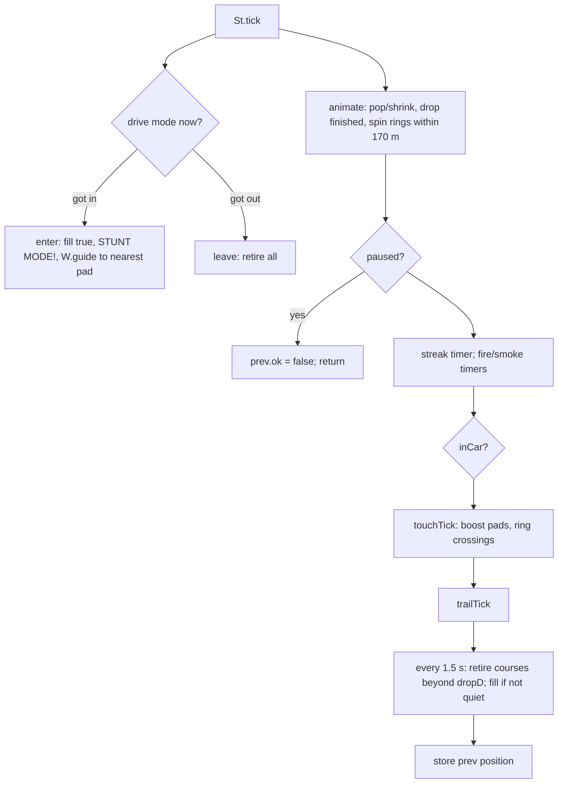

# cft-stunt.js — car stunt courses (ramps, boost arrows, rings of fire, bullseyes) that pop up while you drive, and stunt scoring

## At a glance

| | |
|---|---|
| File | `theme/assets/cft-stunt.js` (454 lines) |
| Global exported | `window.CFTStunt = { attach }` (L453) |
| Attached as | `G.stunt = CFTStunt.attach(G, { bump, bumpTo })` in cft-game.js `startWorld` (~L2273), only `if (G.fun)`; the last gameplay module attached (after G.aim and G.color) |
| Ticked by | cft-game frame: `G.stunt.tick(dt, paused \|\| rt.busy)` (~L2182) |
| Destroyed by | cft-game `destroy()` -> `G.stunt.destroy()` (drops courses, empties `W.ramps`, nulls the four `W.onCar*` hooks, disposes materials/geometries) |
| Physics lives in | cft-world.js (drive branch of `updatePlayer`): `rampAt` (~L4324), `carLaunch` (~L4340), `carAirTick` (~L4346), `carVertical` (~L4368), landing info (~L4400-4419). This module only places courses and scores. |
| Reads data | `D.STUNT` (`KINDS`, `PTS`, `WIPEOUT`, `AIR`; cft-content ~L1666), `D.TUNE.stunt` (~L1880) |
| Tests | `python -I tools/live/game_test.py --stunt` (tools/live/stunttest.js, also in the full run); pictures `--stuntshots DIR` |
| Test flags read | none directly (stunttest sets `norender`, `calm`, `noLuck`, `outposts: false`; courses are not gated by `calm`) |

## Responsibilities

- Detect getting in / out of a car (`W.ride().mode === 'drive'`: own car, moped, SUV, sports car, borrowed car).
- **Place courses** on car streets around you: plan each jump by "flying" it at the speed the boost arrows give, reject spots where a roof is in the way, put rings of fire along the arc and a bullseye where it lands (`plan`, `findSpot`, `fill`).
- **Build and animate** the meshes (ramp wedge, boost pad, fire rings with flame sprites, bullseye, MEGA label); pop in with an overshoot, shrink away when retired.
- Register ramps in `W.ramps` so cft-world can launch the car.
- **Touch checks** each frame in a car: boost pads (`player.boostT`), ring-plane crossings (through / singed), fire and smoke trails.
- **Score** landings reported by cft-world (`W.onCarLand`): air time, flips, half-spins, rolls, rings, singes, bullseye, fakie, rooftop, kind multiplier, streak multiplier; pay coins + XP + mayhem.
- Minimap markers and the phone "Stunts" app data.

**It does NOT:** simulate car flight, flips, landing tolerance, wipeout tumbling or the ramp surface (cft-world), smash props you drive into (cft-game `W.onDriveHit` -> cft-fun `smashProp`), hit figments with the car (cft-fun `updateMonsters` runover), or own the car itself (cft-game rides / cft-hero `H.borrow`).

## Public API

| Name | Signature | What it does | Called by |
|---|---|---|---|
| `St.tick` (~L416) | `(dt, paused)` | Enter/leave detection, animation, streak timer, touch checks, trails, refresh every 1.5 s. | cft-game frame |
| `St.markers` (~L405) | `(out)` | One marker per live course (`K.e` emoji; MEGA red). | cft-ui minimap (~L753) |
| `St.summary` (~L408) | `() -> {best, bestAir, inCar, near, stats[]}` | Phone app data. | cft-ui phone app `stunt` (~L1103) |
| `St.spawn` (~L200) | `(kind, x, z, ux, uz) -> course \| null` | Plan + build a course here (tests). | stunttest.js |
| `St.courses` | array | All courses, including ones shrinking away (`c.out`). | tests, internal |
| `St.test` (~L440) | object | `{plan, st, drop, streak, jump, enter, leave, touchTick}` | stunttest.js |
| `St.destroy` (~L441) | `()` | Teardown. | cft-game |

### World hooks

| Hook | Direction | Notes |
|---|---|---|
| `W.ramps` | **pushed / spliced** | `{x, z, ux, uz, L, H, w, gS, gE, vy, ref, k}`; cft-world `rampAt` ignores ramps with `k < 0.999` (popping in/out); `retire` removes the ramp immediately |
| `W.onCarAir(a)` | **set** (~L281) | cft-world `carLaunch` -> start `jump = {rings, mega, singed, c}`; `a.why` = `'ramp' \| 'hop' \| 'drop'`; hop bumps `carhops` |
| `W.onCarTrick(kind, n)` | **set** (~L291) | the moment a flip (`'front'`/`'back'`), half-spin (`'spin'`) or roll completes: a pop |
| `W.onCarLand(info)` | **set** (~L299) | scoring; `info = {t, h, why, ramp, dist, flips (signed: negative = front), halfSpins, rolls, fakie, clean, x, z, onRoof}` |
| `W.onCarSettle(a)` | **set** (~L297) | after a wipeout tumble: "beep boop. upright again" |
| `W.carAir()` | called | null on the ground |
| `W.player.boostT`, `W.player.speed` | **written** in `touchTick` | boost: `boostT = T.boostSecs`, speed raised to `run x boostMul x speedMul x 0.97` |
| `W.randomWalkSpot`, `W.roofAt`, `W.standAt`, `W.GRAV`, `W.gravMul`, `W.speedMul`, `W.guide`, `W.label`, `W.emojiSprite`, `W.burst`, `W.pop`, `W.shake` | called | placement and effects |
| `G.addMoney`, `G.addXp(n, 'explore')`, `G.chaos.add('stunt' \| 'firering' \| 'bounce')`, `G.hero.word` | called | rewards and words |

## Internal structure

| Lines | Section | Contents |
|---|---|---|
| 1-20 | Header | Feature notes, API, world hooks, save, counters |
| 24-46 | Setup | constants, `St`, module vars (L31-32: `inCar`, `refreshT`, `t`, `streak`, `streakT`, `jump`, `fireT`, `smokeT`, `fxT`, `prev`), `st()` save accessor (L35), `tip`, `counter` |
| 47-137 | Looks | canvas textures (deck, hazard side, boost arrows, bullseye), `MAT`, `GEO`, `ringGeo` cache (L91), `rampGeo` (L98), `fireRing` (L114), `flatPiece` (L129) |
| 138-262 | Placing a course | `runSpeed`, `gAir`, `pickKind`, `clearAt`, `plan` (L144-175), `build` (L176), `St.spawn`, `findSpot` (L204), `fill` (L217), `retire` (L227), `drop` (L232), `backOut`, `animate` (L242) |
| 263-279 | In and out of a car | `enter` (L264: fill, "STUNT MODE!", guide to the nearest), `leave` (L275: retire all) |
| 280-350 | The air | `W.onCarAir`, `W.onCarTrick`, `W.onCarSettle`, `W.onCarLand` (L299-341), `award` (L342) |
| 351-403 | Pads, rings, trail | `touchTick` (L352), `throughRing` (L376), `singe` (L389), `trailTick` (L395) |
| 404-414 | Minimap + phone | `St.markers`, `St.summary` |
| 415-451 | Tick | `St.tick`, `St.test`, `St.destroy` |

## Key state

**Saved (`save.stunt`, repaired by `st()` ~L35):** `best {pts, name}` (best single stunt), `bestAir` (seconds, 1 decimal), `tips` {intro, air, wipe, ring}. Counters: `stunts`, `flips`, `spins` (full 360s = halfSpins / 2), `rolls`, `firerings`, `megarings` (3 rings of one MEGA in one jump), `bullseyes`, `fakies`, `wipeouts`, `carhops`. Achievements in `D.RPG.ACH` category `'Stunts'` and missions `s-stunts`, `s-mega` read these counters.

**Runtime course object** `c` (from `plan`): `{kind, K (= D.STUNT.KINDS[kind]), x, z, ux, uz (facing), rings: [{x, y, z, R, stand?, obj, hit, hitAt}], objs: [meshes], k (0..1 pop progress), born, out, pad: {x, z, L, w, obj}, ramp?, eye?: {x, z, R, obj}, land: {x, z, roof?}}`.

`jump` (between `W.onCarAir` and `W.onCarLand`): `{rings, mega, singed, c}`. `streak` (clean stunts in a row) and `streakT` (window left). `prev` = last frame's car-middle position for ring-plane crossing.

## Per-frame flow



Scoring (`W.onCarLand`): wipeout (`!info.clean`) -> counter, streak reset, "WIPEOUT!" + a `D.STUNT.WIPEOUT` line, rings still pay quietly. Clean -> `pts = t x PTS.air` + `|flips| x PTS.flip` + `halfSpins x PTS.half` (+ `PTS.fakie`) + `rolls x PTS.roll` + `rings x PTS.ring` + `singed x PTS.singe` + `PTS.eye` (landing inside a live bullseye after > 0.6 s air) + `PTS.roof`; nothing named and `t < T.minAir` = no score; else "BIG AIR"/"SKY HIGH" + `PTS.big`. Then `x (1 + 0.25 x (kinds - 1))` x `(1 + 0.25 x min(4, streak))`. `award`: cash `min(T.cashCap, pts / T.ptsPerCoin) x (1 + 0.05 x level)`, XP `pts / T.ptsPerXp` ('explore'), mayhem `max(0.5, pts / 800)`. Fire-alley rings crossed on the ground pay at once (`PTS.ringGround x streak mul`).

## Tunables

| Knob | Default | Effect |
|---|---|---|
| `D.TUNE.stunt.count` / `countLow` | 7 / 4 | courses kept (high / low graphics) |
| `minD`, `maxD`, `dropD`, `apart` | 45, 260, 420, 70 | spawn band, retire distance, spacing (m) |
| `airG` | 0.6 | gravity in the air (also used by `plan` to fly the jump) |
| `hop`, `flipRate`, `spinRate`, `rollRate`, `landTol`, `spinTol`, `assist` | 7.5, 8.4, 7.4, 10.5, 0.75, 0.8, 2.2 | physics in cft-world (`STUNT`) |
| `boostMul`, `boostSecs` | 1.3, 1.6 | boost arrows; `plan` uses `run x boostMul x 0.97` as the design speed |
| `pivot` | 0.75 | car middle height (rings are aimed at it) |
| `minAir` | 0.8 | trickless jump threshold |
| `ptsPerCoin`, `cashCap`, `ptsPerXp` | 30, 450, 14 | rewards |
| `streakT` | 6 | seconds to launch again and keep the streak |
| `D.STUNT.KINDS[kind]` | kicker / ramp / mega / alley | `L, H, w, vy, rings (fractions of apex time), R, weight`; alley: `alley` (count), `gap` |
| `D.STUNT.PTS` | air 120, flip 500, half 200, roll 350, ring 600, ringGround 250, eye 400, fakie 300, roof 500, big 150, singe 80 | points |

Hard-coded: segment filter in `findSpot` (`sg.car && sg.w >= 6 && !sg.br && sg.L >= 14`), the first course is always a `'ramp'` (has a ring), fallback to a kicker if a plan fails, 30 m run-up and ±2.4 m lateral roof check, steepness limit `|gE - gS| <= 0.25 L`, pad 15 m before the ramp (12 m for alleys), bullseye radius 3.6 (4.5 MEGA), ring "through" if within `R - 0.15`, "singed" within `R + 1.3`, confetti at 2,500 pts.

## How to test

```
python -I tools/live/game_test.py --stunt              # stunttest.js (pop-up, boost, launch, ring, flips, roll, wipeout, hop, alley, phone)
python -I tools/live/game_test.py --stuntshots OUTDIR  # pictures
```

Page script pattern (stunttest.js): set `W.controls.enabled = true` after `G.ui.closeAll()` (`G.stepSim` does not, and a dialog left open turns controls off), give yourself a car and `G.setRide('car')`, `St.test.drop(c)` for each course to start clean, `St.spawn('ramp', x, z, ux, uz)` in front of you, drive with `W.input` (`f`, `jump`, ...) and `G.stepSim(n)`, read counters.

There is no stunt section in the `?debug=1` panel; use "Go to -> 🚗 Parked car" then E to borrow one, and drive.

## How to modify safely

- **New stunt piece / course kind:** add `D.STUNT.KINDS.<kind>` (`n, e, L, H, w, vy, rings, R, weight`, or `alley`/`gap` for ground rings). `plan` and `build` handle ramps with rings generically. A genuinely new shape (e.g. a loop) needs: geometry in `build`, a world-side surface (cft-world `rampAt` only knows wedges in `W.ramps`), a touch check in `touchTick`, and points in `D.STUNT.PTS` + a branch in `W.onCarLand`.
- **Rings too high/low:** they are placed where the planned arc is at `K.rings[i] x apex time`, at the design speed `ref`; change `vy`, `boostMul` or the fractions, not the y directly. If players arrive slower than `ref` they pass under the rings: that is why boost pads exist.
- **Scoring:** `D.STUNT.PTS` and `D.TUNE.stunt` reward knobs; trick multipliers are in `W.onCarLand` (0.25 per extra kind / per streak step).
- **Physics feel** (flip speed, floatiness, landing tolerance): `D.TUNE.stunt` + cft-world `carAirTick` / `carVertical`, not here.

Pitfalls:
- `W.onCarAir/onCarTrick/onCarLand/onCarSettle` are single slots; `St.destroy` nulls them.
- Ramps must leave `W.ramps` when a course retires (`retire` and `drop` both splice), or cars launch off invisible ramps.
- `plan` uses the **current** ride's run speed: a course planned for a sports car is wrong for a moped (courses refresh as you drive; there is no re-plan on ride change).
- Flame sprites: ~13 per ring (8 on low); MEGA courses have 3 rings; watch frame rate when raising `count`.
- `touchTick` relies on `prev` from the last unpaused frame; pausing resets `prev.ok` so a menu can't cause a fake ring crossing.

## Review checklist for AI-made diffs

- [ ] New numbers in `D.TUNE.stunt` / `D.STUNT`, not inline.
- [ ] Courses still planned with a roof check along run-up, arc and rings (no rings inside buildings).
- [ ] `W.ramps` kept in sync with retired/dropped courses; meshes and sprite materials disposed in `drop`.
- [ ] Hooks reset in `St.destroy`; textures/geometries disposed.
- [ ] Rewards through `award` (cash cap, XP source 'explore', mayhem).
- [ ] New counters added to `St.summary` stats / achievements if user-visible.
- [ ] Ran `--stunt` (+ `--stuntshots` for visuals), `check.py`, `python tools/assets.py`.
