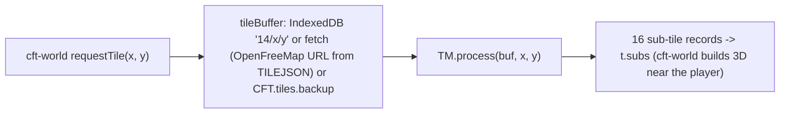

# cft-tiles.js — `TileMaker`: OpenMapTiles vector-tile (MVT/protobuf) decoder into compact map records

## At a glance

| | |
|---|---|
| File | `theme/assets/cft-tiles.js` (~385 lines, pure functions, no three.js, no DOM) |
| Global it exports | `window.TileMaker` in the browser (`globalThis.TileMaker` elsewhere), or `module.exports` in Node (~L382–384) |
| How it is created | A plain object built at load; nothing to instantiate |
| Who calls it | `theme/assets/cft-world.js` only (`const TM = window.TileMaker`): `TM.process` in `requestTile`, `TM.places` in the borough loader, `TM.key`, `TM.Z`, `TM.EXT`, `TM.SUB`, `TM.TILEJSON`, `TM.lonToX` / `latToY` / `xToLon` / `yToLat` in `W.setOrigin`, `W.toXZ`, `W.toLL` |
| Load order | After `cft-content.js`, before `cft-world.js` (cft-kit `ALL`) |
| Origin | Adapted from City Coin Run's tiles.js |
| Test flags | No dedicated test; every `python -I tools/live/game_test.py` run exercises it (the world is built from it). Visual: `--shots`, `--boroshots` (borough names come from `places`), `--ground` |

## Responsibilities

- Web-Mercator tile maths at zoom 14 (`lonToX`, `latToY`, `xToLon`, `yToLat`, `key`).
- A minimal protobuf reader (`Reader`, `readValue`) and MVT layer/feature decoder (`decode`).
- MVT geometry commands → flat coordinate arrays (`geometry`), polygon ring grouping (`polygons`), clipping (`clipRing`, `clipPoly`).
- Turning one tile into a **record** (`process`): buildings (with height guesses and colours), roads and paths, street names, landcover/parks/water areas, house numbers and named places (POIs mapped to game place kinds), split into 4 × 4 sub-tiles.
- Borough/district/town names from low-zoom tiles (`places`).

Not here: fetching tiles, the IndexedDB cache and the server backup (cft-world.js `tileUrl`, `fetchTile`, `tileBuffer`, `fromBackup`), building 3D meshes (cft-world.js), place names shown in the game (made-up shops: cft-game `W.makeShop`; Tim Hortons fix: cft-game `W.placeFix`), the meaning of place kinds (`D.KINDS` in cft-content.js).

## Public API (`TileMaker`)

| Name | Signature | What it does | Called by |
|---|---|---|---|
| `Z`, `EXT`, `SUB`, `VERSION` | 14, 4096, 4, 5 | Zoom, tile units across, sub-tiles per side, record format number | cft-world (`Z`, `EXT`, `SUB`); `VERSION` is only copied into records as `v` (no reader found in the code) |
| `TILEJSON` | `https://tiles.openfreemap.org/planet` | TileJSON URL; cft-world reads `tiles[0]` from it and caches it a day in `cityfuntime.tileurl` | cft-world `tileUrl` |
| `lonToX`, `latToY` | `(deg) -> tile coordinate (float)` | Web-Mercator at zoom 14 | cft-world `W.setOrigin`, `W.toXZ` |
| `xToLon`, `yToLat` | `(tile coordinate) -> deg` | Inverse | cft-world `W.toLL` |
| `key` | `(x, y) -> '14/x/y'` | Tile key | cft-world |
| `decode` | `(buf, wantedLayerNames:Set) -> {layer: {extent, features: [{type, props, geom}]}}` (~L56) | Protobuf → layers (only wanted ones are parsed) | `process`, `places` |
| `process` | `(buf, tx, ty) -> {k, v, x, y, subs}` (~L189) | One zoom-14 tile → record | cft-world `requestTile` |
| `poiKind` | `(class, subclass) -> kind\|null` (~L321) | OpenMapTiles POI → game place kind | `process` |
| `places` | `(buf, z, tx, ty) -> [{n, c, lat, lon}]` (~L366) | Borough / town / city points of a low-zoom tile (`c` = `'suburb'\|'town'\|'city'`) | cft-world borough loader (`addBoroughs(TM.places(...))`) |

## Internal structure

| Lines | Section | What |
|---|---|---|
| 1–9 | header + constants | `Z`, `EXT`, `SUB`, `VERSION`, `TILEJSON` |
| 11–17 | tile maths | `lonToX`, `latToY`, `xToLon`, `yToLat`, `key` |
| 18–166 | protobuf / MVT decoding | `Reader` (`varint`, `skip`, `string`, `packed`), `readValue`, `decode`, `geometry`, `ringArea`, `polygons`, `clipRing` (Sutherland–Hodgman), `clipPoly` |
| 167–187 | lookup tables | `ROAD` (class → [type, width m, coins allowed]), `PATH` (subclass → width), `PARK_KINDS`, `PAL` (building/roof palettes), `hash`, `pick`, `centroid` |
| 189–299 | `process` | Decodes layers `building`, `transportation`, `transportation_name`, `park`, `landcover`, `landuse`, `water`, `housenumber`, `poi`; fills sub-tiles |
| 301–333 | POI mapping | `POI_CLASS`, `SHOP_SUB`, `poiKind` |
| 335–360 | helpers | `addArea` (clips an area into every sub-tile it touches), `splitLine` (keeps segments whose midpoint is in the tile, grouped per sub-tile) |
| 362–380 | boroughs | `PLACE_CLASS`, `places` |
| 382–385 | export | `TileMaker` |

## Key data structures

Coordinates in records are **tile-local units 0..4096** (`EXT`), y down. cft-world converts them to metres with `M / EXT` (`M` = metres per tile at the origin's latitude). Flat arrays `[x0, y0, x1, y1, ...]`; rings are stored open.

**Record** returned by `process`: `{k: '14/x/y', v: 5, x, y, subs: [16 sub-tiles]}`; sub-tile index `j*SUB + i`. Each sub-tile:

| Key | Content |
|---|---|
| `b` | buildings `{h, m, p, hs?, c, g?, r?}`: height m, min height m, outer ring, holes, wall colour, gable height (simple 4-corner houses), roof colour |
| `r` | roads/paths `{t, w, p, k?, br?, be?}`: type (`motorway`...`residential`, `service`, `footway`, `pedestrian`, `steps`, `cycleway`...), width m, polyline, coins allowed, bridge, bridge end points |
| `a` | areas `{k, p, hs?}` with `k` in `grass`, `wood`, `park`, `cemetery`, `pitch`, `playground`, `sand`, `plaza` |
| `wa` | water areas `{k: 'water', p, hs?}` |
| `nm` | street names `{n, c, p}` (`c` = 1 for car roads, 0 for paths) |
| `hn` | house numbers, flat `[x, y, text, ...]` |
| `po` | places, flat `[x, y, kind, name, ...]` (name max 48 chars; unnamed only for `metro`) |

Building rules worth knowing: features with `hide_3d` are skipped; a building belongs to the sub-tile of its centroid and is clipped to the tile; a missing or 5 m `render_height` (OpenMapTiles' "unknown") is guessed from footprint area with a deterministic `hash(bid)` (sheds 3 m, houses 6.5–9.5 m, larger blocks by floors of 3.2 m); default light map colours are replaced from `PAL` (glass for > 45 m, house, brick or stone). Tunnels and indoor/negative-layer roads are dropped; `ramp` roads get width 8.

## Lifecycle



`process` runs synchronously on the main thread once per tile load (the raw buffer is what is cached, so it runs again on every page load). `places` runs on zoom-11 tiles for borough names.

## Tunables

None in `D.TUNE`. File constants: `ROAD` widths, `PATH` widths, `PARK_KINDS`, `PAL`, height-guess thresholds in `process`, `POI_CLASS` / `SHOP_SUB` / `PLACE_CLASS` mappings.

## How to test

```
python -I tools/live/game_test.py --shots OUTDIR      # look at the built city (roads, buildings, areas)
python -I tools/live/game_test.py --boroshots OUTDIR  # borough names from places()
python -I tools/live/game_test.py OUTDIR              # full run: places, deliveries to real house numbers, shops
```

It also loads in Node (`module.exports`), so a decoder change can be checked offline on a saved `.pbf` buffer, e.g. `node -e "const T=require('./theme/assets/cft-tiles.js'); const r=T.process(require('fs').readFileSync('tile.pbf'), x, y); console.log(r.subs.map(s=>s.b.length))"` (you supply the tile file and its x/y; this is not an existing tool).

## How to modify safely

- **New real place kind**: add the OpenMapTiles class/subclass to `POI_CLASS` or `SHOP_SUB` (or a rule in `poiKind`), and the kind to `D.KINDS` (+ `D.SIGN_COLS`) in cft-content.js; run `node tools/live/content_check.mjs` and the full game test.
- **New layer or record field**: add the layer name to the `decode` set in `process`, push into a sub-tile key, and teach cft-world's sub-tile builder to read it. Keep keys short (records for many tiles stay in memory).
- **Height/colour guesses**: keep them deterministic (`hash(bid)`), so a building looks the same on every visit and for every player.
- Pitfalls: `bid` is derived from the tile x/y and feature order, so changing iteration order changes every guessed height and colour. Records use tile units, not metres. The file must stay free of browser-only APIs except the guarded `TextDecoder` (it is meant to run in Node too). After editing: `python tools/assets.py`.

## Review checklist for AI-made diffs

- [ ] Still pure (no DOM, no three.js, no network); `module.exports` path intact.
- [ ] Deterministic output for the same buffer (no `Math.random`).
- [ ] New POI kinds exist in `D.KINDS`; no real business is renamed here (naming rules live in cft-game `W.placeFix`).
- [ ] Coordinates stay in tile units; clipping keeps features inside the tile (no duplicates across tiles).
- [ ] `python tools/assets.py` run; a full `game_test.py` run passes; screenshots look right.
