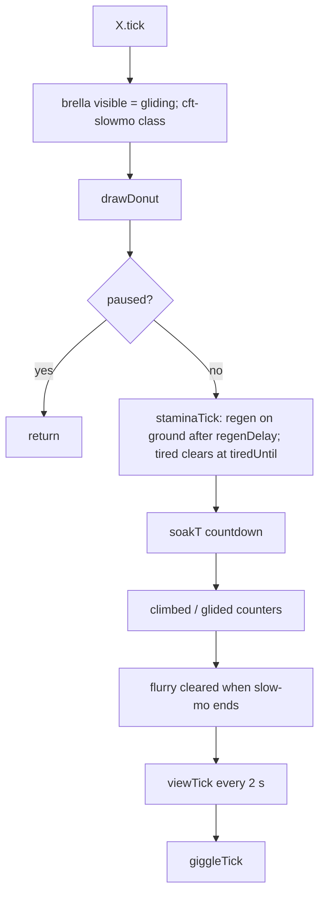

# cft-wild.js — open-air play: stamina, umbrella glide + updrafts, perfect dodge, air slow-mo, chemistry, antennas

## At a glance

| | |
|---|---|
| File | `theme/assets/cft-wild.js` (292 lines, ~18 KB) |
| Global exported | `window.CFTWild = { attach }` (~L291) |
| Attached as | `G.wild = window.CFTWild.attach(G, api)` in cft-game.js `startWorld` (~L2270), after `G.camp`, only when `G.fun` exists. Must come after `G.chaos` and `G.camp` because it wraps their functions at attach time |
| api passed in | `{ bump, bumpTo, spawnPickup, setBusy }` (only `bump` is used) |
| Ticked by | cft-game.js `tick` (~L2179): `G.wild.tick(dt, paused \|\| rt.busy)`, after camp, before aim |
| Main callers | cft-world.js `updatePlayer` (`W.stam`, `W.onClimb`, `W.onClimbJump`, `W.onTired`, `W.onDodge`, `W.flyHook`), cft-fun.js (`strike` → `perfectDodge` ~L519, `F.attack` → `flurryOn`/`flurryHit` ~L181), cft-camp.js (`conduct`, `steam`, `soak`, `soaked`), cft-game.js (speed → `speedMul` ~L227, `findInteraction` → `interaction` first), cft-ui.js (minimap → `markers`) |
| Data | `D.TUNE.wild` (cft-content.js ~L1860) |
| Save | `save.wild = { views: {cellKey: day}, tips: {tipKey: 1} }` |
| Tests | `python -I tools/live/game_test.py --wild` (tools/live/wildtest.js, ~25 checks; also measures the four-corner HUD) |
| Test flags read | none directly (the opening, via `G.camp.inIntro()`, makes stamina free) |

## Responsibilities

- **Stamina donut** used by climbing, hanging, climb-jumps, gliding and air slow-mo; running empty makes you "tired".
- **Default umbrella glide** for everyone (wraps `W.flyHook`; gear flight from cft-chaos.js wins) and **updrafts** over
  fires (cft-camp.js) and sewer manholes (cft-chaos.js).
- **Perfect dodge:** a dodge hop just before a figment strike → slow motion + a flurry of stronger hits.
- **Air slow-mo** when you shoot or use a power high in the air (wraps `G.chaos.fire` and `G.camp.power`).
- **Chemistry:** lightning arcs through nearby metal props, water on fire makes blinding steam, being soaked = fireproof but
  storm strikes hurt double.
- **Rooftop antennas:** the tallest building per `viewCell` square gets an antenna; tuning in reveals that square's secrets.
- **Giggles** near hidden stashes; one-time tips.

**It does NOT:** implement climbing physics, grabbing, wall normals or the dodge hop input (all in cft-world.js
`updatePlayer`, which only asks `W.stam` and fires the `W.on*` hooks); apply slow motion to time (cft-game.js `frame` reads
`G.rt.slowmo` / `G.rt.slowK`); deal lightning or water damage itself except the metal arcs (`X.conduct`).

## Public API

| Name | Signature | What it does | Called by | Line |
|---|---|---|---|---|
| `X.tick` | `(dt, paused)` | per-frame update | cft-game.js `tick` | L264 |
| `X.speedMul` | `() → number` | `tiredSpeed` while tired and on foot (no ride equipped) | cft-game.js speed | L68 |
| `X.perfectDodge` | `(m) → bool` | true if a dodge hop happened within `dodgeWindow`; stuns `m`, starts slow-mo + flurry | cft-fun.js `strike` | L127 |
| `X.flurryOn` | `() → bool` | flurry hits left and the dodge slow-mo (`slowK`) still running | cft-fun.js `F.attack` | L139 |
| `X.flurryHit` | `()` | spend one flurry hit (counter `flurryhits`) | cft-fun.js `F.attack` | L140 |
| `X.conduct` | `(x, z, dmg) → n` | arc from (x, z) to each metal kind within `arcRange`; figments within `arcHit` of it take `dmg × 0.6` volt | cft-camp.js `zap`, `strikeGround` | L158 |
| `X.steam` | `(x, z)` | stun figments within `steamR` for `steamBlind` s (throttled 0.25 s) | cft-camp.js `waterBlast` | L174 |
| `X.soak` | `(secs)` | soaked for at least `secs` | cft-camp.js hydrant (`K.interaction`) | L180 |
| `X.soaked` | `() → bool` | soak timer > 0 **or** a camp storm is on | cft-camp.js `fireTick`, `stormTick` | L181 |
| `X.interaction` | `(p)` | E on the roof next to an untuned antenna → `tuneIn` | cft-game.js `findInteraction` (first of the modules) | L236 |
| `X.markers` | `(list)` | 📡 untuned antennas within 600 m, ✨ unfound secrets in tuned squares | cft-ui.js minimap | L244 |
| `X.stam` / `X.tired` | number / bool | current stamina / exhausted | tests (aimtest.js writes `G.wild.stam`) | L33 |
| `X.views` | array | antennas currently placed | wildtest.js | L222 |
| `X.test` | `{st, views, cellOf, tuneIn, airAim, gliding}` | test handles | wildtest.js | L280 |
| `X.destroy` | `()` | removes meshes/DOM, nulls `W.stam` and hooks, restores `W.flyHook = prevFly` | cft-game.js `destroy` | L281 |

### Hooks it sets or wraps

| Hook | Kind | Effect | Line |
|---|---|---|---|
| `W.stam = {can(kind), use(kind, dt)}` | sets | the stamina gate cft-world.js asks before/while climbing (`'climb'`, `'hang'`, `'climbjump'`) and this module uses for `'glide'` | L52 |
| `W.flyHook` | **wraps** cft-chaos.js's hook (`prevFly`) | calls gear flight first; if not gear-flying, on foot, falling (`vy ≤ 0.5`), > 1.2 m up and Space held: glide (sink capped at `glideSink`, gravity × 0.15) or updraft (`draftUp`) | L108-L122 |
| `W.onDodge` | sets | records the dodge time, counter `dodgehops`, tip | L125 |
| `W.onClimb` / `W.onClimbJump` / `W.onTired` | sets | tip / puff / "NOODLE ARMS!" | L251-L253 |
| `G.chaos.fire` | wraps | on a successful shot → `airAim()` | L153 |
| `G.camp.power` | wraps | on a successful water/volt press (not foam) → `airAim()` | L154 |
| `G.rt.slowmo` / `G.rt.slowK` | writes via `slowmo(secs, k)` | cft-game.js `frame` multiplies dt by `slowK` while `slowmo > 0` (~L2203) | L126 |

## Internal structure

| Section | Lines | Key functions |
|---|---|---|
| setup, `st()`, `tip` | L26-L48 | `free`, `tip`, `st` |
| stamina | L50-L98 | `COST`, `W.stam`, `X.speedMul`, `staminaTick`, `drawDonut` |
| umbrella + updrafts | L99-L123 | `updraftAt`, `W.flyHook` wrapper |
| perfect dodge + flurry | L124-L141 | `W.onDodge`, `slowmo`, `X.perfectDodge`, `X.flurryOn`, `X.flurryHit` |
| air slow-mo | L142-L155 | `airAim`, the two wrappers |
| chemistry | L156-L182 | `METAL`, `X.conduct`, `X.steam`, `X.soak`, `X.soaked` |
| rooftop antennas | L183-L249 | `cellOf`, `antenna`, `viewTick`, `tuneIn`, `X.interaction`, `X.markers` |
| other hooks + tick | L250-L289 | `W.onClimb`, `giggleTick`, `X.tick`, `X.destroy` |

## Key state

- **Saved:** `save.wild.views` {`"cx:cz"` cell key: day tuned}, `save.wild.tips` {`tired`, `glide`, `dodge`, `arc`, `climb`: 1}.
- **Runtime:** `X.stam` (0..`stamMax`), `X.tired`, `regenWait`, `gliding`, `dodgeT` (time of the last dodge hop), `flurry`
  (hits left), `soakT`, `views` Map (cell → {c, b, x, z, y, obj}), `giggled` Set, accumulators `climbAcc`, `glideAcc`.
- **Counters bumped:** `dodgehops`, `perfectdodges`, `flurryhits`, `airshots`, `arcs`, `views`, `climbed` (metres up),
  `glided` (seconds).

## Per-frame flow

Stamina is consumed outside `X.tick`: by cft-world.js calling `W.stam.use('climb' | 'hang', dt)` / `use('climbjump')`, by
the `W.flyHook` wrapper (`use('glide', dt)`), and by `airAim` (subtracts `airAimCost` directly). `W.stam.can(kind)` with
≤ 0.5 left forces exhaustion (`use(kind, 1e3)`). In the opening (`free()`), `can`/`use` always succeed and the donut shows full.

### Perfect dodge sequence

cft-world.js: jump while blocking on the ground → dodge hop → `W.onDodge` (stores `dodgeT`). cft-fun.js `strike(m)`: if the
figment strike lands within `reach + 2.5` and `X.perfectDodge(m)` is true (`G.rt.t − dodgeT ≤ dodgeWindow`), the hit is
cancelled (`'dodge'`). `perfectDodge` stuns `m` for `flurrySecs × 1.4`, sets `flurry = flurryHits`, `slowmo(flurrySecs, slowK)`,
mayhem `parry`, swagger. `F.attack` then checks `X.flurryOn()` (×1.6 damage, +1.2 reach) and calls `X.flurryHit()`.

### Antennas

`viewTick` (every 2 s): for buildings within 560 m (`W.subsNear`) with `h ≥ viewMinH`, area ≥ 60, `m < 2.5`, keeps the tallest
per `cellOf(cx, cz)`; places `antenna()` on its roof (falls back to the bbox centre when `W.roofAt` is null at the centroid);
far antennas (> 650 m and not best any more) are removed. `X.interaction` needs you on that roof (`W.roofAt` within 0.6 m of
the antenna height, you within 1.2 m vertically, 14 m horizontally). `tuneIn` records the day, counter `views`, XP
`60 + 10L` (`'explore'`), banner with the number of unfound secrets (`G.camp.spots` in the same cell), mayhem `photo`.

## Tunables (`D.TUNE.wild`)

| Knob | Meaning |
|---|---|
| `stamMax`, `regen`, `regenDelay` | the donut |
| `climb`, `hang`, `glide` | stamina per second (via `COST`) |
| `climbJump` | stamina per climb-jump |
| `airAim` | in `COST.airaim` but not read by `airAim()` (which uses `airAimCost`) |
| `airAimCost`, `airAimHeight`, `airAimSecs`, `airK` | air slow-mo |
| `tiredSpeed`, `tiredUntil` | exhaustion |
| `glideSink`, `draftUp` | umbrella fall speed, updraft climb speed |
| `dodgeWindow`, `flurrySecs`, `flurryHits`, `slowK` | perfect dodge |
| `arcRange`, `arcHit`, `steamR`, `steamBlind` | chemistry |
| `viewCell`, `viewMinH`, `giggleR` | antennas, giggles |

Captured at attach time (a live Admin > Balance change needs a reload): `COST` (climb/hang/glide/airAim) and `CELL`
(`viewCell`). All other knobs are read through `T` each time. Hard-coded: updraft heights (fire `8 + 5 × size` m, manhole
15 m), `METAL` kinds, soak from a hydrant 10 s (in cft-camp.js).

## How to test

- `python -I tools/live/game_test.py --wild` — four-corner HUD layout, pavement footing, climbing + donut + tired, umbrella
  + updraft, perfect dodge + flurry, air slow-mo, chemistry, antennas.
- Slow-mo and hit-stop only act in the real `frame`; under `G.stepSim` check `G.rt.slowmo` / counters instead of timing.
- Browser: `?debug=1`. There is no dedicated "wild" row; use Campaign → Fire (updrafts, steam), Storm (soaked), Chaos →
  Shooters (perfect dodge practice). Climb any building by walking into it.

## How to modify safely

- **Stamina cost of a new action:** add a kind to `COST` and a knob in `D.TUNE.wild`, then call `W.stam.can(kind)` /
  `W.stam.use(kind, dt)` from the action (keep the `if (stam)` guard: `W.stam` is null before attach and after destroy).
- **New updraft source:** extend `updraftAt` (~L103); return a string used for the particle emoji.
- **New metal prop:** add its prop kind to `METAL` (~L157); it must be findable via `W.propNear(x, z, r, {kind})`.
- **Tune the dodge:** only `D.TUNE.wild.dodgeWindow` / `flurry*` / `slowK`. If you change `slowK`, `X.flurryOn` still works
  because it compares against the same knob, but air slow-mo must keep a different `airK` or air shots will enable flurries.
- **Antenna placement:** `viewTick` filters (`viewMinH`, area 60) and the roof fallback.

**Pitfalls**
- Attach order matters: it captures `W.flyHook`, `G.chaos.fire` and `G.camp.power` once. Re-attaching chaos/camp after wild
  (or replacing those functions later) silently drops the umbrella or air slow-mo.
- `X.destroy` restores `W.flyHook = prevFly` (the chaos hook) after cft-chaos.js already nulled it; harmless today because the
  whole world is destroyed right after (cft-game.js `destroy`), but don't rely on `W.flyHook` being null after destroy.
- `X.stam` is the number; `W.stam` is the gate object. Tests assign `G.wild.stam`.
- Tips are one-time per save (`save.wild.tips`); clear them to see a tip again.

## Review checklist for AI-made diffs

- [ ] Wrappers (`W.flyHook`, `G.chaos.fire`, `G.camp.power`) still call the previous function first and return its result.
- [ ] Stamina use respects `free()` (the opening) and `X.tired`.
- [ ] Slow-mo goes through `slowmo(secs, k)` (max with the current value), never resetting `G.rt.slowmo` downward.
- [ ] New meshes/DOM removed in `X.destroy`; `W.*` hooks nulled.
- [ ] Knobs in `D.TUNE.wild`; FIX_INDEX.md row updated.
- [ ] wildtest.js check added; `python -I tools/live/game_test.py --wild` passes (the HUD corner checks too if any DOM moved); `python tools/assets.py` + `python tools/check.py` pass.
