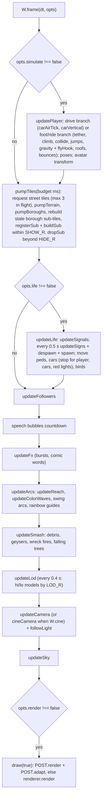

# cft-world.js — the 3D city: streamed real streets, hills, life, the player, camera and sky

`theme/assets/cft-world.js` is the engine room of City Fun Time. It turns OpenStreetMap vector tiles and Mapterhorn
elevation tiles into a three.js city around the player, fills it with people, traffic and pigeons, moves the player
(on foot, on a ride, in a car), points the camera, lights the scene by the hour and draws the minimap. It knows nothing
about missions, money or saves: `cft-game.js` and the attach modules drive it through the object it returns (`W`).

## At a glance

| | |
|---|---|
| Global it exports | `window.CFTWorld = { create }` (bottom of the file, ~L5270) |
| How it is created | `W = G.W = window.CFTWorld.create({ canvas: U.canvas, quality: q, tune: D.TUNE })` in `startWorld` (cft-game.js ~L2217). One world per game session; `W.destroy()` on unmount |
| `create(opts)` options | `canvas` (required), `quality` (`'low'` = phones / weak GPUs, anything else = high), `tune` (= `D.TUNE`, read once), `nopost`, `nomodels` |
| Who calls it | cft-game.js (lifecycle, frame loop, setClock, hooks), and every attach module through `G.W`: cft-fun, cft-rpg, cft-hero, cft-chaos, cft-camp, cft-wild, cft-aim, cft-color, cft-stunt, cft-cine, cft-ui, cft-debug |
| Needs before it (load order) | `three.min.js` (r149, `window.THREE`), `cft-tiles.js` (`window.TileMaker`), optional `cft-post.js` (`window.CFTPost`), `cft-gfx.js` (`window.CFTGfx`), `three-gltf.js` (`THREE.GLTFLoader`, `THREE.SkeletonUtils`), and at run time `window.CFT.tiles` from cft-kit.js (map backup). Order: cft-kit.js `ALL` = tools/live/harness.py `ENGINE` |
| Size | ~5,270 lines, one closure: `create` holds everything |
| Test flags (`tools/live/game_test.py`) | Pictures: `--shots` (day/dusk/night), `--ground`, `--gfx`, `--models`, `--people`, `--heroshots`, `--boroshots`, `--chaosshots`, `--stuntshots`, `--aimshots`. Tests that exercise world code: `--hero` (movement, smashing, borrowed cars), `--wild` (climbing, pavement footing), `--camp` (bouncy world, roofs), `--balance` (feet on roads, light through the day), `--color` (colour blocks, looking up), `--aim` (aim camera, web tether, arcs, gabled roofs), `--stunt` (car air), `--boro` (boroughs), `--fun` (signals, life, look), `--chaos` (decor) |
| Find code | `python -I tools/where.py --toc cft-world.js` (every section and definition with line ranges) |

## Responsibilities

- **Renderer and scene**: WebGLRenderer, fog, hemisphere + sun (shadow-casting) + fill light, the night point light, far
  fallback floor, `worldGroup` for sub-tiles; post-processing via cft-post.js and procedural materials via cft-gfx.js on high quality.
- **Tile streaming**: zoom-14 street tiles (OpenFreeMap through `TileMaker`), split into 4 x 4 sub-tiles; registration
  (physics + data) and 3D building per sub-tile by distance; IndexedDB cache; server backup and archive (`window.CFT.tiles`).
- **Terrain**: Mapterhorn Terrarium WebP tiles at zoom 15 (falling back to lower zooms), ground height grid, bridges.
- **Boroughs**: zoom-11 place points, one of 12 colour `LOOKS` per borough (walls, roofs, kerbs, centre lines, trees, banners).
- **City geometry**: terrain mesh, draped roads/pavements/areas/water with photo ground textures, walls (window/facade
  attributes), roofs (flat, gabled, cornices, roof clutter, balconies), street names painted on roads.
- **Street furniture and decor**: lamps, benches, hydrants, bins, mailboxes, parked cars, trees, bushes, decor junk; all
  instanced per sub-tile, smashable (session only), parked cars borrowable.
- **Traffic lights, shop signs, made-up shops, named places** (`W.places`).
- **Colour blocks** shader layer (grey until freed; levels decided by cft-color.js).
- **Queries**: ground/roof/building/road lookups, nearest street, random street spot, collision, ray cast.
- **Builders**: people, animals, monsters (built or glTF), vehicles, props, shields, labels, emoji sprites, name plates.
- **The player**: avatar, look, weapon in hand, rides, movement physics (walk, run, double jump, climb, wall jump, mantle,
  web tether, dodge, bounces, roofs), car driving and car stunts physics, followers.
- **Camera** (follow, wall avoidance, aim shoulder cam, look-up tilt, cut-scene override), **day and night**, **sky**.
- **Ambient life** (`W.life`): pedestrians, traffic, pigeon flocks.
- **Input**: keyboard, mouse look + pointer lock, wheel zoom, touch joystick/look.
- **Effects**: emoji bursts, comic words, speech bubbles, smash debris, hydrant geysers, wreck fires, swing arcs, reach
  marker, rainbow floor guides, camera shake. **Maps**: rotating minimap, big map, sub-tile map canvases, snapshot.

**What it does NOT do** (owner in brackets): missions, money, saves, the clock's value (cft-game.js; it calls
`W.setClock(save.clock)` every tick); combat, figment AI, deciding what a smash is worth (cft-fun.js, cft-hero.js via
`W.onDriveHit`); stamina (cft-wild.js `W.stam`); jetpack/glide physics (cft-chaos.js `W.flyHook`); ramp placement and
stunt scoring (cft-stunt.js, `W.ramps` + `W.onCar*`); colour-block levels (cft-color.js); cut-scene shots (cft-cine.js
`W.cine`); HUD, menus, marker lists for the maps (cft-ui.js); decoding vector tiles (cft-tiles.js `TileMaker.process`);
post-processing and facade/PBR shaders (cft-post.js, cft-gfx.js); all game data (cft-content.js; the world only sees
`D.TUNE` through `opts.tune`).

## Public API

Everything below is a property of the returned `W`. "Called by" lists modules (`cft-` dropped) found by grep; tests are
`tools/live/*test.js`. Line hints are approximate.

### Lifecycle, frame, rendering

| Name | Signature | What it does | Called by |
|---|---|---|---|
| `W.setOrigin` (~L5057) | `(lat, lon)` | Bumps `gen`, clears every tile, grid, bucket, place, signal, sign and life array, sets `W.origin` and requests the home terrain tile (its height becomes y = 0) | game |
| `W.frame` (~L5097) | `(dt, {simulate, life, budget, render})` | One frame (see Per-frame flow). `simulate:false` skips `updatePlayer`; `life:false` skips `updateLife`; `budget` = ms for building sub-tiles (default 6); `render:false` skips drawing | game (`frame`, `G.stepSim`) |
| `W.render` (~L5163) | `()` | Camera + sky + draw without simulating (loading screen) | game |
| `W.snapshot` (~L5087) | `(w, h) -> Promise<dataURL>` | Renders now, returns a JPEG of the view | game |
| `W.pump` / `W.pumpAt` (~L5082) | `(budget)` / `(x, z, budget)` | Runs `pumpTiles` around the player / any point (preloading a destination) | game |
| `W.registerAround` (~L1451) | `(x, z, r)` | Registers (data + physics, no 3D) every loaded sub-tile within r | game |
| `W.loadStatus` (~L1452) | `(x, z, r) -> {built, total, pending, errors, hills}` | Loading progress around a point | game |
| `W.isBusy` (~L1448) | `() -> bool` | Sub-tiles within `SHOW_R` still unbuilt or tiles still loading | (exposed) |
| `W.stats` (~L1449) | `{builds, buildMs, maxMs}` | Sub-tile build timings | tests, tuning |
| `W.destroy` (~L5256) | `()` | Removes listeners, unlocks the pointer, disposes post + renderer (forces context loss), bumps `gen`, flushes the archive queue | game |
| `W.resize` | `()` | Re-reads the canvas size | game |
| `W.renderInfo` | `() -> {triangles, calls}` | Last frame's stats (from `POST.info` when post is on) | (exposed: console, tuning) |
| `W.setClock` (~L4556) | `(hour)` | Sky colours, light rows (`LIGHT`), sun direction, fog, lamp glow, stars, moon, post grade, env map refresh; sets `W.night`, `W.glow`, `W.light` | game (every tick) |
| `W.lightAt`, `W.sunDir` | `(h) -> row`, `Vector3` | Interpolated `LIGHT` row; current light direction | `W.sunDir`: balancetest |
| `W.THREE`, `W.scene`, `W.camera`, `W.renderer`, `W.gfx`, `W.post`, `W.origin` | objects | Raw handles; `W.gfx` / `W.post` are null on low quality | most modules use `W.scene` / `W.THREE` |
| `W.TOUCH` | bool | `(pointer: coarse)` at create time | game |

### Terrain and map queries

| Name | Signature | What it does | Called by |
|---|---|---|---|
| `W.groundAt` (~L1292) | `(x, z) -> y` | Terrain height (0 until the home tile is known or when the world is flat). Same triangles as the ground mesh | aim, camp, chaos, cine, color, fun, game, hero, wild |
| `W.surfaceAt` (~L1346) | `(x, z, y?) -> y` | `standAt`, or a bridge deck (+ road lift) when you are on it (y above deck − 1.6) | cine, fun, game |
| `W.standAt` (~L1487) | `(x, z) -> y` | Ground + drawn road lift (`roadLift`) or + `KERB_Y` on a pavement: where feet go | aim, stunt, tests |
| `W.roadLift` / `W.paveAt` | `(x, z)` | Road surface lift in metres / 1 on a pavement band (high quality only) | tests |
| `W.elevAt` (~L1276) | `(x, z) -> metres` | Real elevation above sea level, NaN while unknown | game |
| `W.normalAt` | `(x, z) -> [nx, ny, nz]` | Terrain normal (shared array, copy it) | (exposed) |
| `W.terrain` | `() -> {on, off, h0, exag, grid, tiles, inflight}` | Terrain state | gametest |
| `W.terrainReady`, `W.to15`, `W.terrainTiles` | | Terrain internals | (exposed; no caller today) |
| `W.heightAt` (~L1473) | `(x, z) -> m` | **Building height** (top above its base) at a 1.5 m cell, 0 = open ground. Not the ground | camp, chaos, fun, game, hero |
| `W.roadAt` (~L1474) | `(x, z) -> 0/1` | Road mask (half width + 0.4 m) | chaos, fun |
| `W.inside` | `(x, z) -> bool` | Inside a solid building footprint | (exposed) |
| `W.roofAt` (~L2752) / `W.roofTop` (~L2750) | `(x, z) -> y \| null` / `(b, x, z)` | Walkable roof height (gabled roofs follow `gableRise`) | stunt, wild |
| `W.collide` (~L2706) | `(pos, R?, footY?) -> hit` | Pushes `pos` out of building walls (3 iterations); feet above a roof skip that building | chaos, fun, game |
| `W.rayCast` (~L4448) | `(ox, oy, oz, dx, dy, dz, maxD, from) -> {x, y, z, d, kind} \| null` | First wall or ground along a ray (0.5 m steps + bisection) | aim, cine |
| `W.streetAt` (~L2764) | `(x, z) -> name` | Street name within ~14 m | camp, debug, fun, game, rpg, ui |
| `W.nearestWalk` (~L2777) | `(x, z, maxD, carOnly) -> {x, z, yaw, car, w, dist}` | Nearest street point (footways cost +3 m) | camp, debug, fun, game |
| `W.randomWalkSpot` (~L2793) | `(cx, cz, minD, maxD, filter?, rnd?) -> {x, z, yaw, car}` | Random street spot weighted by street length, clear of buildings | most modules |
| `W.buildingsNear`, `W.wallSpot`, `W.housenumbersNear`, `W.waterNear`, `W.areaNear` | | Building lists, the street-facing wall point of a building, house numbers, a street spot by water / by a park-like area | game |
| `W.subs` / `W.subsNear` / `W.tiles` | | All sub-tiles / registered ones within r / the tile map | game, camp, wild |
| `W.findArea` (~L4423) | `(kinds, minA) -> {x, z, k}` | Centre of the nearest park/plaza/... (tests, screenshots) | chaos |
| `W.districtAt` (~L1098) / `W.districts` / `W.LOOKS` / `W.boroughsReady` | | Borough `{n, c, look}` at a point, all boroughs, the 12 looks, names loaded yet | rpg, ui, borotest |
| `W.places`, `W.placeIds` | array, Set | Named places `{id, x, z, kind, name, pin:{x,z,yaw}, made?, virtual?}`; made-up shops have id `m:<tile>:<sub>:<building>` | chaos, debug, fun, game, hero |
| `W.signals` / `W.signalState` (~L1679) | `()` / `(node, group) -> 0 red 1 yellow 2 green` | Traffic-light nodes and their state (18 s cycle) | funtest |
| `W.signs` / `W.refreshSign` (~L4894) | `()` / `(placeId)` | Built shop signs; drop one so it is rebuilt with new info | signs: funtest; refreshSign: hero |
| `W.toXZ` / `W.toLL` (~L5080) | `(lat, lon)` / `(x, z)` | Coordinate conversion | game |
| `W.nameSpots` | array | Where street-name labels lie (tests) | game_test.py `--ground` |

### Smashing, parked cars, decor

| Name | Signature | What it does | Called by |
|---|---|---|---|
| `W.propNear` (~L1848) | `(x, z, r, {cars, kind}) -> entry \| null` | Nearest smashable thing (street furniture, tree, decor; parked cars with `cars`) | camp, chaos, fun, wild |
| `W.hitProp` (~L1876) | `(entry, dmg, dir) -> 'hit' \| 'smashed' \| 'wreck' \| null` | Damages it; at 0 hp hides the instance (scale 0), or wrecks a car (dark, tilted, fire + `W.onWreckFire`), spawns debris, geysers, falling trees, bursts, then `W.onSmash(e)` | camp, fun |
| `W.isSmashed` / `W.smashCount` | `(key)` / `()` | Session smash state | debug, tests |
| `W.carAt` (~L1823) | `(x, z, R) -> parkedCar \| null` | A parked car's footprint at a point | fun |
| `W.borrowable` / `W.borrowCar` / `W.parkCar` (~L1965) | `(x, z, r)` / `(pc) -> tint` / `(x, z, yaw, tint) -> pc` | Find, take (hides the instance) and park (a loose `W.vehicle` mesh) a car | hero, game |
| `W.decorMesh`, `W.decorStats`, `W.decorCount`, `W.DECOR_KINDS` | | One decor piece as a mesh; decor counts | chaos |
| `W.treeMesh`, `W.bushMesh` | `(k, col)` / `(k)` | One tree / bush as a plain mesh | screenshots |
| `W.Merge`, `W.GEO` | class, `{CYL, CYL8, SPHERE, CONE, BOX, TORUS}` | The vertex-colour geometry merger and shared primitives | chaos, wild |

### Colour blocks (copied from `CGW`, ~L648-720)

| Name | Signature | What it does | Called by |
|---|---|---|---|
| `W.setBlockOrigin` | `(x, z)` | Centre of block 0,0 (cft-color keeps it in the save) | color |
| `W.setBlockColor` / `W.blockColor` | `(bx, bz, [buildings, streets, nature, sky])` / `(bx, bz)` | Writes / reads a texel of the 48 x 48 level texture | color |
| `W.blockOf` / `W.blockCentre` / `W.BLOCK` | | Block index of a point / centre of a block / 2000 m | color |
| `W.colorWave` | `(x, z, {life, max})` | A ring of full colour running outward | color |
| `W.colorOff` / `W.colorIsOff` | `(bool)` / `()` | Full colour everywhere (setting) | color |
| `W.greyify` | `(material, channel)` | Adds the grey layer to any material ('r', 'g', 'b' or 'ground') | colortest; use it for new world materials |
| `W.skySat` | number | Sky saturation, written by cft-color.js, read by `greyCol` in setClock | color |

### Builders

| Name | Signature | What it does | Called by |
|---|---|---|---|
| `W.person` (~L2985) | `(look?, npc?) -> Group` | A person; `userData` has `body, head, legL/R, kneeL/R, armL/R, elbowL/R, handL/R, kind:'person', kid, shield` | fun, game |
| `W.randomLook` (~L2891), `W.isKid`, `W.SILLY`, `W.HAIR_STYLES` | | Random look from a seed; child test (`h < KID_H`) | fun, game, chaos |
| `W.animate` (~L3169) | `(fig, speed, dt, pose?)` | Resets every joint, then walk/run/idle or a pose: sit, ground, ride, pedal, air, wave, dance (and others in the function) | chaos, cine, fun, game, hero |
| `W.mouth` (~L3265) | `(fig, 0..1)` | Talking mouth for cut-scenes | cine |
| `W.animal` (~L3281) | `(kind, color)` | dog, cat, pigeon, duck | chaos, fun, game |
| `W.monster` (~L3334) / `W.animateMonster` (~L3564) / `W.monModels` | `(kind)` / `(g, dt, speed)` | Built figment, swapped for a glTF model when `MON_MODELS` has one loaded | camp, fun |
| `W.vehicle` (~L3676) / `W.SILLY_CARS` | `(kind, color, {silly})` | skateboard, kickscooter, bike, moped, car, suv, sports, taxi, van, bus, truck, police | internal: `W.setRide`, `W.parkCar`, `spawnPed`, `spawnCar` |
| `W.propMesh` (~L3602) | `(kind) -> Mesh` | Held props and weapons (switch on kind) | aim, chaos, fun |
| `W.shieldMesh` (~L3658) | `(kind, col)` | Off-hand shields | internal: `buildPerson` when `look.shield` is set |
| `W.label` (~L3758) / `W.emojiTex` / `W.emojiSprite` | | Cached canvas text / emoji textures and sprites | most modules |
| `W.foePlate` (~L3790) | `({big, height}) -> Sprite` with `userData.plate.set(s, dt)` / `.dispose()` | Figment name + health plate | camp, fun |
| `W.say` (~L3839) | `(obj, text, secs)` | Speech bubble (one per object) | camp, chaos, fun, game, hero, rpg |
| `W.removeObj` (~L4738) | `(obj)` | Removes from the scene and disposes non-shared geometry | camp, chaos, fun |

### Player, rides, camera, input, effects

| Name | Signature | What it does | Called by |
|---|---|---|---|
| `W.player` | object | See Key data structures | nearly every module |
| `W.cam` | `{yaw, pitch, dist, cur, lookT, shake, aimK}` | Camera state | camp, chaos, ui, tests |
| `W.input` | `{f, b, l, r, sprint, jump, hold, jx, jy}` | Movement input (keys and touch fill it; tests set it) | ui, tests |
| `W.controls` | `{enabled, look}` | `enabled` false = no movement/look input (overlays) | game |
| `W.avatar` | Group | The player's root (body + ride mesh) | chaos, fun, hero, wild |
| `W.setLook` (~L3854) | `(look)` | Rebuilds the player's body, re-applies ride pose and weapon | camp, fun, game, rpg, ui |
| `W.setWeapon` / `W.swing` / `W.swinging` / `W.showReach` / `W.arcCount` | | Weapon in the right hand; overhead swing + reach crescent | fun, aim, camp, chaos |
| `W.reachMarker` (~L3911) / `W.reachShown` / `W.reachRadius` / `W.reachHeight` | `({r, arc, hot, ranged} \| null)` | Melee reach fan on the ground, fed every tick | fun, tests |
| `W.guide` (~L3935) / `W.guides` | `(x, z, {max, speed, waves, hue})` | Rainbow chevrons on the floor toward a point | aim, stunt |
| `W.setRide` (~L3980) / `W.ride` | `(spec)` / `()` | `{kind, mode:'foot'\|'ride'\|'drive', walk, run, jump, radius, turn, accel, color}` | game, hero |
| `W.setFollowers` (~L3994) / `W.followers` | `(list of Groups)` | Partner/kids/pets trailing a breadcrumb path | game |
| `W.headZ` | `(x, y, f) -> z` | The face's front surface in head-group metres (the face pass, 2026-11-24): place face parts on it | tests |
| `W.graffitiNear` / `W.graffitiStats` / `W.graffitiAtlas` | `(x, z, r)` / `()` / `()` | Graffiti spots near a point / {buildings, tagged} / the painted atlas canvas | tests |
| `W.teleport` (~L4436) | `(x, z, yaw?)` | Moves the player to the surface, clears velocity and car air | chaos, debug, game, hero, tests |
| `W.carAir` / `W.carLaunch` / `W.rampAt` / `W.ramps` / `W.STUNT` / `W.GRAV` | | Car air state, launch, ramp surface, the ramp list (written by cft-stunt), stunt tuning, gravity | stunt |
| `W.lock` / `W.unlock` / `W.isLocked` | | Pointer lock | ui, camp, chaos |
| `W.touchUI` | `{joy, knob}` | DOM elements for the touch joystick (set by the game) | game |
| `W.burst` (~L5125) / `W.pop` (~L5136) / `W.shake` | | Emoji burst, comic word, camera shake | many |
| `W.project` (~L5158) | `(x, y, z) -> {x, y, behind, w, h}` | World point to canvas pixels | hero, wild |
| `W.drawMinimap` (~L5170) / `W.drawMap` (~L5214) | `(canvas, {radius, markers, rects, ...})` / `(canvas, {cx, cz, scale, markers, rects, boroughs})` | Rotating minimap / north-up big map | ui |
| `W.life`, `W.nearestPed`, `W.holdPed`, `W.agentOn`, `W.agentAdvance`, `W.agentPoint` | | Life arrays and the street-graph agent helpers (see Ambient life) | camp, chaos, fun, game, hero, rpg |
| `W.lastHit`, `W.night`, `W.glow`, `W.light`, `W.aimRay`, `W.groundTextures` | values | Last wall hit time in a car; night 0..1; lamp glow; current light row; the camera ray (read by cft-aim); ground photos loaded | aim, tests |

### Hooks other modules set (the world reads them; all optional)

Pattern in the code: `if (W.onX) W.onX(...)` at the event site, or a plain flag read every frame.

| Hook / flag | Set by | Read in | Meaning |
|---|---|---|---|
| `W.makeShop(seed) -> {kind, name}` | game | `registerSub` | Name a made-up shop for ~24% of suitable buildings |
| `W.placeFix(pl)` | game | `registerSub` | Rename a real place (Tim Hortons -> Tom Hearton's) |
| `W.signList() -> places`, `W.signInfo(pl) -> {e, name, col, fg} \| null` | game | `updateSigns` | Which places get signs and what is on them |
| `W.onDriveHit(e, speed, dir)` | game | `updatePlayer` (drive) | Car hit street furniture / a parked car (the game calls `W.hitProp`) |
| `W.onSmash(e)` | chaos | `W.hitProp` | Something broke |
| `W.onWreckFire(x, z)` | camp | `W.hitProp` | A car became a wreck: start a real fire |
| `W.onBounce(pc)` | fun | `updatePlayer` | Landed on a parked car's roof |
| `W.stompHook(x, y, z) -> vy \| 0`, `W.onPropBounce(e, chain)`, `W.onWallJump()`, `W.onMantle()` | camp | `updatePlayer` | Bouncy world: stomp a figment, bounce off props/roofs, wall jump, mantle |
| `W.stam` `{can(kind), use(kind, dt)}`, `W.onClimb`, `W.onClimbJump`, `W.onTired`, `W.onDodge`, `W.flyHook` | wild | `updatePlayer` | Stamina gate for climbing; climbing events; perfect-dodge hop; umbrella glide |
| `W.flyHook(dt, player, input, grav, ctl) -> grav`, `W.gravMul` | chaos (also wild) | `updatePlayer`, `carVertical` | Jetpack / glide gravity; low-gravity event |
| `W.tether {x, y, z, v0, acc, max, life, t}`, `W.onTetherEnd(how)`, `W.aiming`, `W.onWheel(deltaY, e) -> handled` | aim | `updatePlayer`, `updateCamera`, `updateReach`, wheel handler | Web pull; aim camera; scroll wheel for shooters |
| `W.blocking` | fun | `updatePlayer` | Guard pose, slower walk, dodge hop |
| `W.speedMul`, `W.noRun`, `W.pose` | game (pose also chaos, ui) | `updatePlayer` | Speed multiplier, no sprint, idle pose for the player |
| `W.onCarAir(a)`, `W.onCarTrick(kind, n, a)`, `W.onCarLand(info)`, `W.onCarSettle(a)` | stunt | `carLaunch`, `carAirTick`, `carVertical` | Stunt scoring |
| `W.cine {pos, look, fov, face, pose}` | cine | `updateCamera` -> `cineCamera` | Cut-scene camera; null = normal camera |
| `W.showOff` | ui | `updateCamera`, `updateReach` | Wardrobe: avatar turns to a close camera |
| `W.skySat` | color | `greyCol` (setClock) | Sky saturation of the block you stand in |

Read by the world but **set by no module today** (dead hooks, safe to use for new features): `W.onPlace`, `W.onHonk`,
`W.onBirds`, `W.lifeMul`, `W.onJump2`, `W.wantLock`. Conversely cft-chaos.js reads `W.MAT_VC` and balancetest.js reads
`W.deckAt`; neither is exported (both have fallbacks).

## Internal structure (a guided tour)

All inside `create(opts)` unless noted. Ranges from `tools/where.py --toc`.

| Lines | Section | What it does |
|---|---|---|
| 19-34 | module top | Constants (`CELL`, `CH`, `BUCKET`, `SHOW_R`, `HIDE_R`, `LOAD_R`, `GRAV`, `EXAG`, terrain URL/zooms, emoji font); helpers `hash`, `signedArea`, `reversed`, `smooth`, `angDiff` |
| 35-84 | renderer + scene | Renderer (pixel ratio cap 1 low / 1.75 high, shadows high only), `POST` and `GFX` creation, fog, camera (fov 62), hemi, `sun` (shadow map `SHADOW` 4096 or 2048, ±120 m box), `fill`, `sunDir` vs `sunPos`, `nightLight`, far `ground` plane, `worldGroup` |
| 85-159 | sky | Gradient dome shader (`skyMat`), sun/moon sprites (`discTex`), stars, clouds; `updateSky` keeps them around the camera/player; `resize` |
| 160-228 | materials | `cssColor`, `windowTextures` (day + night emissive window atlas), `MAT` (walls, plain, terrain, drape, trunk, crown, vc, glow, bulb, pool, signal, prop, tint, wreck, halo; decor + dglow added at ~L636) |
| 229-415 | ground textures | `TEX` layers and `TL` names, `GU` uniforms, `groundify` shader patch (cache key `cft-ground`), `loadGround` (texture array from `ground-*.jpg`), `cartoonRoad` (asphalt drawn, not a photo), `ROAD_STYLE`, `roadStyle`, `AREA`, the `Merge` class, shared primitives |
| 416-638 | street furniture shapes | `leafShell`, `seg`, `TREE` (4 kinds), `TREE_LO` (LOD stand-ins), `treeKind`, `BUSH`, `FLOWERS`, `SHARED` set, `propGeo`, the decor layer `DECOR` + `DECOR_HP` / `DECOR_HI` / `DECOR_TINTS` |
| 639-881 | colour blocks + cars | `CGW` API, `cgPatch` / `greyify` (shader layer, every world material), `updateColorWaves`, `greyCol`; cars: `CAR_SPEC`, `extrudeSide`, `carShapeX`, `carShape`, `carLights`, `WHEEL`, `PROP` (lamp, bulb, pool, halo, bench, hydrant, bin, box, car, van, LOD cars, signal pole/lamp, banner), `carBody`, `carBox`, `cullGeo`, `CAR_TINT`, `BIG` |
| 882-963 | flat-shaded geometry | The `Geo` class: flat polygons, triangles, and draped (`dvert` / `dtri` / `dquad` / `dpolygon`) surfaces that follow `groundAt` with a lift, splitting long edges (`maxE`); ground layers (`glayer`, `guv`) and wall attributes (`uv`, `wa`) |
| 964-977 | state | `W` object, tile/sub-tile collections, grids and buckets, `player`, `cam`, `input`, `ride` |
| 978-1060 | tile sources | IndexedDB (`db`, `idb`, store `tiles` in database `cityfuntime`), `tileUrl` (TileJSON cached a day in localStorage), `fetchT` (10 s abort), `fetchTile` (upstream, else backup), `tileBuffer`, `fromBackup` |
| 1061-1190 | boroughs + archive | `LOOKS`, `districtAt`, `assignLooks`, `subLooks`, `addBoroughs` (marks built sub-tiles stale), `requestBoroTile`, `pumpBoroughs`; archive queue to the server (`queueArchive`, `flushArchive`, batches of 8); `loadGround()` call |
| 1191-1385 | terrain | `terr` state, `to15`, `terrainBuffer`, `decodeTerrain` (512 px -> 256 px averages), `terrainSource` (zoom fallback), `requestTerrain`, `onTerrain` (home tile sets `terr.h0` or turns the world flat), `elevAt`, `node`, `groundAt`, `groundFace`, `normalAt`, bridges (`deckFn`, `deckAt`), `surfaceAt`, `terrainReady`, `pumpTerrain` |
| 1386-1458 | tile streaming | `requestTile`, `rectDist`, `pumpTiles` (the streaming heart), `W.isBusy`, `W.stats`, `W.registerAround`, `W.loadStatus` |
| 1459-1529 | grids | `ckey`, `gridSet`, `gridGet`, `heightAt`, `roadAt`, `roadLift` (+ `lchunks`), `roadLiftCm`, `paveAt`, `standAt`, `rasterize` (scanline fill), `bkey`, `addToBuckets`, `inRings` |
| 1530-1834 | sub-tile data | `registerSub` (buildings, roads, walk graph, grids, names, areas, water, house numbers, trees, props, decor, places, made-up shops), `realNear`, traffic-light nodes (`nodeAt`, `trySignal`, `groupEnds`, `sigState`), `indexProp`, `layProps`, `PAVE_MIX`, `AREA_DECOR`, `layDecor`, `carAt` |
| 1835-2061 | smashing + borrowed cars | `PROP_HP`, `DEBRIS_COL`, `SMASH_FX`, `SMASH_Y`, `W.propNear`, `setInstance`, `W.hitProp`, `debris`, `fallTree`, `updateSmash`, `W.borrowCar`, `W.parkCar`, `W.borrowable`, `nearestWalkLocal`, `plantTrees` |
| 2062-2557 | sub-tile 3D | `groundMesh`, `buildingBase`, `buildSub` (all 3D for one sub-tile), `lodSub`, `updateLod`, `dropSub`, `addWalls`, `facadeStyle`, `cornice`, `obox`, `builtAt`, `facadeExtras`, `gbox`, `roofClutter`, `gable`; road paint colours `edgeCol`, `paveCol`, `kerbCol`, `KERB_Y`, `DASH` |
| 2558-2703 | street names + maps | `nameMat` (canvas texture, LRU of `NAME_MAX`), `streetNames`, `nearestRoad`, `dashes`, `disk`, `drawSubMap` |
| 2704-2881 | queries | `collide`, `gableRise`, `roofTop`, `roofAt`, `streetAt`, `nearestWalk`, `randomWalkSpot`, `buildingsNear`, `wallSpot`, `housenumbersNear`, `waterNear`, `areaNear`; the `Object.assign(W, {...})` export at ~L2875 |
| 2882-3847 | builders | Look palettes, `W.randomLook`, `prims` / `PRIM_HI` / `PRIM_MID` / `PRIM_LO`, `torsoGeo`, `personKOF`, `W.person` / `buildPerson`, `W.animate`, `W.mouth`, `W.animal`, `W.monster`, glTF figments (`MON_MODELS`, `MON_H`, `loadMonsters` 1.2 s after create, `monModel`, `playMon`, `W.animateMonster`), `W.treeMesh`, `W.bushMesh`, `W.propMesh`, `W.decorMesh`, `W.shieldMesh`, `W.vehicle`, `W.emojiTex`, `W.label`, `W.foePlate`, `W.emojiSprite`, `W.say` |
| 3848-4025 | player + ride | `avatar`, `W.setLook`, `holdWeapon`, `W.setWeapon`, swing arcs (`arcGeo`, `arcFx`), reach marker (`reachGeo`, `updateReach`), guides (`CHEV`, `W.guide`, `updateArcs`), `applyRidePose`, `W.setRide`, followers (`updateFollowers`) |
| 4026-4311 | movement | `slopeAlong`, `slopeMul`, `updatePlayer` (drive branch, foot/ride branch, poses, avatar transform) |
| 4312-4519 | car stunts + camera | `STUNT`, `rampAt`, `carLaunch`, `carAirTick`, `carVertical`, `W.carAir`, `W.findArea`, `W.teleport`, `W.rayCast`, `updateCamera`, `cineCamera`, `followLight` |
| 4520-4619 | day and night | `SKY`, `SKY_TOP`, `LIGHT`, `lightAt`, `W.setClock` |
| 4620-4985 | ambient life | `TW`, `life`, `laneOff`, `nextSegs`, `segPoint`, `advance`, `W.agentOn`, `spawnPed`, `TRAFFIC`, `spawnCar`, `spawnFlock`, `removeObj`, traffic lights 3D (`buildSignal`, `dropSignal`, `updateSignals`), shop signs (`wallFor`, `buildSign`, `awningTex`, `dropSign`, `updateSigns`), `updateLife`, `W.nearestPed`, `W.holdPed` |
| 4986-5055 | input | `KEYS`, keyboard, `look`, pointer lock, mouse drag, wheel zoom, touch joystick + look |
| 5056-5121 | origin, frame | `W.setOrigin`, `W.toXZ`, `W.toLL`, `W.pump`, `W.pumpAt`, `W.snapshot` / `takeSnap`, `W.frame`, `draw` |
| 5122-5271 | effects + maps | `W.burst`, `W.pop`, `updateFx`, `W.shake`, `W.project`, `W.render`, `W.renderInfo`, `W.drawMinimap`, `W.drawMap`, `W.destroy`; then `W.setClock(10)`, `resize()`, `return W` |

## Key data structures and state

**Coordinates.** World x = east, z = south, y = up, in metres from the home point given to `W.setOrigin` (the save's
home lat/lon). `origin = {lat, lon, gx0, gy0, M}`: `gx0`/`gy0` are fractional zoom-14 tile coordinates of home and
`M` = metres per zoom-14 tile at that latitude (40075016.686 x cos(lat) / 2^14; about 1.7 km in Montreal), so a
sub-tile (`TM.SUB` = 4 per side) is about 430 m. Ground y = (elevation − elevation at home) x `EXAG` (1.5), so home is y
= 0. **Yaw**: models face −z; the facing vector of a yaw is (−sin yaw, −cos yaw), and the yaw of a direction (dx, dz)
is `Math.atan2(-dx, -dz)`. Every save position is lat/lon; only the world uses x/z.

**Tiles** (`tiles`: Map key `TM.key(x, y)`): `{k, x, y, state: 'loading'|'ready'|'error', ox, oz (world origin of the
tile), s (metres per tile unit), subs, tries, retryAt}`. Never unloaded until the next `W.setOrigin`: their data stays
in memory, only the 3D is dropped.

**Sub-tiles** (`allSubs`): `{tile, idx, rec (TileMaker record), x0, z0, x1, z1, reg, group, ...}`. After `registerSub`:
`buildings` `[{id, p, hs, rings, h, m (min height), c, r (colours), g (gable rise), x0..z1, cx, cz, area, lo, base, shop}]`,
`roads` `[{t, w, k, br, p, be, deck}]`, `walk` (street-graph segments), `walkLen`, `names`, `areas`, `water`, `hn`,
`trees` (flat x,z list) + `treeK`, `bushes`, `props` (lists per kind, stride 3 `[x, z, yaw]` or 4 with tint for cars),
`decor` (stride 5 `[x, z, yaw, tint, scale]`), `looks`. After `buildSub`: `group` (a Group in `worldGroup`), `inst`
(kind -> InstancedMeshes, instance i = item i of that kind's list), `near` (LOD state), `canvas` (minimap image).
Buildings with `m >= 2.5` (raised parts) are drawn but not solid.

**Walk segments** (`s.walk`, also in `segBuckets` by both ends): `{x1, z1, x2, z2, L, w, t, car (driveable and >= 5 m
wide), acc (cumulative length, for weighted picks), br, n1, n2 (traffic nodes), g1, g2 (signal groups)}`. Traffic and
pedestrians move along these as **agents** `{sg, dir: ±1, t (metres along), off (sideways offset)}` via `advance` and
`segPoint`.

**Grids** (chunked typed arrays, `CH` = 32 cells per chunk side, key `ckey`): `hchunks` (Float32, building top height,
`CELL` 1.5 m), `rchunks` (road mask, `CELL`), `lchunks` (drawn road lift in cm, `LCELL` 0.5 m), `pchunks` (pavement
band mask, `LCELL`), `nodes` (terrain heights per `GS` grid node, 5 m high / 8 m low). **Buckets** (25 m cells, key
`bkey`): `buckets` (solid buildings), `nameBuckets`, `segBuckets`, `bridgeBuckets`, `propBuckets` (smashables),
`carBuckets` (parked and loose cars). `snodes` (4 m cells) holds street-corner nodes; `sigList` the nodes with lights.

**Smash state**: `smashed` Map `propKey(kind, x, z)` -> `true` (gone) / `'wreck'` / `'gone'` (borrowed); `propHp`
remembers dents. It lives as long as the world (the session); `buildSub` re-applies it when a sub-tile is rebuilt.

**Terrain** (`terr`): `{h0 (home elevation or null), off (no heights for home: flat world), tiles (zoom-15 squares with
state 'loading'|'ready'|'flat'|'error'), src (decode promises by z/x/y), inflight, minY, homeKey}`.

**Player** (`W.player`): `pos`, `vel`, `vy`, `grounded`, `face` (yaw the body faces), `heading` (car yaw), `speed`,
`slope`, `pitch`, `phase`, `moved`, `footMoved`, plus fields added while playing: `jumps`, `chain` (bounces in a row),
`fell`, `running`, `climb` `{nx, nz, t, lost}`, `climbPush`, `noGrab`, `carAir` (stunt state), `onRamp`, `boostT`.
**Ride** (`ride`, via `W.ride()`): defaults `{mode: 'foot', walk: 6.2, run: 12.5, jump: 8.5, radius: 0.4}` in the state
section, `turn: 1.9, accel: 9` added by `W.setRide`; the game passes its own numbers (`D.WALK`, `D.VEHICLES`).
**Camera** (`W.cam`): `yaw`, `pitch` (clamped −1.25..1.35 in `look`), `dist` (wanted, 7.5, wheel 2.5..30), `cur` (actual
after wall pull-in), `lookT` (last manual look; the car camera swings behind after 1.5 s), `shake`, `aimK`.

**Life** (`W.life`): `{peds, cars, birds, max, maxCars, flocks, t}`. Ped `{a, obj, fig, speed, pause, look, id, dog,
chatted, type}` (`type`: walk, jog, kid, elder, skate, bike; `obj` may be a holder with wheels, animate `fig`); flags
other modules set: `ctl` (the game moves it), `hold` + `holdPose`, `keep` (never despawned). Car `{a, obj, kind, len,
speed, max, honk, waiting}`. Flock `{x, z, birds, gone}`. `life.t` is the clock for traffic lights.

**Generation guard**: `gen` increments on `W.setOrigin` and `W.destroy`; every async tile/terrain/borough callback
captures it and returns if it changed. `destroyed` stops late texture/model loads.

## Per-frame flow and lifecycle

The game's `frame` (cft-game.js) runs `tick(dt)` (which calls `W.setClock(save.clock)`), then
`W.frame(dt, {simulate, render})`. Tests call `G.stepSim(n)`, which runs `W.frame(1/30, {budget: 1e9, render})`.



**Lifecycle.**

1. `create(opts)`: builds renderer, materials, shared geometries (trees, props, decor, cars), state, input listeners;
   starts `loadGround()` (ground photos) and schedules `loadMonsters` (1.2 s). Ends with `W.setClock(10)` and `resize()`.
   Nothing streams until `W.setOrigin`.
2. `W.setOrigin(lat, lon)`: resets everything, computes `origin`, requests the home terrain tile.
3. Streaming, each frame in `pumpTiles`: tiles within `LOAD_R` (850 m) of the player are requested nearest first. A
   loaded tile becomes 16 sub-tiles. A sub-tile whose nearest edge is within `SHOW_R` (600 m) is registered once
   (`registerSub`: data, physics grids, places, props) and, once every hills tile under it is ready (`terrainReady`), built
   (`buildSub`) within the frame's ms budget. Beyond `HIDE_R` (900 m) its 3D is dropped (`dropSub`); its data stays.
   `boro.stale` sub-tiles (borough names arrived or changed) are rebuilt in place. The game uses `W.pumpAt` +
   `W.loadStatus` to preload a destination and `W.registerAround` to query further than `SHOW_R`.
4. Traffic-light 3D is built within 280 m and dropped beyond 330 m (`updateSignals`, every 0.7 s); signs within 170 m,
   dropped beyond 230 m.
5. `W.destroy()`: removes listeners, disposes the renderer and post, bumps `gen`. Scene objects are not traversed; the
   context loss frees GPU memory.

## Tunables

**From `D.TUNE` (cft-content.js, passed as `opts.tune`; read once at create, so a new value needs a new world):**

| Key | Read at | Default in cft-world.js |
|---|---|---|
| `D.TUNE.world` `{peds, pedsLow, cars, carsLow}` | `TW` / `life` (~L4621) | 44 / 22 / 20 / 9 |
| `D.TUNE.smash.hp` `{bin, box, hydrant, bench, lamp, tree, car, van}` | `PROP_HP` (~L1836) | same values; note `DECOR_HP` is merged first, and a given `hp` object **replaces** the built-in defaults wholesale |
| `D.TUNE.stunt` (airG, hop, flipRate, spinRate, rollRate, landTol, spinTol, boostMul, pivot, assist) | `STUNT` (~L4316), exposed as `W.STUNT` | 0.6, 7.5, 8.4, 7.4, 10.5, 0.75, 0.8, 1.3, 0.75, 2.2 |

`D.TUNE.smash.weaponMul` and the other `D.TUNE.stunt` keys (count, minD, ...) are read by cft-fun.js / cft-stunt.js,
not here. cft-world.js never reads `window.CFT_DATA` directly.

**Runtime multipliers set by other modules**: `W.speedMul`, `W.gravMul`, `W.noRun`, `W.flyHook` (see Hooks).

**Constants in the file** (change with care; see recipes):

| Constant | Value | Where / meaning |
|---|---|---|
| `SHOW_R`, `HIDE_R`, `LOAD_R` | 600, 900, 850 m | build / drop / request distances (~L23) |
| `GRAV` | 26 m/s² | gravity (cars in the air: x `STUNT.airG`) |
| `EXAG` | 1.5 | hill exaggeration |
| `GS` | 5 m (low 8) | terrain grid; ground mesh and `groundAt` share it |
| `CELL`, `LCELL`, `BUCKET`, `CH` | 1.5 m, 0.5 m, 25 m, 32 | grid cells, fine road grid, bucket size, chunk size |
| `LOD_R` | 140 m (+20 m hysteresis) | full trees/cars/bushes/small decor only nearer than this |
| `FLOOR_H`, `WIN_W` | 3.3 m, 3.6 m | storey height and window bay (also assumed by cft-gfx's facade shader) |
| `KERB_Y` | 0.13 m | pavement height; `standAt` adds the same |
| `ROAD_STYLE[*].y` | 0.05-0.08 | road lift above the terrain (+0.03 in buildSub and `roadLiftCm`) |
| `BORO_R`, `CITY_R`, `BORO_MIX`, `LOOK_GAP` | 6000, 25000, 0.5, 9000 | borough reach, city fallback, how much of the borough colour walls take, minimum distance between equal looks |
| `NAME_GAP`, `NAME_MAX`, `NAME_CAP` | 160 m, 160, 0.56 | street-name spacing, texture cache, letter height vs street half width |
| `CG_N`, `CGW.BLOCK` | 48, 2000 m | colour-block texture size (96 km), block size |
| `KID_H` | 0.78 | look height under which a person is a child |
| `SHADOW` | 4096 / 2048 | shadow map size |
| `cam` defaults | pitch 0.32, dist 7.5 | state section (~L972); car x1.35, show-off 3.4, aim 3.6 in `updateCamera` |
| `SKY`, `SKY_TOP`, `LIGHT` | key-hour tables | `W.setClock` |
| `TRAFFIC`, `CAR_TINT`, `CAR_SPEC` | lists | traffic mix, paint colours, car profiles |
| Spawn radii | peds 125 m (despawn 165), cars 190 m (despawn 230), birds 110 m (170) | `spawnPed`, `spawnCar`, `spawnFlock`, `updateLife`; night reduces life by up to 45% |

## How to test it

All game tests run the real engine in headless Chrome with software WebGL from `tools/live/harness.py` (no Anvil),
start a fresh guest game in Montreal's Plateau and need internet (real map tiles). They take minutes. They are not part
of `tools/check.py`.

```
python -I tools/live/game_test.py --shots OUT        # city by day, dusk, night (world look)
python -I tools/live/game_test.py --ground OUT       # ground photo textures, street names (g8-street-name)
python -I tools/live/game_test.py --gfx OUT          # facades, roofs, cars, you, dusk, night (CFT_QS="&nopost=1" = no post)
python -I tools/live/game_test.py --models OUT       # people, vehicles, trees, bushes, animals up close
python -I tools/live/game_test.py --hero OUT         # tests: speed, smashing, borrowed cars...
python -I tools/live/game_test.py --wild OUT         # tests: climbing, pavement footing
python -I tools/live/game_test.py --balance OUT      # tests: feet on roads, light through the day
python -I tools/live/game_test.py --eval FILE.js OUT # start a game, run FILE.js in the page, print what it returns
python -I tools/live/harness.py                      # play it yourself at http://localhost:8772/
```

What to look at:

- **PASS/FAIL lines** printed by the test scripts (`tools/live/*test.js`); screenshots land in OUT (a temp folder when
  omitted). Picture modes print `[eval]` lines; look at every PNG.
- Which test covers what in this module: `herotest.js` (smashing via `W.propNear`/`W.isSmashed`, borrowing, minimap),
  `wildtest.js` (`W.standAt`, `W.paveAt`, `W.roofAt`, climbing), `camptest.js` (roofs, bounces, `W.subsNear`),
  `balancetest.js` (`W.standAt` vs `W.groundAt` on roads, `W.setClock` / `W.light` / `W.sunDir`), `colortest.js`
  (`W.greyify`, `W.setBlockColor`, `W.colorWave`, `W.aimRay`, `W.reachHeight`), `aimtest.js` (`W.tether`, `W.roofAt` on
  gabled roofs, arcs, guides), `stunttest.js` (`W.ramps`, `W.carAir`), `borotest.js` (`W.districtAt`, `W.LOOKS`),
  `funtest.js` (`W.signals`, `W.signalState`, `W.life`, `W.signs`, `W.carAt`), `gametest.js` (`W.terrain`, `W.surfaceAt`).
- Tests step with `G.stepSim(n)` and `window.CFT_TEST.norender = true` (software rendering is 0.5-1.5 s a frame). If you
  press keys in a test, set `W.controls.enabled = true` yourself (it can be stale).
- **In the browser console** (harness or the live app): `window.__cft` is `G`; `__cft.W` is the world. Useful:
  `__cft.W.loadStatus(__cft.W.player.pos.x, __cft.W.player.pos.z, 300)`, `__cft.W.stats`, `__cft.W.renderInfo()`,
  `__cft.W.terrain()`, `__cft.W.setClock(21)`.
- **URL switches read by the world**: `?nopost=1` (no post-processing), `?nomodels=1` (built figments only).
- **The play-test panel** (`?debug=1`, remembered in localStorage until `?debug=0`; cft-debug.js): a bug button with
  jumps to time of day, figments, cars, money; it teleports with `W.teleport` / `W.nearestWalk` and "Copy note info"
  includes the street (`W.streetAt`), the ride (`W.ride()`), smash count and the quality.
- After editing: `python -I tools/check.py` (runs `tools/doc_check.py`, which checks that this page's backticked names
  still exist), then the narrowest game test for what you touched (see FIX_INDEX.md's last column).

## How to modify safely (recipes)

1. **Add a smashable street-furniture kind** (e.g. a bike rack). Shape: a `propGeo(m => ...)` entry in `PROP` (faces −z,
   stands on y = 0). Placement: add a list to `P` in `layProps` and `put('rack', x, z, yaw)` where it belongs. Drawing: add
   the kind to the `['lamp', 'bench', 'hydrant', 'bin', 'box']` loop in `buildSub` (it uses `inst(kind, PROP[kind],
   MAT.prop, list, 3, true)`). Smashing: add hits to `D.TUNE.smash.hp` in cft-content.js (the in-file default object is
   ignored once `D.TUNE.smash.hp` exists), colours to `DEBRIS_COL`, emoji to `SMASH_FX`, optional burst height to
   `SMASH_Y`. Test: `--hero` and a `--models`/`--heroshots` picture.
2. **Add a decor kind.** `def('name', tinted, ownColours, glow)` inside `DECOR`; add it to `PAVE_MIX` or an
   `AREA_DECOR[area].mix`; hits in `DECOR_HP` (or leave it out: unsmashable); tints in `DECOR_TINTS`; add to `DECOR_HI` if
   small (near-only); debris/emoji in `DEBRIS_COL` / `SMASH_FX`. `layDecor` caps 900 items per sub-tile. Test: `--chaos`,
   `--chaosshots`.
3. **Change the camera distance / feel.** Default `cam.dist` and pitch in the state section (~L972); wheel limits in the
   canvas `wheel` handler (~L5017); car multiplier, aim distance, FOV widening and the wall pull-in loop in
   `updateCamera` (~L4460). Look-up behaviour: `look` (~L5000) clamps pitch, `updateCamera` tilts below −0.2. Test:
   `--heroshots`, `--color` (looking up).
4. **Add a new W hook.** At the event site write `if (W.onThing) W.onThing(args)`; never assume it is set. Set it in the
   owning module's `attach` (as cft-stunt sets `W.onCarAir`) and clear it in that module's destroy if it closes over
   module state (cft-aim sets `W.onTetherEnd = null`). Add a row to the Hooks table here and to the module's header
   comment. Prefer an existing dead hook name (`W.onHonk`, `W.onBirds`, `W.onJump2`) when it matches.
5. **Add a query.** Write a plain function in the queries section using the grids/buckets (never scan `allSubs` per
   frame without a `rectDist` filter), then add it to the `Object.assign(W, {...})` at ~L2875. Remember `heightAt` is
   building height; use `groundAt` / `standAt` / `surfaceAt` for y.
6. **Change people/traffic density.** `D.TUNE.world` (or the live Admin > Balance values, applied when the world is
   created). Radii and the night factor are in `spawnPed`, `spawnCar`, `updateLife`. New pedestrian type: a branch in
   the `q` thresholds of `spawnPed` and its pose in the ped loop of `updateLife`. Test: `--shots`, `--fun`.
7. **Add a vehicle kind.** A branch in `W.vehicle` (cars: a `CAR_SPEC` profile + `CAR_KIND` mapping, built by
   `carShape`); add to `TRAFFIC` for traffic; if the player can ride it, the game's `D.VEHICLES` entry and, if the body
   should hide or sit differently, `applyRidePose`. Test: `--models`.
8. **Tune the light through the day.** Edit `LIGHT` rows (hour, sun colour, sun strength, sky colour, ground colour, sky
   strength, exposure, warmth, saturation), `SKY` / `SKY_TOP` for sky colours; `W.setClock` applies them. Test:
   `--balance`, `--shots`.
9. **Add a ground texture layer.** Append to `TEX` (order = layer index) and `TL`, add the photo via
   `tools/ground_textures.py`; the shader arrays size themselves from `NT`. **Also update `cgPatch`'s `ground` pick**,
   which hard-codes which layer numbers count as nature (−1, 2, 3, 5) vs streets. Test: `--ground`, `--color`.
10. **Add a new world material.** Put it in `MAT`, call `greyify(mat, 'r'|'g'|'b')` (or it ignores colour blocks), and if
    it is used by InstancedMeshes with per-instance colour give it its own material (see pitfalls). Any custom
    `onBeforeCompile` needs a unique `customProgramCacheKey`.

### Pitfalls and gotchas

- **three.js r149 keeps one shader program per material**: a material shared by tinted and untinted InstancedMeshes draws
  all of them untinted (parked cars turned white). Tinted instances use `MAT.tint`, `MAT.signal`, `MAT.crown`.
- **r149 never frustum-culls an InstancedMesh by its instances.** Per-sub-tile instances are placed at the sub-tile centre
  (`culled` in `buildSub`) on a `cullGeo` wrapper whose bounding sphere is `CULL` (radius set in `W.setOrigin`).
  Instance matrices are relative to that centre.
- **Disposal**: geometries in `SHARED` (trees, props, decor, `cullGeo` wrappers, debris box) are never disposed;
  `dropSub` and `removeObj` dispose everything else they find. Anything you create per sub-tile must live in `s.group`
  so `dropSub` frees it; anything shared must be added with `shared(...)`. Materials are not disposed by `dropSub` (they
  are shared `MAT` entries); per-object materials you create need their own dispose (as `updateFx`, `updateArcs` and
  `dropSign` do). `fallTree` creates a crown material per fallen tree and does not dispose it.
- **Shader cache keys**: `groundify` uses `cft-ground`, `nameMat` `cft-street-name`, `greyify` appends
  `|cftgrey:<channel>`. Two materials with different patches and the same key share one program.
- **Duplicated geometry rules that must stay in sync**: the road lift drawn in `buildSub` (`st.y + 0.03 + bridge 0.006`)
  and `roadLiftCm`; pavement band widths (2.0 m residential / 2.6 m other) in `registerSub` (pchunks) and `buildSub`;
  the gable ridge choice in `gable` and `gableRise`; `FLOOR_H` / `WIN_W` and cft-gfx's facade grid. Breaking one gives
  "legs in the ground" or sinking into roofs (both were real bugs, see SKILL.md).
- **Determinism**: `layProps`, `layDecor`, `plantTrees` and made-up shop seeds are hashed from tile x/y and sub-tile index
  so a street always looks the same; adding or reordering `rnd()` calls reshuffles every street. Made-up shop ids
  (`m:<tile>:<sub>:<building>`) depend on TileMaker's building order.
- **TDZ**: some constants used by `buildSub` (`edgeCol`, `paveCol`, `kerbCol`, `KERB_Y`, `dashCol`, `DASH`) are declared
  after it; that is fine only because no sub-tile is built during `create`. Do not call `buildSub` or `pumpTiles` from
  create-time code.
- **Async results and `gen`**: any new async loader must capture `gen` and bail out if it changed, or a world moved by
  `W.setOrigin` gets tiles from the old origin.
- **`terr.h0 == null`** until the home terrain tile decodes: `groundAt` returns 0 and sub-tiles wait (`terrainReady`).
  If home has no heights the whole world is flat (`terr.off`).
- **Performance**: `pumpTiles` sorts all sub-tiles by distance every frame and `buildSub` is the main hitch (watch
  `W.stats.maxMs`); keep per-frame work bucket-based. Low quality skips shadows, post, gfx, bushes, LOD models, pavements,
  facade extras and most detail; test both qualities when you add `!LOW` branches.
- **Input listeners** must be added with `on(...)` so `W.destroy` removes them. Keys are ignored while focus is in an
  input; movement keys only `preventDefault` when `W.controls.enabled`.
- **Real places are real businesses**; Tim Hortons is always shown as Tom Hearton's (`W.placeFix` in cft-game.js).
- **Line endings are LF**; keep them.

## Review checklist (for a diff that touches cft-world.js)

- [ ] Every new or renamed `W.*` member is exported in one place and documented here; callers in other modules updated
      (grep `W.<name>` across `theme/assets/cft-*.js` and `tools/live/*test.js`).
- [ ] New hooks are called as `if (W.onX) W.onX(...)`; no module assumes another module's hook exists.
- [ ] Heights use `groundAt` / `standAt` / `surfaceAt` (never `heightAt` for the ground); yaw follows (−sin, −cos).
- [ ] New meshes per sub-tile go into `s.group`; shared geometries are registered in `SHARED`; new per-object
      materials/textures are disposed when the object goes.
- [ ] New InstancedMeshes use `cullGeo` + `culled`, and tinted ones a material not shared with untinted ones.
- [ ] New or patched materials call `greyify` and keep a unique `customProgramCacheKey`.
- [ ] Async code captures `gen`; nothing builds 3D during `create`.
- [ ] Duplicated rules stay in sync (road lift / `roadLiftCm`, pavement widths, gable ridge, `FLOOR_H` / `WIN_W`).
- [ ] Per-frame code is O(nearby): buckets or grids, not full scans of `allSubs` / `W.places` without a distance filter.
- [ ] `LOW` branches considered (phones); new `D.TUNE` keys added to cft-content.js with the same defaults as the file.
- [ ] Event listeners added via `on(...)`.
- [ ] The narrowest game test for the change was run and its screenshots looked at; `python -I tools/check.py` passes
      (this page's names still exist).
