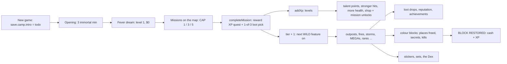

# How a player progresses (cross-module walkthrough)

This page follows one player from a brand-new game to the long game and names, at each step, the exact function, data table
and save field involved. Module details: docs/dev/modules/cft-camp.md, cft-rpg.md, cft-chaos.md, cft-wild.md. Line numbers
are approximate (`~L`) and checked by `python -I tools/doc_check.py --lines`.

## 1. A new game and the opening

| Step | File | Function / data | What happens |
|---|---|---|---|
| New save gets the campaign | cft-game.js | `U.onReady` (~L2301) | `save.camp = { intro: 'todo' }` only for new games (old saves become veterans in cft-camp.js `st`) |
| World loads, modules attach | cft-game.js | `startWorld` (~L2215) | fun → rpg → hero → chaos → camp → wild → aim → color → stunt |
| Opening starts | cft-camp.js | `K.startIntro` (~L150) | dream snapshot `save.camp.snap` (`DREAM_KEYS`), travel 220-360 m from home, night, storm, countdown `D.CAMPAIGN.INTRO_SECS` |
| Chaos runs | cft-camp.js | `introTick` (~L175) | every gate open (`K.allow` true in the opening), you can't be hurt (`K.immortal`, read by cft-fun.js `F.hurt`), ammo/powers free |
| You wake up | cft-camp.js | `endIntro` (~L233) → `wakeUp` (~L218) | everything earned in the dream is put back; `save.xp = 0` (level 1), money and savings 0, `save.camp.seen = storyDone()`; Max's first mission (`c1-couch`) |

`G.storyOn()` (cft-game.js ~L524) is true during the opening and after `c1-couch` is done; many systems (chaos spawners,
fires, MEGAs, rares) wait for it.

## 2. Missions: availability, the cap, completion

| Step | File | Function / data | What happens |
|---|---|---|---|
| Missions become open | cft-game.js | `refreshAvailability` (~L527), `reqMet` (~L85) | a `D.MISSIONS` entry whose `req` is met (`m` = missions done, `lvl` = level, partner, married, kids) gets `save.m[id] = {s: 'open'}` |
| Only some are shown | cft-game.js | `G.openMissions` (~L522) → cft-camp.js `K.capOpen` | story/side missions limited to `D.CAMPAIGN.CAP[min(tier, 2)]` minus active ones (1, then 3, then 5); `save.camp.shown` keeps the chosen ones sticky; odd jobs pass through |
| Accept, steps | cft-game.js | `accept` (~L533), `beginStep`, `updateMissions` (~L712) | `count` steps compare `save.counters[key]` against a baseline `ms.b` set in `beginStep` (`abs: true` = absolute) |
| Complete | cft-game.js | `completeMission` (~L633) | `applyReward` (~L311): money, XP with source `'quest'`, stats, items, sticker (`giveSticker`), relations; `G.rpg.questDone(m)`; counter `missions` (D.MISSIONS) or `jobs`; `G.hero.event('mission')` → cft-chaos.js +`AURA.mission`; `refreshAvailability` |

Side missions are defined with `S(...)` in cft-content.js (~L755, chapter 10) and live in `D.MISSIONS` too, so they count for
the tier. Several are written to teach the newer systems: `s-signal` (count `views`), `s-nosy` (`secrets`),
`s-firefighter` (`fires_out`, level 3), `s-kaiju` (`megas`, level 5), plus Dex missions counting `dex`.

## 3. XP and levels

| Step | File | Function / data | What happens |
|---|---|---|---|
| XP gained | cft-game.js | `addXp(n, src)` (~L250) | `gain = n × G.xpMul() × G.rpg.xpMul(src)`; if `src !== 'quest'`, `+ G.rpg.rested(gain)` |
| Level formula | cft-content.js | `D.calc.xpAt` / `levelOf` (~L1959), `D.TUNE.player` (~L1819) | XP for level L = `xpBase × (L − 1) ^ xpExp` (60, 1.8); cft-game.js wraps them as `xpAt` / `levelOf` (~L17) and `G.level` (cft-game.js line ~203) |
| Level up | cft-game.js | `addXp` | banner text from cft-rpg.js `levelText`, beam from `onLevel`, `G.hero.event('level')` → cft-chaos.js +`AURA.level`, energy refilled |

XP sources by module (source tag in brackets): missions (`'quest'`), figment kills in cft-fun.js (`'monster'`), MEGA kills
in cft-camp.js `killMega` (`'monster'`), mayhem bank in cft-chaos.js `bank` (`'explore'`), Dex first photos in cft-chaos.js
`snap` (`'explore'`), fires out in cft-camp.js `douse` (`'explore'`), secrets in cft-camp.js `openSecret` (`'explore'`),
antennas in cft-wild.js `tuneIn` (`'explore'`), discovery in cft-rpg.js `explore` / `boroughTick` (`'explore'`), outposts in
cft-hero.js `liberate` (`'quest'`), block restored in cft-color.js `checkDone` (`'explore'`), pickups (no source).

What a level gives you:
- **Damage:** `D.calc.dmgMul(L)` = `1 + dmgPerLevel × (L − 1)` (cft-content.js), used by cft-fun.js attacks and every
  cft-camp.js power, fire and MEGA health reference.
- **Health:** `D.calc.maxHp` via cft-fun.js `F.maxHp` (plus `G.rpg.bonus('life')` and outpost `H.hpBonus`).
- **Talent points:** cft-rpg.js `points` = `level − 1 − spent`.
- **Unlocks:** shop items with `req.lvl` (listed by cft-rpg.js `levelText`), missions with `req.lvl` (`reqMet`).
- **Scaled payouts:** most money/XP formulas multiply by `(1 + k × level)` (mayhem bank, Dex photos, secrets, MEGAs,
  block restored, crates). Figment toughness follows you via `D.calc.scale`.

## 4. Campaign tiers: one more crazy thing per mission

| Step | File | Function / data | What happens |
|---|---|---|---|
| Tier = missions done | cft-camp.js | `storyDone` (~L66), `tierTick` (~L97) | count of `D.MISSIONS` with `s === 'done'`, checked every 0.5 s; a banner per newly enabled item |
| Gate | cft-camp.js | `K.allow` (~L75) via `G.allow` (cft-game.js line ~526) | `D.CAMPAIGN.WILD[i]` is on when `i < tier` (or in the opening, veteran save, test bypass, or a mission needs `fires_out` / `megas`) |
| Cap | cft-camp.js | `K.capOpen` (~L84) | `D.CAMPAIGN.CAP = [1, 3, 5]` |

`D.CAMPAIGN.WILD` order (cft-content.js ~L1711) and where each gate is read:

| Missions done | WILD id | Gate read in |
|---|---|---|
| 1 | `critters` | cft-chaos.js `critterTick` |
| 2 | `toys` | cft-chaos.js `toyTick` |
| 3 | `chatter` | cft-chaos.js `chatterTick` |
| 4 | `sky` | cft-chaos.js `skyTick` |
| 5 | `night` | cft-fun.js monster spawning (night count) |
| 6 | `events` | cft-fun.js `updateEvent` (street event timer) |
| 7 | `fire` | cft-camp.js `fireTick`, `W.onWreckFire`, `manageCrates` |
| 8 | `outposts` | cft-hero.js `outpostTick` (~L265) |
| 9 | `day` | cft-fun.js daytime spawns + champion packs |
| 10 | `shooters` | cft-fun.js spawn pool (ranged / flying figments) |
| 11 | `brainrot` | cft-chaos.js `critterTick` |
| 12 | `rares` | cft-rpg.js `rareTick` |
| 13 | `storms` | cft-camp.js `stormTick` |
| 14 | `chaosEvents` | cft-fun.js event pool (`chaos: true` events) |
| 15 | `mega` | cft-camp.js `megaSpawner` |

Not gated: guardians (metro), King Blob, street folk, rivals, secrets, antennas, climbing/gliding.

## 5. Loot, talents, reputation, achievements (cft-rpg.js)

| Source of loot | File | Call |
|---|---|---|
| Any figment kill | cft-fun.js | `hitMonster` (~L394) → `G.rpg.onKill(m)` → `drop('monster' \| 'pigeon' \| 'boss' \| 'rare')` |
| Freed metro station | cft-fun.js | `freeStation` (~L679) → `drop('boss')` |
| Mystery crate event | cft-fun.js | `updateEvent` (~L1318) → `drop('crate')` |
| Treasure chest pickup (new block) | cft-game.js | `collect` (~L1083) → `drop('chest')` |
| Outpost liberated | cft-hero.js | `liberate` (~L311) → `drop('chest', {minQ: 2})` |
| Piñata (15%) | cft-chaos.js | `pinataHit` (~L817) → `drop('crate')` |
| MEGA kill (×2) | cft-camp.js | `killMega` (~L681) → `drop('boss')` |
| Secret stash (chest roll) | cft-camp.js | `openSecret` (~L1000) → `drop('chest')` |
| Mission reward pick | cft-rpg.js | `questDone` (~L461) → `claim` (~L471) → `add(item, 'quest')` |

Quality comes from `D.RPG.SOURCES` + `QUALITY` weights + the pity timer (`D.RPG.PITY`) in cft-rpg.js `rollQ` (~L81).
Equipped items feed `bonus` (~L58), read across the game (stats, damage, armour, speed, prices, income, loot luck, XP).

- **Talents:** cft-rpg.js `learn` (~L227) spends level points in `D.RPG.TALENTS` (tiers open every `TIER_COST` points).
- **Reputation:** cft-rpg.js `repTick` (~L252) turns counter increases into faction points (`D.RPG.FACTIONS[].gain`); tiers
  (`D.RPG.TIERS`) grant bonuses, Epic/Legendary charms and titles via `tierUp` (~L272).
- **Achievements:** cft-rpg.js `achTick` (~L307) checks `D.RPG.ACH` against counters or the specials in `val` (~L286)
  (level, streets, blocks, boroughs, missions, worth, sticker sets, factions, rares...).
- **Rested XP:** cft-rpg.js `offline` (~L327) and `onSleep` (~L334) fill `save.rpg.rested`; `rested` (~L336) doubles
  non-quest XP until it is used up.
- **Discovery:** cft-rpg.js `explore` (~L396) pays XP for new streets/blocks and spawns a chest pickup on each new block;
  `boroughTick` (~L377) pays for new boroughs.

## 6. Outposts, metro stations and colour blocks

| Step | File | Function / data | What happens |
|---|---|---|---|
| Outposts appear (tier 8) | cft-hero.js | `outpostTick` (~L265), `D.OUTPOSTS` | Tom Hearton's and groceries occupied by a figment pack |
| Liberate | cft-hero.js | `liberate` (~L311) | `save.hero.out[placeId] = day`, counters `liberated`, `lib_<kind>`; +5 max energy (`H.energyBonus` ~L263, read by cft-game.js `G.maxEnergy` ~L204) or +5 max health (`H.hpBonus` ~L264), capped by `D.OUTPOSTS[kind].cap`; XP `60 + 10L`; chest loot; `G.color.freed(pl, 'outpost')` |
| Metro station freed | cft-fun.js | `freeStation` (~L679) | metro travel; `G.color.freed(pl, 'metro')`; boss loot |
| Shop visited | cft-game.js | `findInteraction` → cft-color.js `C.visit` (~L139) | a small building-layer point |
| Secret found | cft-camp.js | `openSecret` (~L1000) → cft-color.js `C.secret` (~L155) | street-layer progress |
| Figment bonked | cft-fun.js | `hitMonster` (~L395) → cft-color.js `C.onKill` (~L161) | nature-layer progress (champion 2, rare/boss 3, guardian 5) |
| Block restored | cft-color.js | `checkDone` (~L107) | all three layers full (`D.TUNE.color.libTarget`, `secretTarget`, `killTarget`): money `rewardCash × (1 + 0.15(L − 1))`, XP `rewardXp × (1 + 0.1(L − 1))`, counter `blocks` |

Antennas help here: cft-wild.js `tuneIn` (~L224) reveals the secrets of its 400 m square on the minimap (`X.markers`), which
feeds the street layer. Full design: docs/colour-blocks.md.

## 7. Stickers and the Dex

- **Stickers** (`save.stickers`): cft-game.js `addSticker` (~L290, random, rare ones less likely) and `giveSticker`
  (~L300, mission rewards). Random sources: figment kills (6%, cft-fun.js `hitMonster`), mystery crates (cft-fun.js),
  pickups with `sticker` (cft-game.js `collect`), secrets (cft-camp.js `openSecret`), feats (cft-fun.js `feat`). A finished
  set (`D.STICKER_SETS`, `setDone` ~L191) gives permanent bonuses read through `setBonus` (~L192) and `stat`.
- **The Dex** (`save.chaos.dex`): cft-chaos.js `snap` (~L770) on critters (on from tier 1) and brainrot (tier 11); first photo
  pays money + XP + aura and stores a photo in localStorage; counter `dex` (absolute) feeds Dex missions and achievements.
  Phone app 📸 Dex: cft-ui.js `VIEWS.dex` → `C.summary`, `C.dexPics`.

## 8. Where to look when progression feels wrong

| Symptom | First place to look |
|---|---|
| "Nothing happens in the city" early on | `D.CAMPAIGN.WILD` order, cft-camp.js `K.allow`, `storyDone` (is the mission in `D.MISSIONS`?) |
| "Too many / too few missions on the map" | `D.CAMPAIGN.CAP`, cft-camp.js `K.capOpen`, `save.camp.shown` |
| "Levels too slow / fast" | `D.TUNE.player.xpBase` / `xpExp`, mission `reward.xp`, rested XP (cft-rpg.js `rested`) |
| "Loot too rare" | `D.RPG.SOURCES`, `QUALITY[].w`, `PITY`, `bonus('loot')` |
| "Talent did nothing" | the talent `fx` key and the reader of that `bonus` key; cache (`mark`) |
| "Block won't restore" | `D.TUNE.color` targets, cft-color.js `progress` |
| "Kept items after the opening" | cft-camp.js `DREAM_KEYS`, `wakeUp` |

## Caveats found while writing this page

- `save.counters.blocks` is bumped by **two** unrelated things: cft-fun.js `strike` (~L526, a blocked attack) and cft-color.js
  `checkDone` (~L111, a restored colour block). A mission step counting `blocks` (blocking attacks, cft-content.js ~L1491)
  would also advance on a restored block. cft-rpg.js `val('blocks')` is unaffected (it uses `save.rpg.blocks`).
- Rested XP doubles every non-`'quest'` source, including `'explore'` (discovery, mayhem bank, antennas, block restored).
- The crazy list counts every finished `D.MISSIONS` entry, story or side, but not odd jobs.
